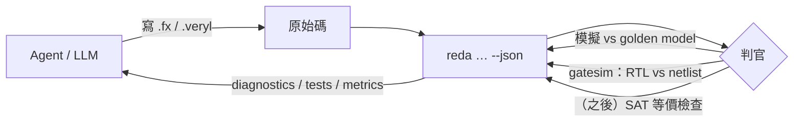

# AI 回饋介面：`reda --json` 設計筆記

> 分支：`aitest`。狀態：設計草案，尚未實作。

## 1. 為什麼要做

AI 時代程式碼的產生變便宜，**確認它是對的**仍然昂貴。對寫硬體的 agent 來說，最有價值的不是另一個生成器，而是一個「判官」：

- **快**：毫秒到秒級回饋，agent 一小時能迭代上千次；
- **可信**：判斷來自模擬器、合成器、等價檢查這些確定性的工具，不是另一個 LLM；
- **結構化**：錯誤是機器能讀的資料，附位置、錯誤碼與反例，不是給人看的 log。

rueda 已經有完整的流程（Fluxa / Veryl → 模擬 → 合成 → FPGA / ASIC → 虛擬板 → RV64），而且全部是自己的程式、沒有 license、可重現。缺的只是**給 agent 的介面**。



## 2. 現況（`51beac0`）

`reda` 已是統一的 CLI（`sim`、`test`、`synth`、`fpga`、`asic`、`gatesim`、`emu`、`cc`、`rvemu`、`board`），輸出是給人讀的文字。實際跑出來的樣子：

```text
$ reda sim fluxa/examples/err_overflow.fx
[FAIL] overflow_is_caught (0.000s)
       fluxa/examples/err_overflow.fx:4: runtime error in task `Mac`: assignment to `acc`:
       value 1073676289 does not fit i24 (range -8388608..=8388607)

$ reda sim fluxa/examples/err_deadlock.fx
[FAIL] circular_wait (0.000s)
       deadlock: all 3 live task(s) are blocked
         task `A` (#1) is blocked: recv on `test:circular_wait:t1->r1` (FIFO empty)
         ...

$ reda fpga --pnr veryl --bin fir4.bin fluxa/examples/fir4.fx
  cells: 191
    SB_CARRY 37 / SB_DFF 24 / SB_DFFSR 5 / SB_LUT4 125
```

觀察到的缺口：

| 缺口 | 例子 | 對 agent 的影響 |
|---|---|---|
| 規格有錯誤碼，訊息常常沒帶 | 溢位是規格的 E0301，訊息裡沒有；E0412 有 | agent 無法依錯誤種類決定修法 |
| 執行期錯誤只有行號，沒有欄位 | `err_overflow.fx:4:` | 一行有多個運算時定位不準 |
| 反例是自由文字 | deadlock 的等待環 | 要靠 regex 解析，脆弱 |
| 指標混在文字裡 | cells、LUT 數、時序 | 無法直接比較兩次嘗試的 PPA |
| 錯誤型別只有 `{line, col, msg}` | `fluxa/sim/src/lexer.rs` 的 `FxError` | 沒有錯誤碼、檔名、範圍、附註 |

## 3. 設計原則

1. **加旗標，不改預設**：沒有 `--json` 時輸出完全不變；`--json` 時 stdout **只有一份 JSON 文件**，其他雜訊改到 stderr。
2. **一個信封，所有子命令共用**：agent 只要學一種格式。
3. **可重現**：同樣的輸入得到同樣的 JSON（位元組層級）。耗時這類不確定的欄位放在 `timing_info`，比較時可以略過。
4. **錯誤碼穩定**：沿用 Fluxa 規格（`fluxa/docs/Fluxa語言規格v0.1.md` §6.2）既有的 `E0xxx`；沒有規格碼的錯誤給暫定碼，並在文件中列表。§6.2 已要求每個錯誤都包含**位置、證據、可行修正**，JSON 只是把這三件事變成欄位：`file/line/col`、`data`、`notes` / `fix`。
5. **反例是一等公民**：測試失敗時給出「第一個出錯的地方」與足以重現的資訊（時間 / 週期、訊號、期望值、實際值、波形檔）。
6. **exit code 不變**：0 通過、1 失敗、2 參數錯誤或用盡指令數。

## 4. 信封格式（`reda/1`）

```json
{
  "schema": "reda/1",
  "command": "sim",
  "lang": "fluxa",
  "inputs": [{ "path": "fluxa/examples/err_overflow.fx", "sha256": "…" }],
  "ok": false,
  "exit": 1,
  "diagnostics": [
    {
      "code": "E0301",
      "severity": "error",
      "phase": "sim",
      "message": "assignment to `acc`: value 1073676289 does not fit i24",
      "file": "fluxa/examples/err_overflow.fx",
      "line": 4, "col": 39, "end_line": 4, "end_col": 50,
      "context": { "task": "Mac", "test": "overflow_is_caught" },
      "data": { "var": "acc", "type": "i24", "value": "1073676289",
                "range": ["-8388608", "8388607"], "min_type": "i34" },
      "notes": ["carry 累加器至少需要 i34（8 × 32767² = 8589410312）"]
    }
  ],
  "tests": [
    { "name": "overflow_is_caught", "ok": false, "diagnostic": 0 }
  ],
  "metrics": {},
  "artifacts": [],
  "timing_info": { "secs": 0.001 }
}
```

說明：

- 數值一律用**字串**表示大整數（Fluxa 內部是 120 位元精確整數，超過 JSON 安全整數範圍）。
- `data` 依錯誤碼而定，結構寫在錯誤碼表裡；agent 依 `code` 解析 `data`。
- `tests[].diagnostic` 指向 `diagnostics` 的索引，不重複內容。
- `phase` ∈ `parse | check | sim | synth | map | pnr | timing | gatesim | drc`。

### 4.1 反例（counterexample）

deadlock 不再是文字，而是一張等待圖：

```json
{
  "code": "E0701",
  "phase": "sim",
  "message": "deadlock: all 3 live tasks are blocked",
  "data": {
    "blocked": [
      { "task": "A", "id": 1, "op": "recv", "chan": "t1->r1", "fifo": "empty" },
      { "task": "A", "id": 2, "op": "recv", "chan": "t2->r2", "fifo": "empty" },
      { "task": "test", "id": 0, "op": "recv", "chan": "tz->rz", "fifo": "empty" }
    ]
  }
}
```

（規格的錯誤碼表沒有執行期 deadlock；E0601 已是「comptime 超過步數上限」。這裡用暫定的 E0701，見第 9 節。）

Veryl `$assert` 失敗、gatesim 與 RTL 不一致，則用：

```json
"data": { "time": 1234, "signal": "dut.y_data", "expected": "0x3f", "actual": "0x3e",
          "vcd": "out/fir_tb.vcd" }
```

### 4.2 各子命令的 `metrics`

| 子命令 | metrics |
|---|---|
| `sim`（Fluxa） | 每條通道的 tokens、最大 FIFO 佔用（現有 `--stats`）；每個測試的步數 |
| `sim`（Veryl） | 模擬時間、assert 次數 |
| `synth` | 各種 cell 的數量、總數；port 列表 |
| `fpga` | `SB_LUT4 / SB_CARRY / SB_DFF* / SB_RAM40_4K` 數量與佔晶片百分比；P&R 後的 Fmax、worst slack、關鍵路徑兩端 |
| `asic` | 面積、cell 數、WNS / TNS、功耗、DRC 違規數 |
| `gatesim` | 同 `sim`，加上使用的 netlist 種類 |

`metrics` 的鍵名固定，讓 agent 能直接比較兩次嘗試（例如「LUT 從 125 降到 98，Fmax 不變」）。

## 5. 實作方式

目前各工具的 `cli::main` 自己 `println!` 並呼叫 `std::process::exit`。最小侵入的做法：

1. 新增一個小 crate（暫名 `rueda-report`，放在 `reda/report`，無外部依賴或只依賴 `serde_json`），提供：
   - `Report`：信封的資料結構；
   - 一個全域的 `OnceLock<Mutex<Report>>` 與 `json_mode()`，仿照現有的 `CMD.set(name)`；
   - `report::exit(code)`：JSON 模式下先輸出 JSON 再結束。所有 `process::exit` 改呼叫它。
2. 各工具在印出人讀訊息的同一處，**也**呼叫 `report::diag(...)` / `report::test(...)` / `report::metric(...)`。人讀輸出在 JSON 模式下改到 stderr。
3. `FxError` 加上 `code: Option<&'static str>` 與 `end_col`；執行期錯誤（`runtime.rs`、`interp.rs`）帶上錯誤碼與欄位。
4. `reda` 解析並移除 `--json`，設定 JSON 模式後再分派給子命令。

先做的範圍：**Fluxa 的 `sim` 與 `fpga`（iCE40）**。這兩條就足夠讓 agent 跑完「寫 → 測 → 合成 → 看資源」。Veryl 與 ASIC 隨後跟上。

## 6. MCP 外層

做完 `--json` 後，加一個很薄的 MCP server，讓 Claude Code 這類 agent 直接呼叫：

- 工具：`reda_sim`、`reda_list`、`reda_synth`、`reda_fpga`、`reda_gatesim`；參數就是檔案與旗標，回傳就是信封。
- 形式有兩個選擇（待定）：
  - `reda mcp` 子命令：stdio 上的 JSON-RPC，單一執行檔，部署最簡單；
  - `tools/` 下的 Node 腳本：呼叫 `reda --json`，跟 Rust 核心解耦。

## 7. 驗收

- `fluxa/examples/err_*.fx` 每一個都恰好產生一筆 diagnostic，錯誤碼與位置正確；
- `fir.fx`、`fir4.fx` 的 `--json` 輸出跑兩次逐位元組相同（扣掉 `timing_info`）；
- 不加 `--json` 時，`./test.sh` 的結果與現在一致；
- 一個小腳本：故意改壞 `fir.fx`，讓 agent 只看 JSON 把它修好，記錄迭代次數。

## 8. 之後：判官（第 2 步）

1. **協同模擬判官**：Fluxa 測試本身就是 golden model；`gatesim` 已能把 task 換成 netlist 再跑同一組測試，不一致時以 4.1 的格式回報第一個出錯的週期。
2. **形式等價判官**：對合成前後的 netlist 建 miter，用 SAT 檢查；用來驗證 AI 做的改寫或最佳化。
3. **Benchmark**：30–50 個附規格、golden model 與資源上限的硬體題目。

## 9. 待決定

- 規格沒有涵蓋的執行期錯誤要不要正式編碼？暫定：E0701 執行期 deadlock、E0702 通道端點所有權（`err_linear.fx`）。要併入規格 §6.2 的表，還是另開 `docs/note/error-codes.md`？
- MCP 用 `reda mcp`（Rust）還是 Node 腳本？
- 是否引入 `serde_json`（目前 workspace 的依賴很少）？
