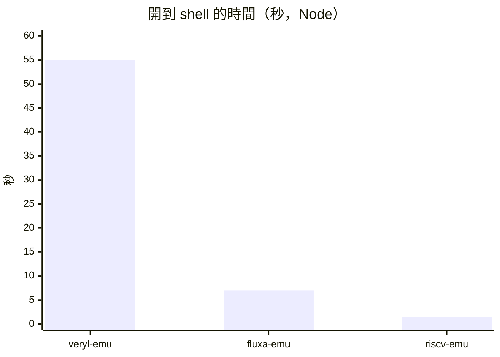

# 三種模擬機引擎的速度：veryl-emu、fluxa-emu、riscv-emu

RV64 開發板的同一個 Linux 映像（OpenSBI + Linux 6.12 + busybox + MicroPython，`web/dist/img_linux.js`）
可以跑在三種引擎上。它們模擬的層級不同，速度也差很多。

## 數字

| 引擎 | 模擬的是什麼 | Node 上 | 瀏覽器裡 | 開到 shell |
|---|---|---|---|---|
| veryl-emu | Veryl 寫的 Rv64Core（`veryl/examples/rv64`），每一拍算整顆電路 | 每秒約 420 萬拍，約 130 萬條指令 | 約 120 萬條指令／秒 | 約 1 分鐘（Node 約 55 秒） |
| fluxa-emu | Fluxa 寫的 SoC（`fluxa/rv64/linux/soc.fx`），task 編成狀態機 | 每秒約 1,400 萬條指令（8,450 萬條約 6 秒） | 約 500 萬條／秒 | Node 約 6–8 秒，瀏覽器約 20 秒 |
| riscv-emu | 只模擬指令集（`riscv/rvemu`），熱區塊再 JIT 成 wasm | 每秒約 5,400–6,700 萬條指令 | 差不多 | 1–2 秒 |

大致上：**fluxa-emu 比 veryl-emu 快約 10 倍，比 riscv-emu 慢約 7 倍。**

數字的來源：

- veryl-emu：`web/PLAN.md` 的紀錄（v2.12–v2.14），以及 npm test 的輸出：開到 shell 用了 2.74 億拍，
  Rv64Core 平均每條指令約 3.3 拍。
- fluxa-emu：2026-11 實際量測（`fluxa/rv64/linux/test.sh`、`boot.mjs`）。量測時機器負載很重（負載平均 10–67），
  所以是保守值。
- riscv-emu：`reda rvemu` 開機加執行指令共 8,450 萬條指令約 1.3 秒；npm test 裡開到 shell 約 1.5 秒。

## 差別來自模擬的層級

- **veryl-emu 是 RTL 模擬。** 每個時脈都要把 Rv64Core 的 441 個訊號、295 個組合邏輯程序重算一遍
  （有髒旗標，值沒變的程序不重算），而且多週期的 Rv64Core 一條指令要好幾拍。
- **fluxa-emu 是行為層級。** Fluxa 描述的是 task 和通道，不是每一拍的暫存器與導線。hart 是一個 task，
  它的程式碼在一個狀態裡就做完一大段（例如整個解碼加執行）；狀態只在通道操作處切開。沒有「每拍重算所有訊號」這回事。
- **riscv-emu 只模擬指令集。** 它直接執行 RISC-V 指令（像 QEMU），而且把常跑的區塊翻成 WebAssembly，所以最快。

所以 fluxa-emu 比 veryl-emu 快，不全是 fluxa-emu 寫得比較好，而是 Fluxa 程式本來就比 RTL 抽象：
同一顆 CPU，Fluxa 版本身要算的東西就少很多。

這也表示 fluxa-emu 模擬的不是「每一拍的硬體」。它的結果要和 **Fluxa 模擬器**相同（`fluxa/emu/tests/agree.rs`
逐個 test 比對），而不是和合成出來的閘級電路逐拍相同；後者是 `reda gatesim` 的工作。
Fluxa 寫的 SoC 則和 riscv-emu 比：前 100 萬條指令的 commit log 逐行相同（`fluxa/rv64/linux/test.sh`）。

## fluxa-emu 的成本在哪裡

fluxa-emu 的加速過程（`fluxa/docs/emu-plan.md`，E1–E3b）：

| 版本 | 改了什麼 | Linux 開機（Node） |
|---|---|---|
| L1 | 第一個能開機的版本 | 9.8 秒 |
| E3 | 往後面狀態的跳躍直接 `br`；task 變數寫入時存回、讀到才載入 | 約 6 秒 |
| E3b | 記憶體存取不再是單獨的狀態、純計算的 `serial for` 展開 | 差不多（雜訊內，約 5%） |

E3b 讓 hart 的狀態從 231 個減到 165 個、每條指令的狀態轉移從約 42 次減到 34 次，時間卻幾乎沒變。
原因是 E3 之後狀態轉移已經很便宜：wasm 裡每個中間碼運算平均不到 0.2 奈秒，一條指令約 76 奈秒，
大部分花在解碼加執行的那個狀態本身（每條指令約 190 個運算）。要再快，得從這部分的計算下手，
例如讓常見指令走更短的路徑。

試過但沒採用的：把 task 的變數整個 `step` 函式期間都放在 wasm 區域變數。V8 的 TurboFan
對這麼大的函式（上千個區域變數、上百個狀態）配置暫存器很差，反而慢約三倍。

## 該用哪一個

| 想做的事 | 用 |
|---|---|
| 寫板上的程式（C、MicroPython、shell），要快 | riscv-emu |
| 看 Fluxa 寫的硬體跑起來，改了 `soc.fx` 之後驗證 | fluxa-emu |
| 看 Veryl 寫的硬體每一拍的行為，改了 Rv64Core 之後驗證 | veryl-emu |
