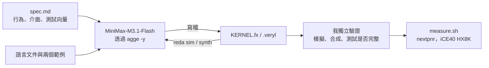

# 方向 C：讓 AI 寫硬體，Fluxa 對 Veryl

> 分支：`aitest`。實驗檔案在 `fluxa/bench/`。相關：[fluxa-static-check.md](fluxa-static-check.md)、[ai-feedback.md](ai-feedback.md)。

## 1. 問題

Fluxa 對高階電路有沒有價值？這裡用一個具體的問法回答：**同一個便宜的模型、同一份規格、同樣的回饋工具，寫 Fluxa 和寫 Veryl，哪一個比較寫得出來？寫出來的硬體差多少？**

## 2. 方法

- **5 個核心**（`fluxa/bench/*/spec.md`）：fir4（4 階 FIR）、dot8（8 對內積）、crc32（位元組串流 CRC-32）、sort4（每 4 個排序）、hist（16 格直方圖，用記憶體）。每份規格附上測試向量，期望值由 Python 算出。
- **共用規則**（`common.md`）：兩種語言用同一個 valid / ready / close 串流介面，各自寫出設計和檢查全部向量的測試。
- **參考資料**：Fluxa 給 `docs/manual/tw/17-fluxa.md`、`fluxa/docs/synthesis-plan.md`、`fir4.fx`、`mac.fx`；Veryl 給 `04-veryl.md`、`05-sim.md`、`fifo.veryl`、`seq101.veryl`。
- **執行**：`run.sh LANG KERNEL`。模型用 agge 的 agent 模式（`-y`，能自己跑 shell），每個組合一個獨立的工作目錄，一次只跑一個（MiniMax 的 Token Plan 限制同時的請求）。agge 預設每個 agent 最多 40 步。`bin/reda` 記下每一次 reda 呼叫。
- **驗證**：不論模型回答什麼，我都重新跑模擬與合成，並讀過測試，確認它真的檢查了規格的每一個向量。
- **量測**：`measure.sh`，`reda fpga` 走 nextpnr 佈局繞線，iCE40 HX8K（ct256）。UP5K 的 48 腳封裝放不下 dot8 那麼寬的介面，所以全部用 HX8K。

## 3. 結果

### 3.1 寫得出來嗎

| 核心 | Fluxa | Veryl |
|---|---|---|
| fir4 | ✅ 22 s，3 次 reda | ❌ 930 s，10 次 reda，結束時還有語法錯誤 |
| dot8 | ✅ 137 s，8 次 | ❌ 328 s，7 次，模擬一直失敗 |
| crc32 | ✅ 52 s，3 次 | ✅ 502 s，6 次（第二次執行，見 §4） |
| sort4 | ✅ 83 s，6 次 | ✅ 204 s，4 次 |
| hist | ✅ 30 s，8 次 | ❌ 214 s，7 次，模擬一直失敗 |
| **合計** | **5 / 5** | **2 / 5** |

沒有通過的三個 Veryl 執行，agge 的回答是空的或是一段沒寫完的標籤：這是 agent 達到 40 步上限時的回答形式，研判是步數用完（agge 在 `-q` 模式下不顯示這個警告，沒有直接證據）。

每一份通過的 Fluxa 測試都完整檢查了規格的全部向量；通過的兩份 Veryl 測試台也是。

### 3.2 程式大小（含測試）

| 核心 | Fluxa 行數 | Veryl 行數 | 比例 |
|---|---|---|---|
| fir4 | 30 | 176* | 5.9× |
| dot8 | 48 | 231* | 4.8× |
| crc32 | 85 | 188 | 2.2× |
| sort4 | 81 | 316 | 3.9× |
| hist | 38 | 259* | 6.8× |

\* 沒有通過的版本，是 40 步用完時的檔案。

Veryl 多出來的主要是兩件 Fluxa 替你做掉的事：**valid / ready 握手的狀態機**，以及**測試台一拍一拍地驅動握手**。Fluxa 的 `chan` 與 `send` / `recv` 把兩者都藏起來了，這也是模型在 Veryl 上失敗的地方（fir4、dot8、hist 都卡在模擬時序）。

### 3.3 寫出來的硬體（iCE40 HX8K）

| 實作 | LC | LUT4 | CARRY | DFF | BRAM | Fmax (MHz) |
|---|---|---|---|---|---|---|
| fir4，AI 寫的 Fluxa | 260 | 165 | 47 | 29 | 0 | 224 |
| fir4，人寫的 Fluxa（`fluxa/examples/fir4.fx`） | 191 | 125 | 37 | 29 | 0 | 213 |
| dot8，Fluxa | 1658 | 1521 | 94 | 625 | 0 | 86 |
| crc32，Fluxa | 141 | 139 | 0 | 37 | 0 | 200 |
| crc32，Veryl | 148 | 146 | 0 | 34 | 0 | 179 |
| sort4，Fluxa | 363 | 316 | 35 | 79 | 0 | 67 |
| sort4，Veryl | 298 | 251 | 35 | 48 | 0 | 55 |
| hist，Fluxa | 128 | 120 | 4 | 24 | 1 | 111 |

nextpnr 每次的 Fmax 有約 ±5% 的變動（同一份 `fir4.fx` 量過 222 與 213）。

兩種語言都寫得出來的兩個核心，**面積和速度在同一個量級**：crc32 幾乎一樣，sort4 的 Fluxa 多 22% 面積、但快 22%。所以 Fluxa 的抽象沒有讓硬體明顯變差。

### 3.4 AI 寫的 Fluxa 和人寫的差在哪

- **不必要的加寬**：fir4 兩個模型（MiniMax、GLM）都把樣本先 `to::<i32>()` 再乘，面積比人寫的多 36%。位寬推導本來就會給出剛好的寬度，加寬反而浪費。這正是 `reda check` 可以補上的提示（目前它只檢查「裝不下」，不檢查「太寬」）。
- **pipeline**：這一輪 MiniMax 在 fir4、dot8、crc32 都用了 `pipeline(ii = 1)`。前一輪 GLM 寫的 dot8 沒有用，結果是 874 LC、26 MHz 的循序電路；MiniMax 的 pipeline 版本是 1658 LC、86 MHz。

## 4. 實驗過程中修掉的工具問題

這個實驗本身就是在測「AI 加上工具」這條鏈，結果鏈上有好幾個環節先斷了：

| 問題 | 修正 | 在哪 |
|---|---|---|
| MiniMax 在長上下文把工具標籤寫壞：`<shell timeout>120">`、屬性寫成子元素、雜訊 `]<]minimax[>[`、開頭少了 `<`（含自閉合標籤），agge 把它當成最終答案而結束 | `tools.repair()` 修回正確格式；還是解析不了的標籤退回給模型重寫 | agge `26f3428`、`5b88712`、`54886d1` |
| 10 個同時跑撞上 MiniMax 的速率限制（429），agge 只等 2 + 4 + 8 秒就放棄 | 429 等 10、20、40、60、60、60 秒，或照 `Retry-After` | agge `5b88712` |
| `reda check` 的 E0501 誤報：AI 寫的 dot8 用 `for x0 in a { … a.recv() … }`，一輪收 8 個，模型卻假設迴圈跑 T(a) 次 | 這種迴圈的次數當作未知 | rueda `3b174a7` |
| NVIDIA 免費端點的 GLM：504、空回覆，每次 10 到 50 分鐘 | 改用 MiniMax；GLM 的結果保留在 `fluxa/bench/glm/` | — |

Veryl crc32 第一次執行時，模型的第一步就寫出 `list_files path="." depth="3"/>`（少了 `<`），被 agge 當成答案而結束。修好 agge 之後重跑一次通過，表 3.1 記的是重跑的結果。其他組合都只跑一次。

## 5. 結論與限制

**結論**：在這組實驗裡，便宜的模型寫 Fluxa 的成功率（5/5）明顯高於 Veryl（2/5），用的時間少、程式短 2 到 7 倍，而兩者都寫得出來時硬體品質相當。差距主要來自**握手協定**：Fluxa 的通道把它從語言裡拿掉了，Veryl 必須在設計和測試台兩邊都手寫，而模型正是在這裡失敗。這支持「Fluxa 是讓 AI 寫硬體比較可靠的語言」的看法。

**限制**（這些都會影響結論的強度）：

- 每個組合只跑一次，只用一個模型。要下確定的結論，需要每組跑多次、換幾個模型。
- 40 步的預算對 Veryl 不利：它需要更多步。給更多步會不會過，還沒試。
- Veryl 的參考資料可能不夠：手冊兩章加兩個範例，裡面沒有 valid / ready 握手的完整範例；Fluxa 的範例（fir4、mac）則跟題目很接近。
- 沒有量**吞吐量**（每個樣本幾個時脈）。Fluxa 用了 `pipeline(ii = 1)` 的核心理論上每拍一筆，但沒有用共同的測試台實測，Veryl 版本的吞吐量也沒量。
- 人寫的對照只有 fir4 一個（`fluxa/examples/fir4.fx`），沒有人寫的 Veryl 版本。

## 6. 下一步

1. 每組跑 3 次以上，記錄成功率的分布；再換一個模型（例如 GLM，等端點穩定時）。
2. Veryl 的參考資料補一個 valid / ready 握手的範例，看差距會不會縮小。這可以分辨「語言本身難」和「文件不夠」。
3. 用一個共同的 Verilog 測試台（iverilog）量每個實作的吞吐量與延遲。
4. `reda check` 加一個「位寬過寬」的提示（W 級），針對 §3.4 的加寬問題。
