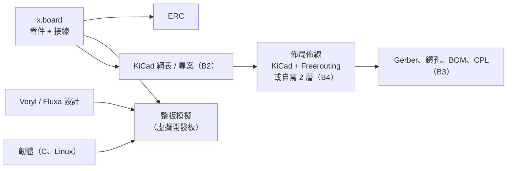

# 把 PCB 與周邊裝置帶進 rueda：規劃

rueda 已經能把 Veryl / Fluxa 做到晶片（FPGA 位元流、SKY130 的 GDS），也能在 IDE 的虛擬開發板上
跑整個系統（iCEBreaker、RV64 開發板、Fluxa 開發板，有 LED、按鈕、UART、VGA、螢幕）。
但板子本身是寫死的：腳位接到什麼，寫在 `eda/src/fpga/board/icebreaker.rs`、`machine.json`
和 SoC 裡。這份規劃要補上**板子這一層**：一份描述說明板上有哪些零件、怎麼接線，
拿它來模擬整塊板，再一路做到可以送去打樣的檔案。

## 兩件難度很不同的事

| | 板級系統設計與模擬 | 實體 PCB 佈局與佈線 |
|---|---|---|
| 做什麼 | 零件、接線、周邊的行為；ERC；整板模擬 | 零件擺放、走線、DRC、Gerber |
| 和 rueda 現有的東西 | 一脈相承（虛擬開發板、模擬機） | 概念接近 `eda/src/asic` 的 place / route，但幾何不同 |
| 可行性 | 高 | 低速 2 層板：中；高速（USB HS、DDR、BGA）：低 |

所以順序是先做前者，實體佈局先交給 KiCad，最後才自己做簡單板子的佈線。

樹莓派、Arduino 這類板子不自己畫，而是當成**模組零件**：你設計的是插在上面的板子
（PMOD 模組、Arduino shield、Pi HAT），或把它們的排針接到你的板子上。

## 架構



`eda` 是語言無關的後端，板子這一層也放在 `eda`（`eda::pcb`）：Veryl 和 Fluxa 的設計都只是
板上 FPGA 的內容。

### 板子描述：`.board` 檔

一行一件事的文字格式，好寫、好 diff，不需要 JSON 函式庫：

```text
# 插在 iCEBreaker PMOD1A 上的感測器模組
board "PMOD 溫度 + LED"
part J1 pmod                   # 連接器：pin 1-4、7-10 是訊號，5 / 11 GND，6 / 12 3V3
part U1 lm75 temp=23.5         # I²C 溫度感測器（位址 0x48 + A2A1A0）
part R1 res 4.7k
part R2 res 4.7k
net SCL J1.1:od U1.SCL R1.1     # :od = 主機（FPGA）以開汲極驅動這支腳
net SDA J1.2:od J1.8 U1.SDA R2.1
net 3V3 J1.6 R1.2 R2.2 U1.VCC
net GND J1.5 U1.GND U1.A0 U1.A1 U1.A2
plug J1 icebreaker.PMOD1A      # 模擬時插在哪裡
```

- `part ID KIND [值] [key=value…]`：零件，從零件庫取它的腳位、封裝、行為模型。
- `net NAME PIN…`：一條線上的所有腳位（`零件.腳`）。
- `plug ID HOST.CONNECTOR`：連接器插在主板的哪個排針上（模擬時用）。

### 零件庫

每個零件帶三樣東西：腳位、封裝（B2 起）、行為模型。

| 類別 | 零件 | 行為模型 |
|---|---|---|
| 被動 | `res`、`led`、`btn` | 數位化的電氣模型：電阻是弱連接（上拉 / 下拉、LED 的限流），LED 依兩端電位亮 |
| 連接器 | `pmod`（之後：Arduino shield、Pi 40-pin） | 腳位對到主板 |
| I²C | `lm75`（溫度） | 從端狀態機：START / STOP、位址、指標暫存器、讀寫 |
| SPI 類 | `74hc595`（移位暫存器） | SRCLK 上升緣移位、RCLK 上升緣鎖存 |
| 之後 | `mcp3008`（SPI ADC）、`ssd1306`（I²C OLED）、`at24c`（EEPROM）、`ch340`（USB-UART） | 協定層模型，寫一次所有板子共用 |

### 整板模擬

虛擬 iCEBreaker（`eda::fpga::board`）本來就逐時脈模擬 FPGA 的腳位。插上一塊板子後：

1. 每個時脈，FPGA 輸出腳的值有變才重算板上的線（板子小，事件驅動就夠快）。
2. 一條線的電位：任何人拉低就是 0（開汲極、推挽輸出 0、從端的 ACK）；否則推挽輸出 1 是 1；
   否則看電阻：上拉 1、下拉 0；都沒有就是浮接。推挽 1 和別人拉低同時發生記為衝突。
3. 零件模型看到線的電位變化（例如 SCL 上升緣）就前進一步，必要時改變它驅動的線。
4. 線的電位回到 FPGA 的輸入腳。

## 階段

| 階段 | 內容 | 完成的樣子 |
|---|---|---|
| **B1** | `.board` 格式、零件庫（被動、`pmod`、`lm75`、`74hc595`）、ERC、整板模擬接上虛擬 iCEBreaker、`reda board`、IDE 顯示 | 一個 Veryl 設計透過 I²C 讀 LM75 的溫度、用 74HC595 點 8 顆 LED，在 IDE 的虛擬板上跑，可以拉溫度滑桿 |
| B2 | 封裝（KiCad 官方庫的 footprint 名稱）、匯出 KiCad 網表與專案 | `reda board --kicad` 的輸出在 KiCad 打開，零件與連線都在 |
| B3 | Gerber、Excellon 鑽孔、BOM、CPL；IDE 的 2D PCB 預覽 | 板廠（如 JLCPCB）收得下的製造檔 |
| B4 | 自寫的 2 層板佈局與低速自動佈線、DRC | 小板子從 `.board` 一路到 Gerber 都在 rueda 裡完成 |
| 之後 | USB 裝置（FPGA 上的 USB FS device，或 MCU 內建）、更多零件與主板（Arduino、Pi） | |

### B1 的細節

- `eda::pcb`：
  - `desc`：解析 `.board`；
  - `lib`：零件庫（每種零件的腳位、類型：電源 / 輸入 / 輸出 / 開汲極 / 雙向）；
  - `erc`：電氣規則檢查（見下）；
  - `sim`：線的電位與零件模型，接到 `eda::fpga::board::Board`。
- ERC 檢查：
  - 不存在的零件或腳位、一支腳出現在兩條線上；
  - 兩個推挽輸出在同一條線；
  - 開汲極的線沒有上拉；
  - 零件的電源腳沒有接到 3V3 / GND；
  - 輸入腳浮接、接了東西的連接器沒有 `plug`。
- `reda board x.board`：列出零件、線、ERC 結果。
- IDE：專案裡有 `.board` 檔時，虛擬 iCEBreaker 插上它；畫出模組上的 LED 與感測器（溫度可以拉）。

## 不做 / 先不做

- 類比模擬（SPICE）：板子的電氣模型是數位的；需要時把 ngspice 當成外部工具。
- 高速信號（USB HS、DDR、HDMI）與 BGA：阻抗、差動對、等長、多層板都超出這個專案的範圍。
- 樹莓派等級的主板：當成模組零件使用。
