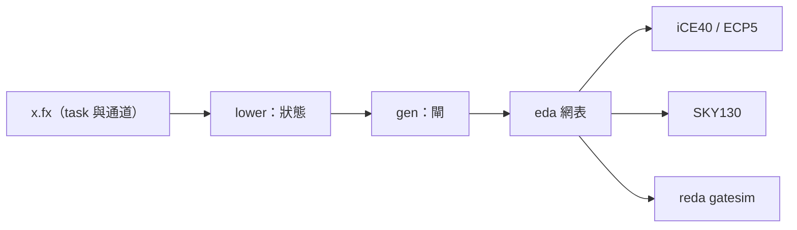

# rueda 0.7.0

2026-11-01。自 0.6.0（第一次發佈到 crates.io）以來的變更：Fluxa 可以合成成電路、有了快速的 fluxa-emu，
而且 Linux 可以開在 Fluxa 寫的 RV64 上。

```bash
cargo install rueda
```

線上 IDE：<https://ccc-eda.github.io/rueda/web/dist/index.html>

## Fluxa 合成（F1–F9，新 crate `rueda-fluxa-synth`）

- 一個 `task` 合成成 FSM 加資料路徑；通道參數變成 valid / ready 串流埠，其他參數是輸入埠，或用
  `--param NAME=VALUE` 固定成常數。
- 支援定點數、陣列、`@reg`、`pipeline(ii = 1)` 迴圈（一個時脈一次迭代），`mem` 對應到 block RAM，
  記憶體可以有初始內容。
- 會 `spawn` 一整個網路的 task 合成成一個網表，通道變成 FIFO。泛型 task 和網路的陣列參數也能合成。
- 和 Veryl 共用後半段流程（`eda::flow`）：`reda synth / fpga / asic x.fx` 都能用，可以到 iCE40、ECP5、SKY130。
- 閘級共模擬：`reda gatesim KIND x.fx`，把某個 task 換成合成後的網表，跑同一組 test。
- 成果：
  - RV32I 的四級管線合成成一個網表，test 在閘級上通過；
  - 程式內建的 RV32I Core 在 ECP5 上完成布局繞線；
  - RV64G（含多週期 FPU task `Fpu`）合成成一個網表，在 ECP5 上完成布局繞線。



## fluxa-emu（E1–E3b，新 crate `rueda-fluxa-emu`）

- Fluxa 程式先編譯再跑：task 變狀態機，通道變環形緩衝區；有 Rust 執行器和 WebAssembly 後端。
- 結果和 Fluxa 模擬器逐個 test 比對相同（`fluxa/emu/tests/agree.rs`）。
- `reda emu x.fx` 在命令列上跑；IDE 裡用 `fluxa_emu_compile`。
- 速度：開 Linux 時每秒約 1,400 萬條指令，比 veryl-emu 快約 10 倍，比 riscv-emu 慢約 7 倍。
  比較與原因見 [docs/note/emu-compare.md](../note/emu-compare.md)。

## Linux 開在 Fluxa 寫的 RV64 上（L1–L3）

- `fluxa/rv64/linux/soc.fx`：RV64IMAC + Zicsr / Zicntr / Zifencei / Sstc / Svadu、Sv39、TLB、CLINT、
  UART、PLIC、GPIO、finisher。
- 開的是和 Veryl Rv64Soc 同一個 OpenSBI + Linux 6.12 + busybox + MicroPython 映像；前 100 萬條指令的
  commit log 和 riscv-emu 逐行相同（`fluxa/rv64/linux/test.sh`）。
- 8 個 hart 的 test（`tests_soc.fx`）在 Fluxa 模擬器和 fluxa-emu 上都跑。

## IDE

- 新的「Fluxa 開發板」：模擬機引擎可選 fluxa-emu，範例有 Linux、跑馬燈、俄羅斯方塊、貪食蛇、
  呼吸燈（PWM）、反應時間。
- 開機快照：從按下執行到俄羅斯方塊開始約 1.8 秒（冷開機約 25 秒）。
- Fluxa 專案可以合成、看各階段的電路圖、跑閘級 test。泛型 task（例如 RV32I / RV64G 的 `Core`）會取用程式裡
  `spawn` 時給的值。
- Fluxa RV64 範例加入 IDE；拿掉舊的示範頁（`demo.html`）。

## 其他

- `run.sh`：一個入口做 build、serve、test 等常用動作（`./run.sh help`）。
- 文件：手冊第 17 章（Fluxa）加上合成、fluxa-emu、Fluxa 開發板；README 更新。

## 發佈到 crates.io

0.7.0 共 11 個 crate（`rueda-wasm` 不發佈），新增的是 `rueda-fluxa-synth` 和 `rueda-fluxa-emu`。

```bash
./run.sh publish --dry-run   # 打包並建置每個 crate，不上傳
./run.sh publish             # 檢查 git 狀態、版本與 tag，dry run，確認後上傳
```
