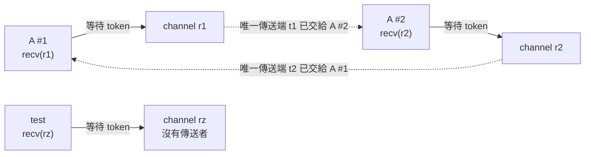

# 4.10 死結：所有程序都在等待，卻沒有人能前進

### 4.10.1 死結的定義

在 KPN 中，當所有仍存活的 task 都因通道操作阻塞，而且沒有任何狀態變更能解除等待，系統就陷入死結。典型特徵是：

- 每個 task 都在 `recv` 空 FIFO，或在 `send` 滿 FIFO；
- 等待關係形成環，或根本沒有任何程序能提供所需 token；
- 網路不會自行恢復。

死結和一般的暫時等待不同。一般等待只要另一方前進，就會解除；死結則沒有可前進的節點。

### 4.10.2 刻意失敗案例：兩個 task 互相等待

```fluxa
task A(i: in chan<u8>, o: out chan<u8>) {
    let v = i.recv();
    o.send(v);
}

test circular_wait {
    let (t1, r1) = chan::<u8>(depth = 1);
    let (t2, r2) = chan::<u8>(depth = 1);

    spawn A(r1, t2);
    spawn A(r2, t1);

    let (tz, rz) = chan::<u8>(depth = 1);
    let v = rz.recv();
    assert v == 0;
}
```

等待圖是：



兩個 `A` 都先接收，但唯一的傳送端分別在另一個 `A` 手中；沒有任何一個能先送出 token。測試主體還在另一條沒有傳送者的通道上等待，整個網路沒有任何前進點。

模擬器會以 E0701 報告死結，並列出每個存活 task 正在等待哪個通道。實際訊息格式以工具版本為準，核心證據是：所有 live task 都 blocked，且等待鏈無法閉合。

### 4.10.3 常見死結來源

#### 環形等待

兩個或多個 task 各自持有下一個 task 所需的資源，形成等待環。這就是上一節的 `A` 與 `A`。

#### 沒有生產者

測試或 task 建立了一條接收通道，卻沒有任何傳送端：

```fluxa
let (tx, rx) = chan::<u8>(depth = 1);
let v = rx.recv();  // 永遠等不到 token
```

若 `tx` 仍由同一個 task 持有，它永遠不會被送入網路；這不是「深度不夠」，而是拓樸缺少能前進的節點。

#### 關閉前仍有未完成的循環依賴

若 task A 要先收到資料才能送出資料，而 task B 也要先收到 A 的資料才能送出自己的資料，單純關閉其中一條通道並不能解除循環等待。

#### 測試端和 DUT 互相塞滿

測試主體一口氣送完所有輸入，再開始讀輸出；若輸出 FIFO 無法容納整段資料，測試主體會卡在輸入 `send`，DUT 則卡在輸出 `send`，形成死結。正確做法是：

- 增大輸出 FIFO；
- 或讓測試一邊送、一邊收；
- 或使用能明確支援的背壓協定。

### 4.10.4 增加 FIFO 深度不是通用修法

死結有時是容量不足，有時是拓樸根本不可能前進：

| 症狀 | 根因 | 合理修正 |
| --- | --- | --- |
| 測試送完輸入前就卡住，DUT 正在輸出 | 輸出緩衝不足 | 增大深度，或交錯收送 |
| task 都在等待彼此尚未產生的 token | 等待環 | 重排協定，讓某個 task 先產生 seed token |
| 接收通道沒有傳送者 | 缺少節點或接線錯誤 | 建立正確的 task 與端點連接 |
| 廣播的一個分支不再消費 | 分支堵塞廣播器 | 修正分支生命週期或關閉責任 |

如果死結是等待環，把 FIFO 從 1 加到 100 通常沒有幫助：容量變大只是讓 task 在不同時間點卡住，環仍然存在。設計修正應回到資料流依賴，而不是只調整參數。

### 4.10.5 用等待圖診斷死結

遇到 E0701 時，可依序做四件事：

1. 列出所有存活 task。
2. 標出每個 task 正在執行的通道操作。
3. 對每條被等待通道，尋找其唯一傳送端目前位於哪個 task。
4. 沿著「誰必須先動」反推，找出循環或缺少的起點。

這張圖會把「所有 task 都在等」的抽象錯誤，轉成可以修改的具體依賴。例如：

```text
A 等 B 的 token
B 等 A 的 token
→ 等待環，必須讓 A 或 B 先送 seed token。

C 等一條沒有 tx 的通道
→ 缺少生產者，檢查 spawn 接線。
```

第 5 章會進一步用 trace、stats 與兩種排程器，把這套等待圖分析變成可重現的除錯流程。
