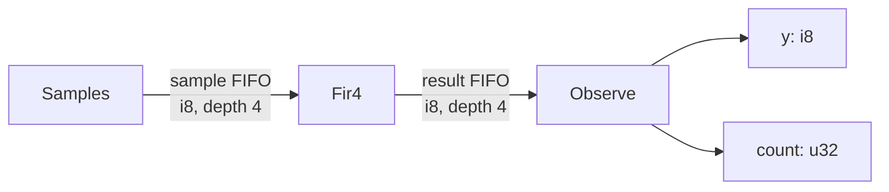

# 4.11 用契約組合元件

### 4.11.1 元件契約與內部實作要分開

一個可重用元件的介面不應洩漏太多內部拓樸。例如 `FirNetwork` 對呼叫者承諾的是：

- 接受 `i8` 樣本；
- 產生同樣是 `i8` 的濾波結果；
- 每個輸入對應一個輸出；
- 輸入串流結束後，結果串流也會結束；
- 另送出一個 `u32` 計數。

呼叫者不需要知道 FIR 與觀察者之間使用深度 4 的 FIFO，也不需要知道 `Observe` 內部使用 `carry`。這些是實作選擇，可以在不破壞外部契約的前提下最佳化。

但元件契約也不能空泛到無法驗證。至少要明確：

1. **資料格式**：每個 token 的型別。
2. **數量關係**：一進一出、一進多出，或其他明確關係。
3. **順序關係**：第 n 個輸出對應哪個輸入。
4. **結束條件**：何時停止，以及下游如何得知。
5. **阻塞條件**：何時可能等待。
6. **錯誤邊界**：型別不相容、端點重複使用等錯誤如何被拒絕。

### 4.11.2 FIR 網路的完整通道表

以目前的 `FirNetwork` 為例，所有通道可記成：

| 通道 | 方向 | 元素型別 | 深度 | 順序與數量 | 關閉責任 |
| --- | --- | --- | --- | --- | --- |
| 外部 `x` | 來源 → Fir4 | `i8` | 由建立通道者決定 | 每個 token 一個樣本，保持順序 | 來源 task 或測試主體 |
| 內部 `result` | Fir4 → Observe | `i8` | 4 | 每個輸入對應一個結果，保持順序 | Fir4 結束時自動關閉 |
| 外部 `y` | Observe → 測試接收端 | `i8` | 由建立通道者決定 | 與 `x` 一對一，保持順序 | Observe 結束時自動關閉 |
| 外部 `count` | Observe → 測試接收端 | `u32` | 由建立通道者決定 | 串流結束時送一個總數 | Observe 結束時自動關閉 |

這張表把本章前面各個概念放在一起：

- 「方向」對應 task 介面上的 `in` 與 `out`；
- 「元素型別」必須完全相符；
- 「深度」是有界性與背壓的設計參數；
- 「順序與數量」是 token 守恆契約；
- 「關閉責任」讓 end-of-stream 沿網路傳遞。

注意，外部通道的深度不是元件偷偷決定的。呼叫 `FirNetwork` 的人建立 `x`、`y`、`count`，因此也負責選擇它們的深度，並確保測試或上游的行為能與這些深度配合。

### 4.11.3 網路不變量

與其只看個別 task 的程式碼，不如為整張網路寫下不變量。FIR 網路至少有以下幾條：

> **守恆不變量**：若輸入串流包含 n 個樣本，正常完成後輸出串流包含 n 個結果，且 `count = n`。

> **對應不變量**：對任意 k ≥ 0，輸出的第 k 個結果是第 k 個輸入樣本套用 FIR 遞推式所得的值。

> **順序不變量**：結果通道保持輸入順序；計數通道不承載逐樣本事件，只在最後送出一個摘要。

> **結束不變量**：輸入端點關閉後，所有已送入樣本都被處理，結果與計數端點分別在摘要送出後關閉。

> **有界不變量**：任何時刻每條 FIFO 的待處理 token 數不超過其深度。

這些不變量能直接導出測試。例如，測試 `fir_network_normal` 同時檢查結果值、順序與數量；`fir_network_max_value` 則確認值域邊界不會破壞守恆。

### 4.11.4 把來源也納入網路

若希望測試更貼近「來源 → FIR → 消費者」的完整形狀，可以讓來源也是一個 task：

```fluxa
task Samples(xs: [i8; 6], out: out chan<i8>) {
    for v in xs {
        out.send(v);
    }
}
```

再建立一條專門的測試網路：

```fluxa
task SampleFirNetwork(
    y: out chan<i8>,
    count: out chan<u32>
) {
    let (t_input, r_input) = chan::<i8>(depth = 4);
    let (t_result, r_result) = chan::<i8>(depth = 4);

    spawn Samples([64, 64, 64, 64, 64, 64], t_input);
    spawn Fir4(r_input, t_result);
    spawn Observe(r_result, y, count);
}
```

這張網路有三個節點：



`Samples` 結束時，來源 FIFO 關閉；FIR 讀完既有 token 後結束，再關閉結果 FIFO；`Observe` 讀完結果後送出計數並結束。每次 `spawn` 都把相鄰節點所需的端點交給下一位 owner，沒有任何端點被複製。

這個版本也讓「來源結束如何觸發整張網路結束」變得非常直觀：關閉不是某個 task 對另一個 task 的額外命令，而是沿著 FIFO 逐級傳遞的資料流結束事件。
