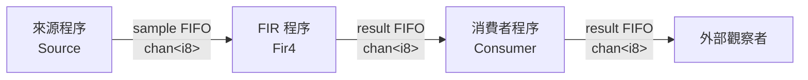

# 4.2 從一段演算法到一張網路

先看一段最直覺的 4 階 FIR 程式：

```fluxa
for sample in samples {
    let y = c0 * sample + c1 * history[0]
          + c2 * history[1] + c3 * history[2];
    history = [history[1], history[2], sample];
    outputs.push(y);
}
```

這段程式描述了**演算法**：先乘、再加、接著更新歷史值，最後產生輸出。但如果要把它做成可重用的硬體元件，還缺少幾個問題：

- `samples` 從哪裡來？每次送來一個整數，還是一次送來一組資料？
- `outputs` 要送往哪裡？輸出端是否和輸入端使用相同格式？
- 濾波器如何知道資料流已結束？
- 如果來源比 FIR 快，或 FIR 比來源快，資料要放在哪裡？
- 若把 FIR 與另一個模組組合，誰負責傳送、誰負責接收，兩邊是否可能同時操作同一端點？

Kahn 程序網路把這些問題變成語言中的一級結構。

### 4.2.1 節點、邊與 token

在程序網路中：

- **節點**是 `task`。每個 task 是獨立程序，有自己的區域變數、控制流程與通道端點。
- **邊**是通道。每條通道都是單向、有界、先進先出的佇列。
- **token**是通道中的資料項。token 必須符合通道宣告的元素型別；同一個值送兩次，就是兩個不同的 token。

以 FIR 為例，抽象後的拓樸是：



在這張圖裡，FIR 不是一條從頭跑到尾的時間線，而是空間中一個可以和其他程序同時存在的節點。來源可以先送出一批樣本，消費者可能還在處理上一個結果；FIFO 與阻塞式操作負責協調它們。

這個觀點很重要：**硬體的「空間資料流」不是由程式碼中從上到下的行號決定，而是由 task 與通道的連接關係決定。**

### 4.2.2 token 契約不只是元素型別

只寫 `chan<i8>` 還不足以描述一條可組合介面。完整的 token 契約至少要回答：

| 契約項目 | 必須說明的內容 | 為什麼重要 |
| --- | --- | --- |
| 元素型別 | 每個 token 可表示的值域與位寬 | 避免隱式窄化與格式不一致 |
| 方向 | 誰是傳送端、誰是接收端 | 避免把同一端點交給兩方 |
| 數量 | 一次傳送幾個 token、整體是一對一還是一對多 | 決定守恆與結束條件 |
| 順序 | 同一通道是否保持 FIFO 順序 | 決定測試 oracle 能否比較序列 |
| 深度 | FIFO 能緩衝多少 token | 決定吸收短期速率差異的能力 |
| 背壓 | 滿或空時如何等待 | 決定程序之間如何互相施加壓力 |
| 關閉 | 誰在何時宣告不再有 token | 讓接收端能判斷資料流結束 |

本章會逐項把這張表填滿。這個「契約先於實作」的習慣，是 Fluxa 與一般高階合成工具最重要的差異之一。
