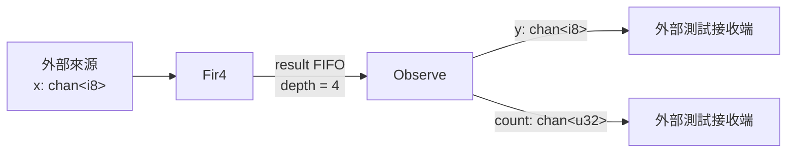

# 4.6 把 FIR 組成程序網路

現在把前兩章的內容接起來。下面的 FIR 沿用 `fluxa/examples/fir4.fx` 的資料路徑：4 個定點係數、3 個 `@reg` 歷史樣本、平衡加法樹，以及飽和輸出。通道只負責傳遞樣本與結果；濾波器自己的歷史狀態仍留在 task 內。

### 4.6.1 元件契約

先定義 FIR task：

```fluxa
const COEF: [fixed<1, 7>; 4] = [0.125, 0.375, 0.375, 0.125];

task Fir4(x: in chan<i8>, y: out chan<i8>) {
    let mut hist: [i8; 3] @reg = [0; 3];

    pipeline(ii = 1) for s in x {
        let win: [i8; 4] = concat([s], hist);
        let acc = (0..4).unrolled()
                         .map(|k| win[k] * COEF[k])
                         .tree_sum();
        hist = win[0..3];
        y.send(acc.to::<i8>(round = nearest, ovf = sat));
    }
}
```

這個元件的契約是：

1. `x` 每個 token 是一個 `i8` 樣本，範圍為 −128 到 127。
2. 每收到一個樣本，`y` 就產生一個 `i8` 結果；樣本與結果一對一，不多也不少。
3. 同一通道保持輸入與輸出順序。
4. FIR 的初始歷史為三個零。
5. 當 `x` 關閉且已送入的樣本全部處理完畢後，`y` 關閉。
6. 定點乘加以明確的 `nearest` 捨入與 `sat` 溢位策略落入 `i8`。

其中第 2、5 條正是「token 守恆」與「end-of-stream」契約。將來替換係數、插入前處理器或接上另一種消費者時，這些條目仍然必須成立。

### 4.6.2 加入消費者

為了觀察 FIR 的輸出數量，再加入一個只負責轉發與計數的消費者：

```fluxa
task Observe(
    x: in chan<i8>,
    y: out chan<i8>,
    count: out chan<u32>
) {
    carry n: u32 = 0;

    for v in x {
        n += 1;
        y.send(v);
    }

    count.send(n);
}
```

`Observe` 不改變資料，只為每個輸入產生一個同值輸出，並在輸入串流結束後送出一個總數。這使測試可以同時檢查：

- 結果序列；
- token 總數；
- 關閉是否讓網路正常終止。

### 4.6.3 建立固定形狀的網路

用一個頂層 task 把內部通道與兩個子 task 組裝起來：

```fluxa
task FirNetwork(
    x: in chan<i8>,
    y: out chan<i8>,
    count: out chan<u32>
) {
    let (t_result, r_result) = chan::<i8>(depth = 4);

    spawn Fir4(x, t_result);
    spawn Observe(r_result, y, count);
}
```

這段程式建立的是：



要注意端點如何移動：

- `x` 移轉給 `Fir4`，成為它的輸入接收端；
- `t_result` 移轉給 `Fir4`，成為它的輸出傳送端；
- `r_result` 移轉給 `Observe`，成為它的輸入接收端；
- `y` 與 `count` 移轉給 `Observe`，成為它的兩個輸出傳送端。

這不是把端點複製兩次，而是為相鄰節點各準備一組端點：`t_result` 由 FIR 擁有，`r_result` 由觀察者擁有；兩者共同構成同一條 FIFO。每個端點仍然只有一位 owner。

### 4.6.4 一個完整的正常案例

以下測試可與元件放在同一個 `.fx` 檔案中：

```fluxa
test fir_network_normal {
    let (tx, rx) = chan::<i8>(depth = 8);
    let (ty, ry) = chan::<i8>(depth = 8);
    let (tn, rn) = chan::<u32>(depth = 1);

    spawn FirNetwork(rx, ty, tn);

    for _ in 0..6 {
        tx.send(64);
    }
    tx.close();

    let want = [8, 32, 56, 64, 64, 64];
    for expected in want {
        assert ry.recv() == expected;
    }

    assert rn.recv() == 6;
}
```

先把焦點放在網路，而不是係數。測試中的來源每次送入 `64`，期望的輸出序列則是：

```text
輸入： 64  64  64  64  64  64
       │   │   │   │   │   │
       ▼   ▼   ▼   ▼   ▼   ▼
輸出： 8  32  56  64  64  64
```

前兩個輸出分別來自係數部分和 `0.125` 與 `0.375`；隨著歷史樣本填滿，結果逐步接近 `64`。最後 `tx.close()` 是必要的：若來源還活著且沒有宣告結束，`Observe` 的 `for v in x` 就無法知道何時停止。

`assert rn.recv() == 6` 同樣重要。只檢查第一個結果，無法證明其餘 token 沒有遺失；只檢查總數，則無法證明順序或內容正確。完整的網路契約需要同時有「值」「順序」「數量」三類證據。

### 4.6.5 邊界案例：最大輸入值

正常案例之外，至少還要測試值域邊界。以下測試連續送入 `i8` 的最大值：

```fluxa
test fir_network_max_value {
    let (tx, rx) = chan::<i8>(depth = 4);
    let (ty, ry) = chan::<i8>(depth = 4);
    let (tn, rn) = chan::<u32>(depth = 1);

    spawn FirNetwork(rx, ty, tn);

    for _ in 0..4 {
        tx.send(127);
    }
    tx.close();

    for _ in 0..4 {
        assert ry.recv() == 127;
    }
    assert rn.recv() == 4;
}
```

這個案例同時確認：最大值可沿通道完整通過、FIR 不少產生 token、觀察者最後能收到正確總數。最小值 −128、零輸入與剛好跨越飽和邊界，也應在完整測試矩陣中另外安排。

### 4.6.6 FIFO 不是演算法狀態

網路中的兩種狀態不可混為一談：

- `Fir4` 的 `hist` 是**元件內部狀態**，保存前三次輸入，讓 FIR 的數學定義成立。
- `result FIFO` 是**元件間的緩衝**，保存尚未被下一個 task 消耗的 token。

把歷史值改放在 FIFO 裡，會讓元件的契約取決於外部何時讀取，語意不再清楚。通道深度也不能取代 FIR 的移位暫存器：前者處理程序間速率差，後者處理濾波器的時間遞迴。

這個區分也會直接影響後續的硬體映射：task 內的 `@reg` 與 `carry` 會成為元件的狀態，通道則會成為連接元件的 FIFO。
