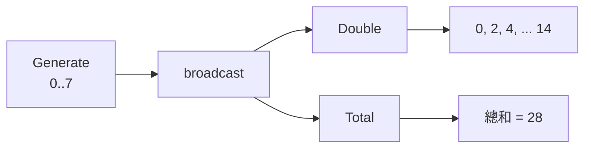

# 4.8 複製與扇出：`broadcast` 不是競爭式消費

### 4.8.1 一對多與一對一的差別

考慮一個來源產生十個樣本，而網路中有三個用途：

1. 送到 FIR 計算；
2. 送到監看器記錄；
3. 送到另一條控制路徑。

直覺上，三個分支都應該看到 `0, 1, 2, ...`。這是**一對多廣播**。若三個分支只允許合計收到十個 token，則是**競爭式消費**，每一個 token 只交給其中一個分支。兩種語義完全不同。

Fluxa 的 `broadcast(rx, n)` 明確提供前者：

```fluxa
let outs = broadcast(rx, 3);
```

它會：

1. 消耗來源接收端 `rx`；
2. 建立 `n` 個新的接收端；
3. 讓來源通道中的每個 token 依序送到每一個分支；
4. 讓每個分支各自收到完整的 token 序列。

因此呼叫後，原始 `rx` 不可再使用；`outs[0]`、`outs[1]`、`outs[2]` 分別是一條分支的接收端。

### 4.8.2 一個可執行的廣播網路

```fluxa
task Generate(out: out chan<u8>) {
    for i in 0..8 {
        out.send(i);
    }
}

task Double(x: in chan<u8>, y: out chan<u16>) {
    for v in x {
        y.send(v * 2);
    }
}

task Total(x: in chan<u8>, y: out chan<u16>) {
    carry sum: u16 = 0;

    for v in x {
        sum += v;
    }

    y.send(sum);
}

test broadcast_full_sequence {
    let (tg, rg) = chan::<u8>(depth = 2);
    let outs = broadcast(rg, 2);
    let (td, rd) = chan::<u16>(depth = 2);
    let (tt, rt) = chan::<u16>(depth = 1);

    spawn Generate(tg);
    spawn Double(outs[0], td);
    spawn Total(outs[1], tt);

    for i in 0..8 {
        assert rd.recv() == i * 2;
    }

    assert rt.recv() == 28;
}
```

這個網路的邏輯是：



`Double` 收到八個 token，`Total` 也收到八個 token。`Total` 跑得比 `Double` 快或慢，都不應讓另一分支漏掉資料。

### 4.8.3 廣播也會施加背壓

廣播不是「無成本複製到無限多地方」。廣播器必須把來源 token 依序送入每一條分支；若其中一條分支的 FIFO 已滿且接收端不再前進，廣播器就會卡在該分支的 `send`，後面的 token 也無法繼續交付。

因此 `broadcast` 的實際吞吐量受最慢分支限制。設計時可以：

- 增加分支 FIFO 的深度，吸收短期 bursts；
- 確保每個分支最終都會消費資料；
- 避免某個分支因為等待另一條通道而形成循環依賴。

更深的 `broadcast` 也會增加儲存需求與硬體面積；它不是「複製端點就免費得到平行分支」。合成時，廣播器及其分支 FIFO 都是網路中的真實資源。

### 4.8.4 `broadcast` 的來源端點為何會被消耗

`broadcast(rx, n)` 不是單純「替 `rx` 建立 n 個參考」。它把來源接收端交給內部廣播程序，由廣播程序擁有唯一讀取權。若原 owner 仍能讀 `rx`，它就可能和廣播器競爭 token，破壞每個分支都收到完整序列的保證。

所以線性所有權在這裡特別重要：

```fluxa
let outs = broadcast(rx, 2);
// 從這裡開始，rx 已不可再用。
```

這與 `spawn` 的理由相同：每個接收端都必須有唯一 owner。
