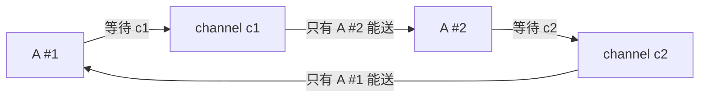

# 5.10 死結診斷：所有 task 都在等待誰？

死結是程序網路最典型的生命週期錯誤。它的特徵是：沒有任何存活 task 能再前進，但測試仍在等待結果。

### 5.10.1 E0701 報告包含什麼

`fluxa/examples/err_deadlock.fx` 建立兩個相同的工作 task，但讓它們互相等待：

```fluxa
task A(i: in chan<u8>, o: out chan<u8>) {
    let v = i.recv();
    o.send(v);
}

test circular_wait {
    let (t1, r1) = chan::<u8>(depth = 1);
    let (t2, r2) = chan::<u8>(depth = 1);
    spawn A(r1, t2);
    spawn A(r2, t1);

    let (tz, rz) = chan::<u8>(depth = 1);
    let v = rz.recv();
}
```

兩個 A 都不會先產生 token：

- 第一個 A 要先從第一條通道接收，才能送到第二條；
- 第二個 A 要先從第二條通道接收，才能送到第一條；
- 測試又等待一條沒有來源的新通道。

模擬器會以 E0701 報告仍存活的 task 與各自等待的操作。概念上像：

```text
deadlock: all 3 live task(s) are blocked
  task `A` (#1) is blocked: recv on `test:r1->t2` (FIFO empty)
  task `A` (#2) is blocked: recv on `test:r2->t1` (FIFO empty)
  task `test` (#0) is blocked: recv on `test:tz->rz` (FIFO empty)
```

通道名稱會依來源程式的端點命名而不同，重點是每個 task 的等待理由。

### 5.10.2 建立等待圖

把報告轉成等待圖：

- 節點：task；
- 指向通道的邊：task 正等待哪條通道；
- 從通道指向 task 的邊：哪個 task 必須送出 token 才能解除等待。

上述程式的核心環是：



測試主體對第三條通道的等待是另一個等待邊，但它不是解除前兩個 task 等待的來源。

### 5.10.3 從「誰最後仍可前進」回推

除錯時可反過來問：

> 在所有存活 task 中，誰不需等待別人就能產生下一個 token？

若找不到任何一個節點，而且網路沒有外部輸入可啟動，就形成死結。接著檢查那個節點是否被不必要地放在 `recv` 之前，是否缺少來源，或關閉責任是否錯誤。

### 5.10.4 增加 FIFO 深度為何救不了它

把深度從 1 改成 100，只會讓已經送入的 token 有更多緩衝空間。在上例中，兩個 A 都還沒送出第一個 token，因此 FIFO 一開始就是空的；沒有人能從深 FIFO 取到資料。

只有下列情況，增加深度可能有用：

- token 已存在，但接收端暫時尚未取走；
- 來源只需要跨過短暫速率差；
- 多個生產者已能產生資料，消費者只是稍後才執行。

它不能解決循環等待、缺少來源或錯誤關閉。

### 5.10.5 常見死結模式

**循環等待。** A 等 B 的輸出，B 等 A 的輸出。

**自己等自己。** task 的輸入與輸出被接到同一條 FIFO，接收前必須先送出。

**缺少終止來源。** 測試或下游永遠等待一個沒有任何 task 會產生的通道。

**先等待、後啟動。** task 在讀取某個由尚未 spawn 的 task 產生的 token；端點所有權或網路組裝順序使它永遠無法被啟動。

**關閉責任錯誤。** 某個 task 提前結束並隱式關閉輸出，但上游仍期待它接收更多 token；另一側則永遠等不到結束。

### 5.10.6 死結偵測不是通用 timeout

目前 E0701 的判定是「所有存活 task 都阻塞」。如果某個 task 陷入無限迴圈、持續計算或永遠不回到等待點，它不會被判定為「所有 task 都阻塞」，而可能讓測試持續執行。換言之：

- E0701 能診斷封閉的等待環；
- 它不能取代 timeout、資源上限或 liveness 監控。

同樣地，單次測試通過不能證明網路在所有輸入下都不會死結。死結是否可達仍要靠結構分析、靜態通道守恆檢查與測試共同涵蓋。第 6 章會說明 `reda check` 能在部分有限模型中提前找出這類問題。
