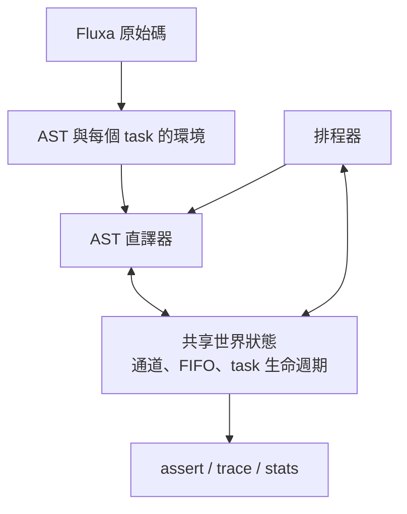

# 5.2 行為模型不是「跑一次看看」

很多初學者把模擬器想成一台比真實硬體快的電腦：把程式放進去，等它輸出結果。這種理解對一般軟體測試還算夠用，但對資料流硬體並不完整。硬體行為模型必須把下面三件事分開：

1. **語意**：每個 task 會做什麼，token 如何流動，結果是什麼。
2. **狀態**：目前每條 FIFO 裡有哪些 token，哪些 task 還活著。
3. **排程**：下一個時刻允許哪個可執行的 task 前進。

若把三者混在一起，測試結果就可能回答「這一次排程恰好如何執行」，而不是「設計契約要求什麼」。

Fluxa 的行為模型因此分成三層：



### 5.2.1 AST 直譯器：執行語意

第一層是 AST 直譯器。它讀懂 `let`、`if`、`for`、方法呼叫與 task 呼叫，並把每一段 Fluxa 程式翻成可逐步執行的動作。例如：

```fluxa
y.send(v);
```

在直譯器內部不是一般軟體意義上的「呼叫一個函式後立即返回」，而是：

1. 檢查送端所有權與通道型別；
2. 檢查值是否符合通道元素型別；
3. 若 FIFO 已有空間，把 token 放入尾端；
4. 若 FIFO 已滿，進入等待點；
5. 成功後更新計數、追蹤資訊與排程器狀態。

直譯器負責「這一步的語意是什麼」，但不獨自決定「現在輪到哪個 task 執行」。這個分離使同一份 AST 可以在不同排程策略下執行。

### 5.2.2 共享世界狀態：所有程序共同看見的事實

第二層是共享世界狀態。它至少保存：

- 每條通道的元素型別、容量與 FIFO 內容；
- 每條通道的送端、收端目前屬於哪個 task；
- 已成功送出與接收的 token 數；
- 存活 task、已完成 task 與正在等待的 task；
- 通道是否已關閉；
- 排程器用來判斷「有沒有任何狀態改變」的 epoch。

task 自己的普通變數則不放在共享世界裡。每個 task 有獨立的環境與控制流程；task 之間唯一預設的通訊媒介是通道。這正是 Kahn 程序網路能保持確定性的重要條件。

「共享世界」這個名稱容易讓人誤解：它不是讓多個 task 任意修改一塊共享記憶體。世界狀態是由通道操作依語意更新的；例如 `recv` 只能由通道的收端 owner 執行，token 也只能從 FIFO 頭端取走。

### 5.2.3 排程器：決定誰先前進

第三層是排程器。它只看得到 task 的可執行狀態：

- 某個 task 正在計算，就可繼續執行；
- 某個 task 正在等待空 FIFO，就不能接收；
- 某個 task 因 FIFO 滿而等待，就不能送出；
- task 結束、通道關閉或 token 移動，都可能喚醒其他 task。

排程器可以很公平，也可以刻意偏向某個 task；只要它遵守通道語意，就不應改變邏輯 token 序列。這就是「排程無關」真正要表達的意思：**不要求每個 task 同時前進，只要求所有可能前進的次序都遵守同一份因果契約。**

### 5.2.4 每個測試都是一個新的世界

執行一個 `test` 時，模擬器會建立新的共享世界。不同測試不會共用上一個測試留下的 FIFO、task 或變數。這使測試可以：

- 獨立執行；
- 以 `--test NAME` 隔離；
- 在同一份程式中並排維護多組案例；
- 重現失敗而不受其他測試執行順序影響。

這也是為什麼第 2 章所說的「測試是硬體規格的一部分」不是一句口號：測試不只是呼叫元件後看回傳值，它實際上建立了一個受控的 token 環境與生命週期。
