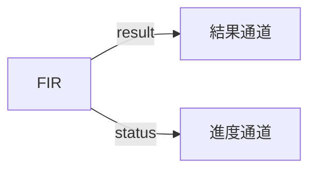

# 5.4 Kahn 確定性：哪些順序被保證，哪些沒有

「排程無關」很容易被誤解成「所有事件都有一個全域固定順序」。Kahn 程序網路並不是這樣。它保證的是較精細、也更有用的契約。

### 5.4.1 同一通道有順序

每一條通道都是 FIFO。若來源依序送出：

```text
a, b, c
```

接收端必定依序得到：

```text
a, b, c
```

不論來源與接收端如何交錯執行，也不論 FIFO 深度是 1 還是 16。深度只改變「來源何時因 FIFO 滿而等待」，不改變 token 的邏輯次序。

這個保證是測試可以逐項比較序列的基礎。若一個元件接收第  $n$  個輸入後應產生第  $n$  個輸出，測試就可以依序 `recv` 並比較，而不必把整個序列先收集到陣列。

### 5.4.2 不同通道沒有全域順序

假設 FIR 同時把結果送到 `result`，把進度送到 `status`：



我們可以可靠地斷言：

- `result` 內部保持結果順序；
- `status` 內部保持進度順序。

但不能只憑語意斷言「`result[3]` 一定先於 `status[3]` 被送到外部觀察者」。兩個節點之間若沒有額外同步，兩條通道上的事件可以合法交錯。

這表示 `--trace` 的全域事件序不一定是穩定的 API。穩定的是：

- 每一條通道的子序列；
- 每條通道的 token 數；
- 關閉相對於該通道既有 token 的位置。

若兩個事件間的先後真的有語意重要性，就應把它們放進同一條通道、建立明確同步，或在測試中驗證所需的因果關係，而不是假設排程器會恰好照某個順序跑。

### 5.4.3 FIFO 深度改變等待，不改變邏輯輸出

把通道深度從 2 改成 8，會改變：

- 一次可以緩衝多少 token；
- 來源最多能比接收端快多少；
- `send` 何時開始阻塞；
- FIFO 最大佔用；
- 可能觀察到的跨通道事件交錯。

它不應改變：

- 同一通道的 token 順序；
- token 的內容；
- 成功送出的總數；
- 最終關閉行為。

這正是「深度影響等待與吞吐，但不應改變邏輯輸出序列」的實證方式。實務上可以對同一元件建立兩份測試檔，只把 FIFO 深度改掉，再比較每條通道的 token 投影。

### 5.4.4 為什麼禁止 `try_recv`、`empty` 與 `len`

如果 task 可以檢查「此刻 FIFO 是否為空」，就會引入排程依賴：

```text
執行緒 A：檢查 empty，得到 true
執行緒 B：送入 token
執行緒 A：依舊跳過接收
```

另一種排程可能讓 A 在 B 送入後才檢查，於是同一份程式得到不同 token 序列。類似地，`try_recv` 會讓「資料是否恰好已到達」變成控制條件；`len` 會讓暫時佔用量影響邏輯。

Fluxa 因此在 task 層只保留阻塞式通道操作：

- `tx.send(v)`：必須等到 token 真的進入 FIFO；
- `rx.recv()`：必須等到 token 真的可以取走；
- `for v in rx`：取完既有 token，再等待關閉。

`stage` 層保留非阻塞操作的設計位置，但它尚未實作，不能用來繞過這項規則。

### 5.4.5 確定性不等於所有副作用都固定

同一組資料若直接送到同一條 FIFO，token 序列是確定的。但 task 若呼叫 `print`，多個 task 的標準輸出先後可能受排程影響。`print` 適合除錯，不適合作為跨 task 的正式 oracle。

可靠的 oracle 應把可觀察結果放在通道或測試變數中，例如：

- 傳送結果 token；
- 傳送計數；
- 傳送完成旗標；
- 在測試主體中依序接收並斷言。

這也說明為什麼第 4 章建議把計數放在獨立通道，而不是讓多個 task 同時 `print` 計數：前者有通道順序可比較，後者只有可能有爭議的輸出先後。

### 5.4.6 確定性不會消除死結

如果兩個 task 互相等待，FIFO 再深也沒用：深度只影響 token 已在 FIFO 時的緩衝，不能讓一個尚未送出的 token 變成已送。排程無關表示「只要能完成，結果不受排程影響」，不表示「所有網路都能完成」。

死結是契約或拓樸錯誤，不是排程器應該靠運氣繞過的問題。
