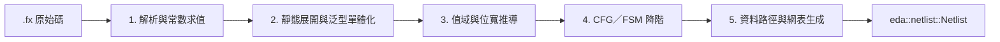

# 7.2 先分清楚兩種「執行」

對軟體工程師而言，`recv` 是一個會令執行緒停住的方法；`send` 是一個可能因佇列滿而等待的方法。硬體卻沒有「一條程式跑到下一行」這件事。在每個時脈邊界，電路同時觀察所有輸入、更新所有暫存器，並決定下一個狀態。

因此，同一個 task 在行為模型與硬體模型中有兩種時間：

| 模型 | 「時間」是什麼 | 等待如何表示 |
| --- | --- | --- |
| 行為模擬 | task 的逐步執行 | 排程器讓 task 阻塞在某個通道操作 |
| 硬體 FSM | 時脈週期 | FSM 保持在等待狀態，直到握手成立 |

例如下面的 task：

```fluxa
task Copy(x: in chan<i8>, y: out chan<i8>) {
    for v in x {
        y.send(v);
    }
}
```

行為模型可以先停在 `recv`，也可以先停在 `send`；另一個 task 可能在這段期間執行。硬體模型則把 task 切成至少兩個等待點：

1. 接收狀態：若 `x` 沒有 token，就保持不動。
2. 傳送狀態：若 `y` 沒有空間，就保持不動。

在傳送狀態裡，複製本身沒有工作；真正的工作是資料路徑把 `v` 接到輸出，以及控制邏輯觀察 `ready`。這種差別正是從 Kahn 程序網路走進同步電路的關鍵。

### 7.2.1 五個階段，而不是一個「編譯器黑箱」

概念上，Fluxa 的硬體前端可以分為五個階段：



| 階段 | 輸入 | 產出 | 最重要的問題 |
| --- | --- | --- | --- |
| 解析與常數求值 | 原始碼 | AST、`const` 值 | 程式在語意上寫了什麼？ |
| 靜態展開 | AST、頂點 task | task 實例、通道端點、FIFO 清單 | 哪些程序與連接在硬體中存在？ |
| 位寬推導 | 型別、值域、運算 | 每個值的硬體型別 | 每條資料線與運算器要多寬？ |
| CFG／FSM 降階 | task body | 基本區塊、終端器、狀態轉移 | 硬體何時能前進？ |
| 網表生成 | CFG、位寬 | 閘、連線、FF、握手埠 | 如何把上述意圖變成電路？ |

這五個階段是**邏輯責任**，不表示實作完全只能由左往右跑一次。例如，未明確宣告型別的變數可能需要反覆做「推導寬度、產生邏輯、發現新值域、再次加寬」的固定點迭代。重要的是知道每個問題由誰回答，而不是把工具輸出的單一網表視為毫無內部結構的成品。

### 7.2.2 三層中介表示

實際工具鏈中的責任可以再細分成三層：

1. **語意層**保留 AST、任務宣告、型別與通道契約。
2. **硬體中間層**把每個 task 降成 CFG：基本區塊、直線式陳述句與終端器。
3. **連線層**是 `eda::netlist::Netlist`，用 bit-level cell、wire、port 與具名 net 描述電路。

後端不需要知道原始碼是用 `if` 還是 `match`，也不需要知道某個通道原本叫 `ta` 還是 `samples`。這讓 FPGA 與 ASIC 後端可以共享同一套網表流程。第 9 章會從這個分界繼續往後走；本章先把焦點放在第二層如何形成。
