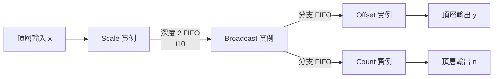

# 7.3 解析、常數求值與靜態展開

### 7.3.1 AST 保存語意，不保存硬體時鐘

Fluxa 前端先把原始碼解析成 AST。`let`、`if`、`match`、`for`、方法呼叫與 task 宣告在這裡仍是語言構造，尚未被假定為「每行一個週期」。

例如：

```fluxa
let mut hist: [i8; 3] @reg = [0; 3];

for s in x {
    let win: [i8; 4] = concat([s], hist);
    hist = win[0..3];
    y.send(win[0]);
}
```

AST 能看出：

- `hist` 是跨迭代保留的 task 區域變數；
- `for` 每次取得一個 `s`；
- `hist` 在迭代內被改寫；
- 最後有一個可能阻塞的通道傳送。

但 AST 尚不能回答 `hist` 需要幾個 FF、`win` 的乘加器多寬，或 `send` 失敗時控制流停在哪裡。這些問題分別留給位寬推導與硬體降階。

`const` 與適合編譯期求值的 `comptime` 運算會在前端先求出。例如：

```fluxa
const TAPS: u8 = 4;
const COEF: [i8; 4] = [3, 5, 5, 3];
```

常數不只是一段「編譯期變數」；它們會影響硬體形狀，例如通道深度、迴圈次數、資料寬度與 ROM 內容。能在早期求出的形狀，越早固定越好，因為後面的靜態檢查與合成都可以直接使用相同結果。

### 7.3.2 頂點 task 與泛型單體化

合成總是從一個具體 task 開始。`--top` 可以明確指定；未指定時，工具會選擇程式中最後宣告的非測試 task：

```sh
reda synth --top Fir4 examples/fir4.fx
```

若 task 宣告 const generic，泛型值必須先固定，才能知道實際的通道深度、陣列長度與資料寬度。合成器會把這組值加入程式的編譯期常數表，再以它解出 task 內的型別與運算式。這一步稱為**單體化**：一個泛型 task 的不同具體化，會得到不同的硬體。

例如：

```fluxa
task Scale<const N: u8>(x: in chan<i8>, y: out chan<i8>) {
    // N 會影響形狀
}
```

`Scale::<4>` 與 `Scale::<16>` 不是同一個電路再靠執行期參數切換，而是兩個已固定的實例化。

目前 type generic 可以在行為模擬中使用，但不能合成。硬體元素寬度若要參數化，應使用 const generic 或明確的值域型別；這是第 2、3 章已建立的邊界。

### 7.3.3 靜態 task 網路如何被發現

一個 task 可能只建立程序網路，自己不處理 token：

```fluxa
task Pipeline(x: in chan<i8>, y: out chan<i11>, n: out chan<u8>) {
    let (ta, ra) = chan::<i10>(depth = 2);
    let outs = broadcast(ra, 2);

    spawn Scale(x, ta, 3);
    spawn Offset(outs[0], y);
    spawn Count(outs[1], n);
}
```

合成 `Pipeline` 時，工具必須知道三件事：

1. 實際會產生哪些 task 實例？
2. 每個實例接到哪些通道？
3. 每條內部通道的深度、元素型別與方向為何？

目前實作利用既有行為模擬器執行「只建立網路」的部分，攔截 `spawn` 與 `broadcast`，取得完整的靜態 spawn tree。這比再寫一套不完整的 spawn 語意更容易保持一致：凡能在編譯期建立的固定迴圈、`comptime` 選擇與 `broadcast`，都會被同一套直譯器記錄。

接著，每個被 spawn 的 task 會各自合成。例如 `Scale` 成為一個含 FSM 與資料路徑的實例，`Offset` 與 `Count` 也各自成為實例；`broadcast` 會展開成一個具有多個輸出端的專用實例。

這種展開只允許固定形狀。若 spawn 次數取決於執行期才取得的值，工具無法替未知數量的實例配置連線，就會明確拒絕，而不會偷偷只產生一個猜測的實例。

### 7.3.4 展開後的硬體拓樸

上例可畫成：



此圖已是硬體拓樸，而不是 Fluxa 函式呼叫圖。`Scale`、`Offset`、`Count` 各自有狀態機；FIFO 儲存 token；廣播器確保兩條分支看見相同序列。合成下一個 task 時，還必須檢查連線兩端的通道方向與元素型別完全相符。

靜態檢查提前排除了錯誤方向、錯誤型別、重複端點所有權與通道守恆問題；到了網表連線階段，合成器仍會再核對一次實際連線。這兩道防線保護的是不同層級：一道看程式結構，一道看真正要放進電路的連線。
