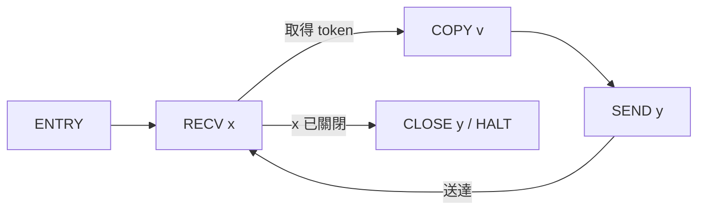

# 7.5 從 task body 到控制流程圖

### 7.5.1 基本區塊與終端器

控制流程圖（Control Flow Graph, CFG）把 task body 分成兩部分：

- **基本區塊（basic block）**：一段直線式程式，內部沒有需要等待的通道操作；
- **終端器（terminator）**：基本區塊最後如何離開。

Fluxa 的硬體降階可把終端器概括為：

| 終端器 | 硬體意義 |
| --- | --- |
| `Goto(next)` | 無條件前往下一狀態 |
| `Branch(cond, yes, no)` | 比較結果選擇兩條路徑 |
| `Recv(dst, ch, next)` | 等待並接收一個 token |
| `Send(ch, value, next)` | 等待並傳送一個 token |
| `Close(ch, next)` | 等待並宣告通道結束 |
| `Halt` | task 停止 |

直線式區塊中的 `let`、算術、比較與純函式呼叫則交給資料路徑生成器。以簡化的 `Copy` 為例，CFG 可以畫成：



這張圖比原始碼多出兩個重要事實：`recv` 與 `send` 都是可能停住的狀態邊界；任務結束前還要把擁有的輸出通道關閉，讓 end-of-stream 沿網路傳遞。

### 7.5.2 為何通道操作不能只是普通函式呼叫

假設把 `recv` 展開成普通函式：

```text
v = receive(ch)
```

它仍需要回答「若 FIFO 是空的，怎麼把控制停在這裡？」若硬體仍往下執行，就可能讀到不存在的資料；若用一個 `has_data` 布林值硬撐過去，又等於偷偷採用 `try_recv` 的非確定語意。

因此 Fluxa 把 `recv` 當成終端器：成功前不進入下一基本區塊。`send` 也一樣；即使輸出 FIFO 有空間，傳送只在握手成立的週期完成，否則 FSM 保持原狀態。

這條規則也讓硬體與第 4、5 章的程序網路語意保持一致：等待只改變「何時前進」，不改變 token 的邏輯次序。

### 7.5.3 表達式中的 `recv` 會被拆出

通道操作有時藏在算術式裡：

```fluxa
acc += a.recv() * b.recv();
```

硬體不能同時完成兩個等待，也不能任意決定先接 `a` 或先接 `b`。降階器依語意求值順序，把接收操作提升成獨立狀態，並用暫存器保存已接收的值。概念上會變成：

```text
RECV a -> tmp_a
RECV b -> tmp_b
COMPUTE acc + tmp_a * tmp_b
```

這個例子也展示了兩種降階的分工：通道操作決定「何時能前進」，算術則在取得兩個運算元後形成資料路徑。若程式改寫成兩個 `let`，閱讀者通常更容易看出等待點；但語意不應因這種表面改寫而改變。

### 7.5.4 接收狀態的四種結果

一個 `recv` 狀態不只有「成功」與「失敗」兩種直覺。還要考慮通道何時關閉：

| 情況 | 硬體動作 |
| --- | --- |
| 通道有 token，`valid && ready` | 接收資料，保存 token，移向下一狀態 |
| 通道暫時沒有 token | 保持接收狀態 |
| 通道已關閉但 FIFO 尚有 token | 先依 FIFO 順序取出既有 token |
| 通道已關閉且 FIFO 已空 | `for v in rx` 結束，進入迴圈出口 |

在硬體介面上，外部通道的 `close` 會和資料一起被接受；內部 FIFO 則用位元記錄是否已關閉。對 `for v in x` 而言，接收終端器會有兩條後繼：「收到 token，執行本體」與「看見 end-of-stream，跳出迴圈」。對單次 `recv()` 而言，關閉後再接收是錯誤條件；硬體介面需要讓測試環境能察覺，而不是把它悄悄當成零值。

### 7.5.5 傳送與關閉是握手中的事件

輸出 task 的 `send` 狀態把資料暫存在輸出資料線上，並以 `valid` 宣告「有 token 要送」。只有接收端讓 `ready` 成立時，token 才真正移動，FSM 才進入下一狀態。

`close` 也需要等待。它不是「立即拉高一個旗號」，而是提出一個 end-of-stream 事件；若對方尚未準備好接收這個事件，FSM 仍停在關閉狀態。這個細節讓關閉與資料遵守同一套 backpressure 規則。

可以把輸出通道想成四組訊號：

```text
data + close：這一筆是資料，還是結束訊號？
valid：目前這一筆有效嗎？
ready：對方現在能接收嗎？
```

第 9 章會把這四組訊號正式稱為串流介面。本章只需要知道：它們是 `send`／`recv` 狀態的硬體投影。
