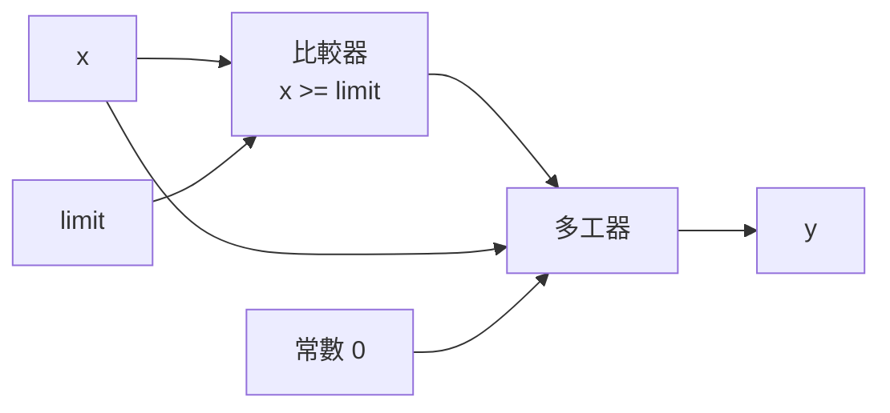

# 7.6 資料路徑：值、分派器與暫存器

控制流說明「何時算」，資料路徑說明「算什麼」。兩者必須對同一組狀態與變數保持一致。

### 7.6.1 直線式運算形成組合邏輯

假設某個狀態包含：

```fluxa
let p = a * b;
let q = p + c;
let d = if p > c { q } else { c };
```

資料路徑生成器會把這段程式建成一條組合網路：

1. `a`、`b` 來自暫存器的 Q 輸出；
2. 一個寬度足夠的乘法器產生 `p`；
3. `p` 與 `c` 進入加法器產生 `q`；
4. 比較器產生 `p > c`；
5. 多工器以比較結果選擇 `q` 或 `c`，產生 `d`。

若 `p`、`q`、`d` 不跨狀態使用，它們可以只是導線，不必各自占一個 FF。若 `p` 必須留到下一個狀態，才需要在時脈邊界把它保存成暫存器。

因此，**原始碼中的 `let` 不等於硬體中的一排觸發器**。它首先是一條資料依賴；是否需要暫存，取決於值的生命週期跨越哪些狀態邊界。

### 7.6.2 條件形成比較器與多工器

`if` 有兩種降階方式，取決於分支是否包含等待點。

#### 純資料分支

若兩個分支都只有算術：

```fluxa
if x >= limit {
    y = x - limit;
} else {
    y = 0;
}
```

控制狀態不必分裂。條件由比較器產生，分支結果由多工器選擇：



若分支只是讓變數取得不同值，生成器也可以分別計算兩條更新路徑，再在暫存器的 D 輸入前以條件選擇。兩者本質相同：條件控制資料選擇。

#### 含通道操作的分支

若分支內會等待：

```fluxa
if x > 0 {
    y.send(x);
} else {
    z.send(0);
}
```

單一多工器不足以描述控制。硬體必須先決定走哪一條分支，再在該分支的接收／傳送狀態等待。基本區塊會分裂，CFG 會有兩條分支路徑，最後在 join 狀態重新合流。

這條界線十分重要：

- **同週期可算完的分支**：比較器加多工器；
- **可能等待的分支**：額外狀態與控制轉移。

### 7.6.3 `match` 是多路比較與選擇

`match` 可視為比較條件的串接：

```fluxa
match opcode {
    0 => result = a + b,
    1 => result = a - b,
    _ => result = 0,
}
```

資料路徑中會有多個比較器，分别判斷 `opcode` 是否等於各個樣式；各 arm 的結果形成候選值，最後由優先順序組成的多工器選出一個。沒有 guard 時，控制邏輯甚至可以完全由資料選擇表示，不必增加 FSM 狀態。

有 guard 或含通道操作時，條件不再只是一個資料位元，而要形成控制分支。降階器會把 scrutinee 評估一次，再將 arm 依優先順序改寫成一串條件分支，避免在每次比較時重新計算表達式。

### 7.6.4 四種狀態，分清它們的用途

初學者常把「狀態」和「變數」混為一談。硬體裡至少有四種不同性質的保存資訊：

| 硬體物件 | 保存什麼 | 典型例子 |
| --- | --- | --- |
| FSM 狀態 FF | 下一個控制步驟 | `RECV`、`SEND`、`COMPUTE` |
| task 變數 FF | 跨狀態仍要用的資料 | FIR 的 `x1`、`x2`、`x3` |
| FIFO entry FF | 已送入但尚未取出的 token | 深度 4 的 `i8` FIFO |
| 暫時組合值 | 目前週期內的計算結果 | `a * b` 的乘積 |

FSM 狀態數增加，不代表資料暫存器一定增加；task 變數很多，也不代表 FSM 一定很大。反過來，若每個基本區塊都有許多跨邊界變數，FF 數可能比狀態碼更早成為面積瓶頸。

### 7.6.5 變數更新形成 D 輸入與 Q 輸出

一個 task 變數 `x` 在硬體上通常是一組 FF：

- `Q` 是目前保存值，供資料路徑讀取；
- `D` 是下一個時脈邊界要載入的值。

若某狀態把 `x` 更新為 `x + 1`，生成器會建立：

```text
D[x] = Q[x] + 1
```

並由「目前狀態是否為該更新狀態」控制。若多個狀態都能更新 `x`，則形成多來源選擇：


$$
D[x] = MUX(state,\; value_{S0}, value_{S1}, \ldots, Q[x])
$$


在沒有更新 `x` 的狀態中，D 端通常維持 Q 值，這就是暫存器的 hold 行為。

「迭代提交」還要再加一層語意。以 `@reg` 為例，同一迭代內讀到的是迭代開始時的舊值，寫入先進入 pending copy，迭代結束時才提交成新值。硬體因此可能有：

- `x`：目前值；
- `x_pending`：本迭代候選值；
- 一個提交動作，把 pending 接到下一個 `x`。

第 8 章會再把 `@reg` 與一般 `let mut`、累加器放在一起比較；本章先理解「迭代結束」為何需要一個明確的時序邊界。
