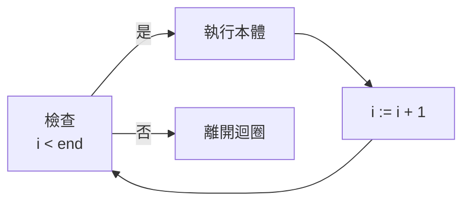
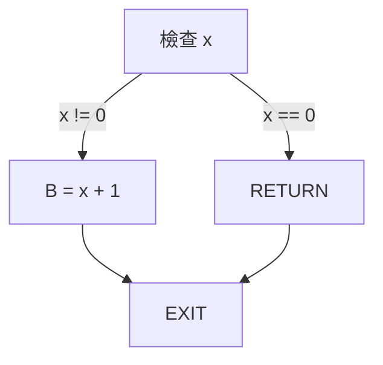

# 7.7 控制流的硬體形狀

### 7.7.1 `return`：跳到 task 的結束狀態

task 內的 `return` 表示提前離開程序。硬體不需要把回傳值放進一般資料路徑，只要讓控制從目前狀態跳到一個共同終止狀態即可。

這個終止狀態還有責任：

1. 關閉 task 仍擁有的輸出通道；
2. 讓狀態機停止前進；
3. 保留必要的 task 結果（若元件契約允許的話）。

以資料流元件而言，更常見的是自然走到 task 尾端，再由終止狀態統一關閉輸出，而不是在每個分支手動關閉。這能降低重複程式碼，也讓 end-of-stream 的時機一致。

必須留意：目前硬體合成子集不支援把 task 的非空回傳值建成一般外部資料埠。資料流元件應優先使用輸出通道表達結果；這也符合第 2 章「通道比 task 回傳值更容易組合」的設計。

### 7.7.2 迴圈有三種可能意圖

同一段 Fluxa 迴圈可能在硬體上具有三種完全不同的解釋。

#### A. 靜態展開

若迭代次數在編譯期已知，而且迭代體不需要等待：

```fluxa
for k in 0..4 {
    p[k] = a[k] * b[k];
}
```

工具可以把四次迭代全部展開，形成四組乘法器與選擇邏輯。FSM 不需要為每輪迭代各設一個狀態；迴圈在硬體上近似一段大型組合網路。

這種解釋適合：

- 次數很少且固定；
- 每輪能做大量並行工作；
- 不依賴執行期才出現的迭代值。

代價是面積隨迭代次數增加。

#### B. 一般循序 FSM

若迴圈要等待通道，或迭代次數取決於執行期值，工具可加入迴圈計數器：



`i` 與 `end` 是跨狀態資料，需要暫存器。每一輪至少跨越一次狀態邊界；本體若含通道操作，還會有更多等待狀態。

#### C. 明確的循序排程

`serial` 排程屬性的意圖，是讓每一輪迭代具有明確時序邊界，而不是試圖把整輪塞進同一個週期。即使迭代體是純算術，這種要求也能阻止工具把它當成大型組合邏輯。

三者的結果值可以完全相同，差別在硬體排程：

| 解釋 | 面積 | 延遲／吞吐 | 適合情境 |
| --- | --- | --- | --- |
| 靜態展開 | 較大 | 延遲低、並行度高 | 固定小迴圈 |
| 一般 FSM | 較小 | 逐輪前進 | 次數未知或需等待 |
| `serial` | 由排程約束決定 | 每輪有明確邊界 | 希望明確控制週期 |

真正追求高吞吐的 `pipeline` 排程留到第 8 章。本章最重要的是看到：語法中的 `for` 本身不保證唯一硬體拓樸；「這輪要做多少工作、何時前進」必須由排程意圖與資源條件共同決定。

### 7.7.3 `for v in channel` 與一般迴圈不同

通道迭代的結束條件不是計數器，而是 end-of-stream：

```fluxa
for v in x {
    // 處理 v
}
```

它的 CFG 至少包含：

- 接收狀態；
- 執行本體的狀態；
- 下一輪回到接收狀態；
- 通道關閉且已清空時的出口。

這個出口不只是一個計數比較，而是通道狀態資訊。因此，通道迭代的硬體控制比固定次數迴圈多了一個「是否看見 close」的判斷。

### 7.7.4 `return` 與分支形成控制圖

一個含提前返回的函式可畫成：



若 `x` 是 task 區域變數，離開分支時要決定 `b` 在 join 點的值。降階器必須用「每條路徑寫了什麼」合併環境：

- 某條路徑沒有改 `b`，就沿用進入分支前的值；
- 兩條路徑都改 `b`，join 點用多工器選擇；
- 一條路徑提前 return，就沒有後續 join 值要合併。

這比一般高階語言的「跳過剩餘程式碼」多了一個硬體問題：資料暫存器在每條控制路徑上都要有明確的下一值。

### 7.7.5 函式呼叫怎麼變成硬體

Fluxa 的一般函式沒有外部副作用，合成時會被**內嵌**到呼叫位置。概念流程是：

1. 依參數建立區域綁定；
2. 把函式 body 內嵌到呼叫者的資料路徑；
3. 以回傳值接到後續運算；
4. 函式內的區域變數若不跨基本區塊，就不必成為 FF。

因此，函式呼叫不像硬體子模組那樣必然有「呼叫堆疊」。只有在語言契約要求保留呼叫邊界，或函式被明確做成 task 實例時，才會出現真正的模組化硬體。

不同函式形式的意義如下：

| 形式 | 合成時的角色 |
| --- | --- |
| `fn` | 依值語意呼叫；可內嵌為組合計算 |
| `comb fn` | 明確要求零狀態、零迴圈的組合邏輯 |
| `comptime fn` | 在編譯期求值，結果影響硬體形狀 |
| `task` | 獨立程序，具有通道、狀態與生命週期 |

目前一般函式在硬體前端以內嵌為主，不會自動變成帶介面的獨立 IP。若元件需要獨立介面、參數化或被多處重複實例化，通常把它寫成 task 或由生成器產生多個 task 實例會更自然。

### 7.7.6 函式內的条件也能形成額外狀態

一般函式若只有算術與條件，條件可用多工器表示。但若函式內含通道操作，它就不再是純值級函式。合成器必須讓控制進入相應的接收或傳送狀態，完成後再回到函式的 continuation。

這也是為什麼語言把 `task` 與 `fn` 分開：`fn` 可以假定「呼叫會在某個時刻完成」，`task` 則必須表達等待、通道契約與生命週期。把阻塞操作偷偷塞進普通函式，會讓「函式回傳值」和「程序何時完成」混在一起。
