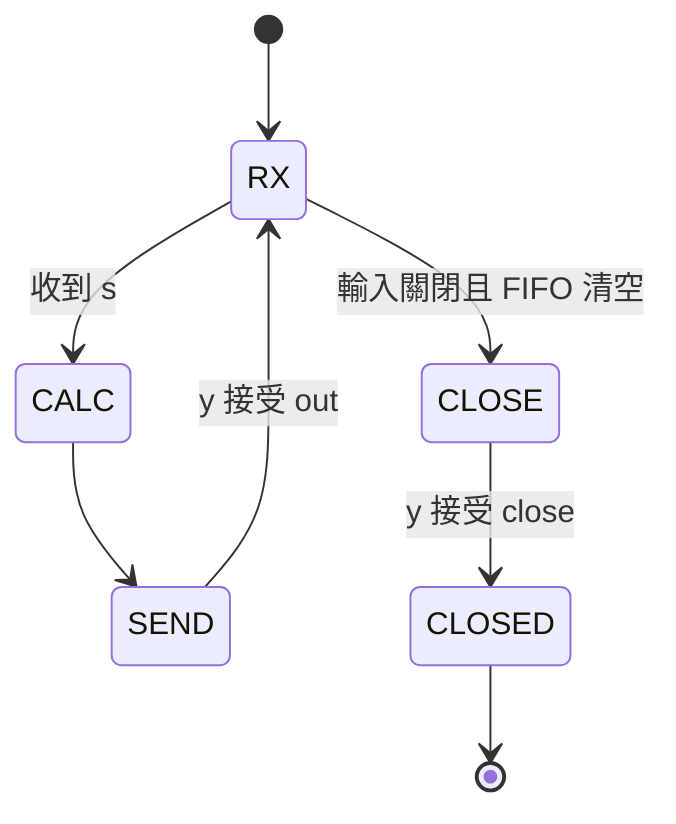
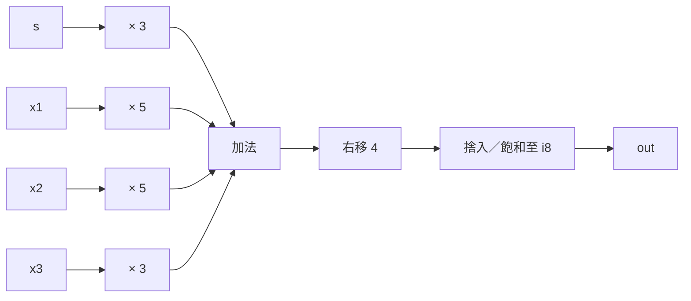

# 7.8 一個 4 階 FIR 的完整降階草圖

現在把前面的概念放到貫穿案例。考慮：

```fluxa
task Fir4(x: in chan<i8>, y: out chan<i8>) {
    let mut x1: i8 @reg = 0;
    let mut x2: i8 @reg = 0;
    let mut x3: i8 @reg = 0;

    for s in x {
        let acc: i16 = 3 * s + 5 * x1 + 5 * x2 + 3 * x3;
        let out: i8 = (acc >> 4).to::<i8>(round = nearest, ovf = sat);
        x3 = x2;
        x2 = x1;
        x1 = s;
        y.send(out);
    }
}
```

### 7.8.1 先讀懂資料契約

在畫 FSM 前，先確認資料依賴：

- `x1`、`x2`、`x3` 分別保存前 1、2、3 個樣本；
- `s` 是目前輸入；
- 四個乘積需要一個 16 位元左右的乘加資料路徑；
- 最後移位、捨入與飽和後送成 `i8`；
- 每收到一個 `s`，才產生一個 `out`；
- `x` 關閉後，輸出 `y` 也必須關閉。

這些資訊分別進入位寬表、FSM、資料暫存器與通道控制，而不是全部塞進同一張「程式流程圖」。

### 7.8.2 基本 FSM

不考慮最佳管線排程時，可用下面的控制骨架理解：



各狀態的責任是：

| 狀態 | 控制責任 | 資料責任 |
| --- | --- | --- |
| `RX` | 等待輸入 token | 把 `s` 接到乘法器輸入 |
| `CALC` | 無條件前進 | 算 `acc`、移位、捨入、飽和 |
| `SEND` | 等待輸出可接受 | 把 `out` 呈現在輸出資料線 |
| `CLOSE` | 等待 close 被接受 | 不傳資料，只送 end-of-stream |
| `CLOSED` | 停止 | 保留必要狀態值 |

若使用 `pipeline(ii = 1)`，工具會把「一輪迭代」嘗試放進更緊密的排程，使輸入與輸出可在適合的週期交錯。排程細節屬於第 8 章，但「接收、計算、傳送、提交歷史」四類工作仍然存在。

### 7.8.3 資料路徑

`CALC` 狀態的資料路徑可畫成：



歷史上 `x3`、`x2`、`x1` 的更新可形成一組移位暫存器：

```text
(x1, x2, x3)_next = (s, x1, x2)
```

但若用了 `@reg`，迭代內讀取舊值、迭代末提交，就要把候選更新與目前值分開，直到迭代邊界才一次提交。這正是 `@reg` 與單純 `let mut` 在硬體上的差異。

### 7.8.4 一個狀態裡有哪些暫存器

FIR 至少需要下列資訊跨越時脈邊界：

- FSM 狀態碼；
- `x1`、`x2`、`x3`，或等价的 pending／目前值；
- 輸出在等待握手時要保持的 `out`；
- 若使用管線，還有各級流水暫存器。

相較之下，下列值不必成為長期 FF：

- `3 * s`：只要在 `CALC` 狀態的組合邏輯中產生；
- 四個乘積的中間加法結果：若不跨狀態使用；
- 比較條件或分支選擇訊號。

這張區分表能幫助我們預估面積，而不是看到四個 `let` 就先假設有四排 FF。
