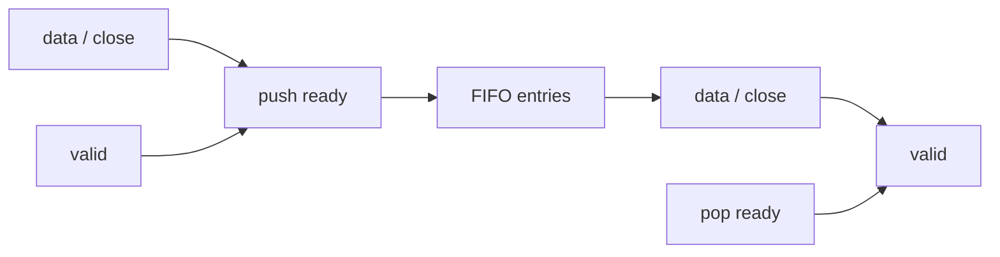

# 7.9 從 task 網路到單一網表

單一 task 的 FSM 與資料路徑生成後，得到的是一個獨立子網表。若頂點 task 會 spawn 其他 task，則還有第二層組合工作。

### 7.9.1 實例、連線與 FIFO

對每個 `spawn`：

1. 產生被 spawn task 的獨立硬體實例；
2. 為其非通道參數代入常數，或在網路層保留成輸入；
3. 將通道端點接到實例的相應埠；
4. 若兩個實例之間有內部通道，建立指定深度的 FIFO；
5. 將頂點 task 自己的通道保留成網路外部介面。

可以把它想成三種連線：

| 連線 | 硬體形式 |
| --- | --- |
| 實例 → 實例 | FIFO |
| 頂點 → 實例 | 頂點串流埠直接接到實例埠 |
| 實例 → 頂點 | 實例串流埠直接接到頂點串流埠 |

目前網路模型要求每條通道只有一個送端和一個接收端。`broadcast` 不是讓多個接收端競爭同一 FIFO，而是建立專門的廣播實例；它先從來源接收，再把每個 token 送往各分支。

### 7.9.2 FIFO 本身也是電路

深度為  $D$ 、token 寬度為  $W$  的 FIFO，不能只畫成一個有深度的方塊。典型結構包含：

-  $D$  個 token entry，每項保存  $W$  個資料位元與 close 位元；
- 寫入指標 `wr`；
- 讀出指標 `rd`；
- 計數器 `count`；
- `full` 與 `empty`；
- push 與 pop 的握手。

概念資料路徑如下：

若 FIFO 滿，push 端不能接受新 token；若空，pop 端不能宣稱有 token。這正是第 4 章 backpressure 的硬體意義。

FIFO 深度不只是「多緩衝一點」。它會增加 entry FF、控制位元與讀寫邏輯。深度過大可以掩蓋模擬中的暫時等待，卻可能在硬體上浪費大量面積。因此，第 4 章強調的 token 契約與背壓分析，不能等到 FPGA 放不下才回頭看。

### 7.9.3 單一網表不是單一 FSM

網路中的每個 task 實例都有自己的 FSM。把它們合成一個網表，不代表所有狀態共用一個狀態暫存器；它代表：

- 各實例的狀態、資料路徑與握手都在同一份連線描述中；
- 內部 FIFO 把它們的埠連起來；
- 整個網路可由同一時脈樹驅動。

這讓 top-level 匯流點非常清楚：`eda::netlist::Netlist` 不知道 Fluxa，但知道 clocks、resets、ports、cells 與 nets。FPGA 與 ASIC 後端從這裡接手，不必重新理解 task 或 channel 的語意。
