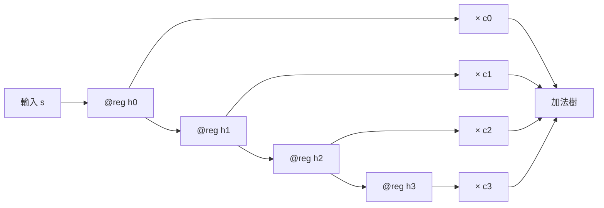

# 8.5 `@reg`：在迭代內讀取舊值

## 8.5.1 一個迴圈裡「上一輪的值」是什麼

FIR 需要保留輸入歷史：

$$
x[n-i],\quad i=0,1,2,3
$$

若用一般可變變數在迴圈中左移，直覺寫法是：

```fluxa
let mut h0 = 0;
let mut h1 = 0;
let mut h2 = 0;
let mut h3 = 0;

for s in input {
    h3 = h2;
    h2 = h1;
    h1 = h0;
    h0 = s;
    out.send(c0 * h0 + c1 * h1 + c2 * h2 + c3 * h3);
}
```

這段程式在軟體裡的行為很清楚，但硬體上有個關鍵問題：這四個賦值在**同一個迭代內**彼此相依。若照程式順序執行，`h3 = h2` 會先讀到舊的 `h2`，接著 `h2 = h1` 又會蓋掉剛才用到的值；編譯器必須證明這些讀取都發生在「本輪開始時」，才能安全地把它們對應成四顆並排的 D 正反器。

`@reg` 把這個語意直接寫進語言：

```fluxa
let mut h0: i8 @reg = 0;
let mut h1: i8 @reg = 0;
let mut h2: i8 @reg = 0;
let mut h3: i8 @reg = 0;

for s in input {
    h3 = h2;
    h2 = h1;
    h1 = h0;
    h0 = s;
    out.send(c0 * h0 + c1 * h1 + c2 * h2 + c3 * h3);
}
```

## 8.5.2 迭代提交語意

Fluxa v1.0 對 `@reg` 的語意是：

- 同一迭代內讀取 `@reg` 變數時，看到的是**迭代開始時**的舊值。
- 迭代內的所有寫入在**迭代結束時**一起提交。
- 下一個迭代才會看到已提交的新值。

用時間軸表示，若第 $n$ 輪輸入為 $s_n$，則：

$$
h_0^{(n+1)} = s_n,\quad
h_1^{(n+1)} = h_0^{(n)},\quad
h_2^{(n+1)} = h_1^{(n)},\quad
h_3^{(n+1)} = h_2^{(n)}
$$

而第 $n$ 輪計算用的是 $h_0^{(n)}, h_1^{(n)}, h_2^{(n)}, h_3^{(n)}$。這正是移位暫存器的行為：四個正反器共用同一個時脈邊界，在邊緣一起更新。



## 8.5.3 `@reg` 與一般 `let mut` 的差別

一般 `let mut` 在同一個迭代內是可觀察的循序狀態：先寫再讀，會看到新值。`@reg` 則刻意把「讀舊值、結束才提交」變成語意的一部分。這個差別不只是風格：

1. **可預測性**：`@reg` 讓「這一輪看到的是上一輪的值」成為語言保證，不依賴編譯器是否夠聰明。
2. **硬體對應**：`@reg` 直接對應正反器與迭代邊界，適合移位暫存器、延遲線與狀態機中的跨步狀態。
3. **靜態檢查**：變數有明確型別時，`reda check` 才能針對跨迭代的落點與值域做分析。

如果只是同一個迭代內的暫存計算，不應該加 `@reg`。把每個變數都標成 `@reg` 只會增加不必要的時序邊界與面積，並讓資料路徑被切成更多段。

## 8.5.4 `@reg` 不會自動解決時序

`@reg` 保證的是語意邊界，不是時序收斂。它把「迭代結束」變成一個可以放正反器的位置，但是否要再插入更多管線階段，仍是資料路徑設計問題。若四個乘法與加法樹在一個時脈內做不完，`@reg` 只會把結果鎖在迭代邊界，並不會替你把組合邏輯切得更短。

因此，看到「每拍一個樣本」的需求時，正確的問題不是「有沒有加 `@reg`」，而是：

- 這個迭代的組合路徑有多長？
- 這條路徑中有哪些值需要在邊界保存？
- 目標裝置的一個時脈週期是否容得下它？

`@reg` 是回答第二個問題的工具，不是第一個與第三個問題的萬用答案。
