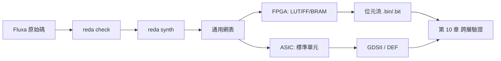

# 9.1 學習目標與全章地圖

前面八章都在回答「如何把一段程式變成一組可合成、可檢查的硬體結構」。這一章要跨過最後一條邊界：**把網表變成真正的晶片或 FPGA 位元流**。

學完本章，你應該能夠：

- 選擇正確的合成頂層 task，並用 `--top` 與 `--param` 固定參數。
- 說明通道參數如何變成 `valid/ready/close` 串流埠。
- 理解內部通道如何變成 FIFO，以及整個 task 網路如何合成成單一網表。
- 讀懂 FPGA 流程的資源、時序與位元流產物。
- 說明 ASIC 流程與 FPGA 流程的相同點與額外風險。
- 從警告與報告回推到型別、拓樸、排程或實作限制。

本章的地圖如下：

這張圖有一個關鍵匯流點：**通用網表**。語言前端不需要知道目標是 iCE40、ECP5 還是 SKY130；後端也不需要知道原始程式是 Fluxa 還是其他語言。只要網表的結構與語意正確，後端就能各自完成映射、佈局與驗證。

本章也會刻意區分「成功產生檔案」與「設計正確」兩件事。產生位元流只代表工具走完了流程；功能是否正確，仍要由模擬與閘級等價驗證回答，這是第 10 章的主題。
