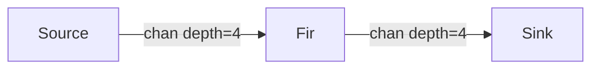

# 9.3 通道如何變成串流埠與 FIFO

## 9.3.1 通道參數的四組埠

在 Fluxa 中，task 的通道參數不是一個抽象指標，而是硬體介面。合成頂層的通道參數 `c` 會展開成四組埠：

| 埠 | 語義 |
| --- | --- |
| `c_data` | token 資料 |
| `c_valid` | 來源端表示有 token 可傳送 |
| `c_ready` | 接收端表示可接受 token |
| `c_close` | 表示此 token 是通道結束訊號 |

token 只在 `c_valid && c_ready` 同時成立時移動：

$$
\text{move} = c_{\text{valid}} \land c_{\text{ready}}
$$

`c_close = 1` 的 token 表示通道結束，其 `c_data` 不承載資料。這個設計把第 4 章的 token 契約直接帶到晶片邊界：關閉不是「丟掉資料」，而是介面上一個獨立的訊號。

## 9.3.2 為什麼不是只有 data 與 enable

只用 `data` 與 `enable` 的介面無法表達背壓。當接收端還沒準備好時，來源端若仍持續改變 `data`，資料就會遺失。`valid/ready` 握手的價值在於它讓雙方都能暫停：

- 來源端沒有 token：`valid = 0`。
- 接收端不能收：`ready = 0`。
- 兩者都成立：該拍完成一次傳輸。

這是一個最小的分散式同步協定。它不保證固定延遲，但保證 token 不會在未握手的情況下消失。

## 9.3.3 內部通道變成 FIFO

top task 內部的通道不是外部埠，而是硬體中的 FIFO。`chan::<T>(depth = d)` 的深度 `d` 決定 FIFO 可暫存多少 token。合成器會：

- 為每條內部通道建立一個 FIFO；
- 把 task 實例的傳送端與接收端連到對應 FIFO；
- 在報告中列出各 FIFO 的閘數。

小型 FIFO 通常由暫存器實作；大型 FIFO 可能改用 block RAM。若 FIFO 的閘數占總閘數至少 30%，合成器會發出警告，提示內部 FIFO 面積過大。這通常表示：

- 深度開得太大；
- 網路中不必要的緩衝太多；
- 某個 task 的生產與消費速率長期不匹配。

## 9.3.4 一個完整的 FIR 網路

以「來源 → FIR → 消費者」為例：

```fluxa
task Source(out: chan<i8> out) {
    for s in samples {
        out.send(s);
    }
    out.close();
}

task Fir(input: chan<i8> in, out: chan<i16> out) {
    pipeline(ii = 1) for s in input {
        out.send(step(s));
    }
    out.close();
}

task Sink(input: chan<i16> in) {
    for y in input {
        consume(y);
    }
}

task Top() {
    let a = chan::<i8>(depth = 4);
    let b = chan::<i16>(depth = 4);
    spawn Source(a.tx);
    spawn Fir(a.rx, b.tx);
    spawn Sink(b.rx);
}
```

合成 `Top` 時，整個 spawn tree 會變成一個網表：三個 task 實例、兩條內部 FIFO，以及頂層的串流埠（若有的話）。



這張圖就是硬體拓樸。程式的結構直接決定網路的形狀；FIFO 深度則是效能與面積的取捨，不會改變 token 的邏輯順序。

## 9.3.5 通道介面也是驗證介面

當通道變成 `valid/ready` 埠之後，測試就不再只是呼叫函式。第 10 章的 `gatesim` 會把網表的串流埠接回原本的測試：來源端依序送 token，接收端比對輸出。因此，通道契約不是只給模擬器看的規格，而是硬體與測試共同的介面。
