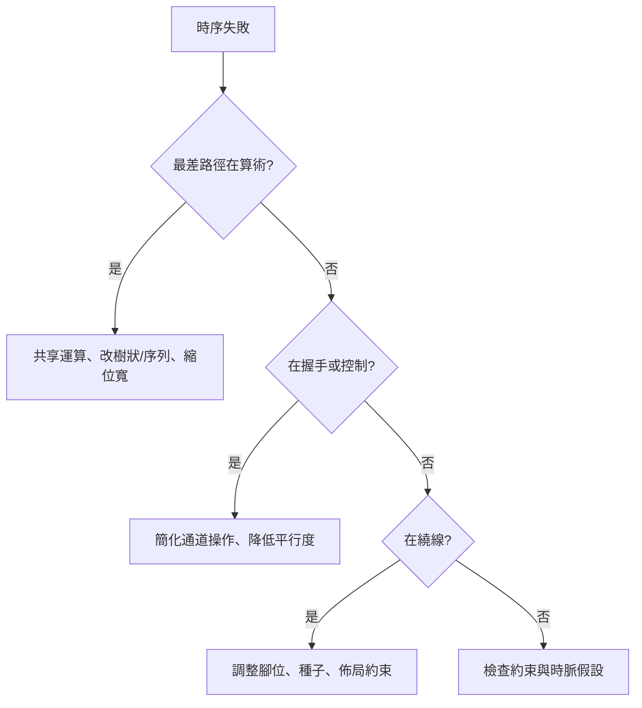

# 9.8 從警告到決策

## 9.8.1 四類不同的訊息

合成與後端工具會產生很多訊息。把它們分成四類，才不會把所有警告都當成同一種問題：

| 類別 | 例子 | 意義 |
| --- | --- | --- |
| 型別／值域 | E0301 | 程式語意可能不安全 |
| 通道／所有權 | E0501、E0702 | 網路契約不成立 |
| 排程／資源 | E0401、E0412 | 硬體結構無法達成要求 |
| 實體／時序 | 時序失敗、DRC、LVS | 後端或目標裝置限制 |

不同類別要回到不同層修正。把 E0401 當成型別錯誤，或把時序失敗當成通道錯誤，都會浪費時間。

## 9.8.2 一個從警告回推的例子

假設 `reda synth` 報告：

```text
warning: FIFO gates are 42% of the total netlist
```

這不是一句「面積有點大」而已。42% 表示內部緩衝占了將近一半的硬體。可能的因果鏈是：

1. 某條通道的生產與消費速率差距很大；
2. 設計者把 FIFO 深度開得很大；
3. 大型 FIFO 被映射成 block RAM；
4. 面積與功耗上升，甚至影響時序。

修正方向可能是降低深度、改變 task 的排程、或把生產與消費拆成不同階段。直接加大 FIFO 只會讓警告更嚴重。

## 9.8.3 時序失敗的決策樹

當時序不通過時，可以依序問：



這棵樹不是保證，而是一種避免亂改的方法：先定位，再只改一個變數，然後重新量測。

## 9.8.4 功能失敗與實體失敗要分開

位元流產生成功、時序也通過，不代表功能正確。反之，時序失敗也不代表功能語意錯誤。這兩類問題要分開處理：

- **功能失敗**：行為模擬、靜態檢查或閘級模擬的結果不一致。回到第 3～8 章的語意與結構。
- **實體失敗**：功能正確，但放不進裝置、跑不到目標頻率或違反實體規則。回到排程、位寬、架構與約束。

把兩者混在一起，就會出現「為了修時序而改了語意」或「功能還沒對就先最佳化」的典型錯誤。

## 9.8.5 每次只改一個決策

後端報告的價值，在於它讓你能做可比較的實驗。一次只改一個決策，例如：

- 只把 FIFO 深度從 32 改成 4；
- 只把依序累加改成平衡樹；
- 只把 `ii` 從 1 放寬到 2；
- 只調整一個腳位。

然後用同一組測試、同一份報告格式重新量測。這樣才能把「結果變好」連回「哪個決策造成改善」。
