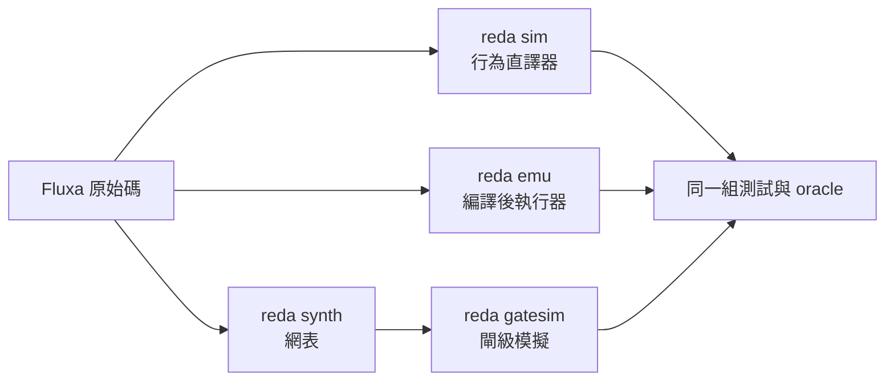

# 10.1 學習目標與三次驗證

## 10.1.1 為什麼「模擬通過」還不夠

一個 Fluxa 設計可能通過行為模擬，卻在合成後行為不同。原因可能有：

- 位寬推導在硬體中與直譯器不同；
- 排程把某些操作重排，改變了可觀察順序；
- 通道 FIFO 深度造成額外等待；
- 後端映射把某個算術運算換成不同的電路。

這些問題不一定會在原始碼層被發現，因為原始碼描述的是語意，而硬體執行的是另一份實作。跨層驗證的目的，就是確認不同層級的實作對同一組測試給出相同結果。

## 10.1.2 三層證據

本書主張用三層證據回答「行為是否一致」：

- `reda sim`：最可讀的行為模型，適合作為 oracle。
- `reda emu`：把 task 編譯成較快的執行器，驗證「編譯後仍然一致」。
- `reda gatesim`：用合成後的網表執行同一組測試，驗證「硬體仍然一致」。

三層都通過，才比較有資格說設計已充分驗證；只通過其中一層，只能說那一層沒問題。

## 10.1.3 學習目標

完成本章後，你應該能夠：

- 說明三種執行引擎各自解決什麼問題；
- 設計可在三層重複執行的測試；
- 比較斷言結果、token 序列、關閉與邊界行為；
- 建立差異測試矩陣並接入 CI；
- 辨認「通過」與「已充分驗證」的差別。

## 10.1.4 本章的版本界線

Fluxa v1.0 已實作行為直譯器、`fluxa-emu` 與多種閘級模擬後端。尚未提供完整的週期精確 `stage` 層與形式屬性證明。因此，本章談的是「以測試與等價比較建立證據」，而不是「用形式方法證明所有可能輸入」。

這個界線很重要：測試通過是必要條件，不是萬能證明。第 10.8 節會專門討論驗證盲點。
