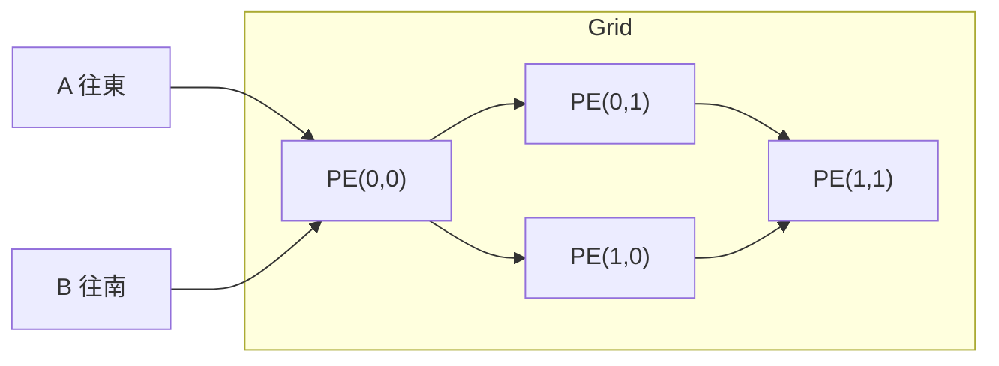

# 11.4 案例三：脈動矩陣乘法

## 11.4.1 規格

計算 `C = A × B`，其中 `A`、`B` 是 `N × N`、row-major 的矩陣：

$$
C_{ij} = \sum_{k=0}^{N-1} A_{ik}B_{kj}
$$

契約：

- `a`、`b` 以 lockstep 輪流讀取：每一輪一個 `a` 值配一個 `b` 值；
- 一組矩陣共 `N·N` 次配對；
- 輸出 `C` 依 row-major 順序；
- 重複直到 `a` 關閉（`b` 同時關閉）；
- 每個輸出元素是 `N` 個乘積之和。

## 11.4.2 為什麼是脈動陣列

脈動陣列把 `N × N` 個運算單元（processing element, PE）排成二維網格：

- `A` 的值往東傳播；
- `B` 的值往南傳播；
- 每個 PE 在自己的位置累加一個乘積。



這種結構的關鍵不是手寫 skew，而是讓阻塞式 `recv` 自然形成斜向波前：每個 PE 等到上游資料可用才前進，整體就形成脈動。

## 11.4.3 PE 的介面

一個 output-stationary PE 大致需要：

- `a_in`、`b_in`：分別來自西邊與北邊；
- `a_out`、`b_out`：往東與往南傳遞；
- 一個本地累加器；
- 一組控制，決定何時輸出與重置。

```fluxa
task Pe(a_in: chan<i8> in, b_in: chan<i8> in,
        a_out: chan<i8> out, b_out: chan<i8> out,
        acc: chan<i32> out) {
    carry sum: i32 = 0;
    for _ in 0..N {
        let a = a_in.recv();
        let b = b_in.recv();
        a_out.send(a);
        b_out.send(b);
        sum += a * b;
    }
    acc.send(sum);
}
```

實際的網路會把每個 PE 的 `a_out` 接到東邊鄰居、`b_out` 接到南邊鄰居，並把累加結果沿著列與行送出。

## 11.4.4 參數化與位寬

`N`、輸入寬 `AW`、輸出寬 `CW` 都應是 const generic：

```fluxa
task Mm4(a: in chan<i8>, b: in chan<i8>, c: out chan<i32>) {
    spawn std::SystolicMatmul::<4, 8, 32>(a, b, c);
}
```

契約要求 `CW` 足以容納 `N` 個乘積之和。若 `AW = 8`、`N = 4`，乘積需要 16 位元，總和需要 18 位元；選 `CW = 32` 很安全，但面積較大。若選 `CW = 16`，必須確認最壞情況不會溢位，或明確接受 wrap。

## 11.4.5 lockstep 與通道深度

因為 `a`、`b` 以 lockstep 讀取，呼叫端必須交錯送出，或給輸入通道足夠的深度。若只有一條通道先送完，PE 會等待另一條，整體吞吐量下降甚至停滯。

這是一個典型的「契約不是只有型別」例子：兩條通道的元素型別都對，但送 token 的節奏錯了，網路仍然不會產生正確結果。

## 11.4.6 測試

測試應包含：

- `N = 2` 的小矩陣，方便人工驗算；
- 全零、單位矩陣、最大元素；
- 多組矩陣連續送入；
- 關閉時是否正確結束。

## 11.4.7 交付摘要

| 欄位 | 內容 |
| --- | --- |
| 頂層 | `Mm4` 或 `MmN` |
| 介面 | `a`、`b`：`chan<i8>`；`c`：`chan<i32>` |
| 契約 | lockstep、row-major、重複直到關閉 |
| 型別 | 乘積 `i16`、總和至少 `i(N+16)` |
| 結構 | `N × N` output-stationary PE |
| 驗證 | sim、gatesim、多組矩陣 |
| 已知限制 | 累加使用 wrap；`CW` 不足時會溢位 |
