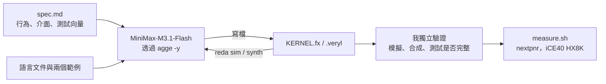

# AI 撰寫硬體實驗：Fluxa 對 Veryl

> 實驗檔案在 [`fluxa/bench/`](../bench/)（規格、腳本、AI 寫出的程式、每次 reda 呼叫的紀錄）。相關：[Fluxa 靜態檢查](../../docs/note/fluxa-static-check.md)、[`reda --format json`](../../docs/note/ai-feedback.md)、[語言規格](Fluxa語言規格v0.1.md)。

## 1. 問題

AI 時代寫程式變便宜，**確認程式是對的**仍然昂貴；硬體又是「錯了不能熱修」的極端。Fluxa 的設計（Kahn 通道、位寬推導、`reda check` 的靜態檢查、同一個 test 跑行為模擬與閘級模擬）把錯誤往前移，理論上應該讓 AI 寫硬體比較可靠。這份實驗用數字檢驗這個說法。

Fluxa 對高階電路有沒有價值？這裡用一個具體的問法回答：**同一個便宜的模型、同一份規格、同樣的回饋工具，寫 Fluxa 和寫 Veryl，哪一個比較寫得出來？寫出來的硬體差多少？**

## 2. 方法



- **5 個核心**（`fluxa/bench/*/spec.md`）：fir4（4 階 FIR）、dot8（8 對內積）、crc32（位元組串流 CRC-32）、sort4（每 4 個排序）、hist（16 格直方圖，用記憶體）。每份規格附上測試向量，期望值由 Python 算出。
- **共用規則**（`common.md`）：兩種語言用同一個 valid / ready / close 串流介面，各自寫出設計和檢查全部向量的測試。
- **參考資料**：Fluxa 給 `docs/manual/tw/17-fluxa.md`、`fluxa/docs/synthesis-plan.md`、`fir4.fx`、`mac.fx`；Veryl 給 `04-veryl.md`、`05-sim.md`、`fifo.veryl`、`seq101.veryl`。
- **執行**：`run.sh LANG KERNEL`。模型用 agge 的 agent 模式（`-y`，能自己跑 shell），每個組合一個獨立的工作目錄（`fluxa/bench/KERNEL/LANG/`），一次只跑一個（MiniMax 的 Token Plan 限制同時的請求）。agge 預設每個 agent 最多 40 步。`bin/reda` 記下每一次 reda 呼叫。
- **驗證**：不論模型回答什麼，我都重新跑模擬與合成，並讀過測試，確認它真的檢查了規格的每一個向量。
- **量測**：`measure.sh`，`reda fpga` 走 nextpnr 佈局繞線，iCE40 HX8K（ct256）。UP5K 的 48 腳封裝放不下 dot8 那麼寬的介面，所以全部用 HX8K。

## 3. 結果

### 3.1 寫得出來嗎

| 核心 | Fluxa | Veryl |
|---|---|---|
| fir4 | ✅ 22 s，3 次 reda | ❌ 930 s，10 次 reda，結束時還有語法錯誤 |
| dot8 | ✅ 137 s，8 次 | ❌ 328 s，7 次，模擬一直失敗 |
| crc32 | ✅ 52 s，3 次 | ✅ 502 s，6 次（第二次執行，見 §4） |
| sort4 | ✅ 83 s，6 次 | ✅ 204 s，4 次 |
| hist | ✅ 30 s，8 次 | ❌ 214 s，7 次，模擬一直失敗 |
| **合計** | **5 / 5** | **2 / 5** |

沒有通過的三個 Veryl 執行，agge 的回答是空的或是一段沒寫完的標籤：這是 agent 達到 40 步上限時的回答形式，研判是步數用完（agge 在 `-q` 模式下不顯示這個警告，沒有直接證據）。

每一份通過的 Fluxa 測試都完整檢查了規格的全部向量；通過的兩份 Veryl 測試台也是。

### 3.2 程式大小（含測試）

| 核心 | Fluxa 行數 | Veryl 行數 | 比例 |
|---|---|---|---|
| fir4 | 30 | 176* | 5.9× |
| dot8 | 48 | 231* | 4.8× |
| crc32 | 85 | 188 | 2.2× |
| sort4 | 81 | 316 | 3.9× |
| hist | 38 | 259* | 6.8× |

\* 沒有通過的版本，是 40 步用完時的檔案。

Veryl 多出來的主要是兩件 Fluxa 替你做掉的事：**valid / ready 握手的狀態機**，以及**測試台一拍一拍地驅動握手**。Fluxa 的 `chan` 與 `send` / `recv` 把兩者都藏起來了，這也是模型在 Veryl 上失敗的地方（fir4、dot8、hist 都卡在模擬時序）。

### 3.3 寫出來的硬體（iCE40 HX8K）

| 實作 | LC | LUT4 | CARRY | DFF | BRAM | Fmax (MHz) |
|---|---|---|---|---|---|---|
| fir4，AI 寫的 Fluxa | 260 | 165 | 47 | 29 | 0 | 224 |
| fir4，Claude Opus 5.5 寫的範例（`fluxa/examples/fir4.fx`） | 191 | 125 | 37 | 29 | 0 | 213 |
| dot8，Fluxa | 1658 | 1521 | 94 | 625 | 0 | 86 |
| crc32，Fluxa | 141 | 139 | 0 | 37 | 0 | 200 |
| crc32，Veryl | 148 | 146 | 0 | 34 | 0 | 179 |
| sort4，Fluxa | 363 | 316 | 35 | 79 | 0 | 67 |
| sort4，Veryl | 298 | 251 | 35 | 48 | 0 | 55 |
| hist，Fluxa | 128 | 120 | 4 | 24 | 1 | 111 |

nextpnr 每次的 Fmax 有約 ±5% 的變動（同一份 `fir4.fx` 量過 222 與 213）。

兩種語言都寫得出來的兩個核心，**面積和速度在同一個量級**：crc32 幾乎一樣，sort4 的 Fluxa 多 22% 面積、但快 22%。所以 Fluxa 的抽象沒有讓硬體明顯變差。

### 3.4 便宜模型寫的 Fluxa 和 Opus 寫的差在哪

`fluxa/examples/` 的範例也是 AI 寫的：Claude Opus 5.5 在開發 Fluxa 時寫的。所以這裡比較的是便宜模型和強模型，不是 AI 和人。

- **不必要的加寬**：fir4 兩個模型（MiniMax、GLM）都把樣本先 `to::<i32>()` 再乘，面積比 Opus 寫的範例多 36%。位寬推導本來就會給出剛好的寬度，加寬反而浪費。這正是 `reda check` 可以補上的提示（目前它只檢查「裝不下」，不檢查「太寬」）。
- **pipeline**：這一輪 MiniMax 在 fir4、dot8、crc32 都用了 `pipeline(ii = 1)`。前一輪 GLM 寫的 dot8 沒有用，結果是 874 LC、26 MHz 的循序電路；MiniMax 的 pipeline 版本是 1658 LC、86 MHz。

## 4. 實驗過程中修掉的工具問題

這個實驗本身就是在測「AI 加上工具」這條鏈，結果鏈上有好幾個環節先斷了：

| 問題 | 修正 | 在哪 |
|---|---|---|
| MiniMax 在長上下文把工具標籤寫壞：`<shell timeout>120">`、屬性寫成子元素、雜訊 `]<]minimax[>[`、開頭少了 `<`（含自閉合標籤），agge 把它當成最終答案而結束 | `tools.repair()` 修回正確格式；還是解析不了的標籤退回給模型重寫 | agge `26f3428`、`5b88712`、`54886d1` |
| 10 個同時跑撞上 MiniMax 的速率限制（429），agge 只等 2 + 4 + 8 秒就放棄 | 429 等 10、20、40、60、60、60 秒，或照 `Retry-After` | agge `5b88712` |
| `reda check` 的 E0501 誤報：AI 寫的 dot8 用 `for x0 in a { … a.recv() … }`，一輪收 8 個，模型卻假設迴圈跑 T(a) 次 | 這種迴圈的次數當作未知 | rueda `3b174a7` |
| NVIDIA 免費端點的 GLM：504、空回覆，每次 10 到 50 分鐘 | 改用 MiniMax；GLM 的結果保留在 `fluxa/bench/glm/` | — |

Veryl crc32 第一次執行時，模型的第一步就寫出 `list_files path="." depth="3"/>`（少了 `<`），被 agge 當成答案而結束。修好 agge 之後重跑一次通過，表 3.1 記的是重跑的結果。其他組合都只跑一次。

## 5. 結論與限制

**結論**：在這組實驗裡，便宜的模型寫 Fluxa 的成功率（5/5）明顯高於 Veryl（2/5），用的時間少、程式短 2 到 7 倍，而兩者都寫得出來時硬體品質相當。差距主要來自**握手協定**：Fluxa 的通道把它從語言裡拿掉了，Veryl 必須在設計和測試台兩邊都手寫，而模型正是在這裡失敗。這支持「Fluxa 是讓 AI 寫硬體比較可靠的語言」的看法。

**限制**（這些都會影響結論的強度）：

- 每個組合只跑一次，只用一個模型。要下確定的結論，需要每組跑多次、換幾個模型。
- 40 步的預算對 Veryl 不利：它需要更多步。給更多步會不會過，還沒試。
- Veryl 的參考資料可能不夠：手冊兩章加兩個範例，裡面沒有 valid / ready 握手的完整範例；Fluxa 的範例（fir4、mac）則跟題目很接近。
- 沒有量**吞吐量**（每個樣本幾個時脈）。Fluxa 用了 `pipeline(ii = 1)` 的核心理論上每拍一筆，但沒有用共同的測試台實測，Veryl 版本的吞吐量也沒量。
- 沒有人寫的對照。唯一的參考版本 `fluxa/examples/fir4.fx` 也是 AI（Claude Opus 5.5）寫的，所以比較的是便宜模型和強模型；Veryl 則完全沒有參考版本。

## 6. 大一點的核心：標準庫的平行模式值不值得做

候選的下一步是在 Fluxa 標準庫用 comptime 做平行模式（`map`、`reduce`、`stencil`、`systolic_matmul`），降階成 task 網路，補上 MLIR `linalg` 那一層的抽象。值不值得做，要看 AI 寫大一點的核心時卡在哪裡。要回答的不是「Fluxa 能不能寫大型核心」，而是：**AI 卡住時，問題出在控制能力，還是網路接線與資源估算？**

### 6.1 實驗

沿用 §2 的方法：MiniMax-M3.1-Flash 透過 agge 執行，一次只跑一個組合。mm4、conv3x3 要跑模擬與合成，步數上限為 40；sha256、tpu4、simt4 只跑 Fluxa 模擬，步數上限為 80。規格在 `fluxa/bench/*/spec.md`，期望值由 Python 參考模型算出：

- **mm4**：4 × 4 矩陣乘法，規定寫成 16 個 PE 實例的脈動陣列（A 往東、B 往南）。
- **conv3x3**：8 × 6 影像串流的 3 × 3 卷積，只能保留兩列 line buffer。
- **sha256**：SHA-256 與比特幣的 SHA-256d 挖礦器；用創世區塊驗證，從答案前 20 個 nonce 開始找。
- **tpu4**：4 × 4 int8 矩陣單元（16 個 PE 任務）加上解碼 LOADW / LOADX / MATMUL（含 ReLU）/ STORE / HALT 的控制任務，跑兩層 MLP。
- **simt4**：4 條 lane 的 SIMT 核心（前端與遮罩堆疊、4 個 lane 任務、記憶體任務），跑 saxpy 和 IF / ELSE 分支發散。

| 核心 | 語言 | 結果 | 行數 | reda 次數 | 時間 |
|---|---|---|---:|---:|---:|
| mm4 | Fluxa | ✅ 模擬與合成通過；網路結構正確，但 nextpnr 放不下 | 319 | 11 | 約 17 分鐘 |
| mm4 | Veryl | ❌ 模擬與合成都失敗 | 993 | 3 | 579 s |
| conv3x3 | Fluxa | ✅ 通過 | 97 | 6 | 466 s |
| conv3x3 | Veryl | ✅ 通過 | 285 | 2 | 173 s |
| sha256 | Fluxa | △「abc」通過；創世區塊挖礦失敗，回傳 `0xFFFFFFFF` | 213 | 7 | 609 s |
| tpu4 | Fluxa | ✅ 模擬通過；網路結構正確 | 261 | 至少 2* | 507 s |
| simt4 | Fluxa | ✅ 第一次嘗試即通過 | 327 | 1 | 918 s |

\* 模型把 trace 輸出改寫進 `reda.log`，覆蓋了原有紀錄，因此只能確定至少有 2 次呼叫。

mm4 的 Fluxa 版本結構正確：16 個 `Pe`、邊界上 8 個吸收多餘值的 `Drain`，以及 `BRow`、`BColumn`、`Feeder`、`Collect`。tpu4 也正確組成 16 個 `Pe`、`Grid` 與 `Controller`。這表示 AI **有能力手寫大型 task network**。

### 6.2 硬體結果

| 實作 | LC | LUT4 | DFF | Fmax (MHz) |
|---|---:|---:|---:|---:|
| conv3x3，Fluxa | 832 | 737 | 348 | 77.5 |
| conv3x3，Veryl | 674 | 581 | 193 | 39.7 |
| mm4，Fluxa | 37,233 | — | 13,647 | — |

conv3x3 的 Fluxa 版本比 Veryl 多用一些邏輯，但 Fmax 較高。

mm4 才是方向 B 真正要解決的問題：37,233 LC 已遠超 HX8K 的 7,680 LC，nextpnr 無法佈置。設計中有 79 條通道，其中 60 條的 depth 被提高到 16。AI 是在反覆處理模擬死結時，把 FIFO depth 一路加大；模擬不會因此變慢或被懲罰，但硬體面積會直接爆掉。

即使把所有 depth 都設成 2，模擬仍會因為 feeding order 需要的深度而死結；改成 2 後仍有 18,644 LC。除了 FIFO，每個 task 自己的控制成本也很高。

### 6.3 sha256 失敗不是語言瓶頸

sha256 的問題是 AI 的演算法錯誤，不是 Fluxa 的限制：

- 80-byte 的區塊標頭必須跨兩個 64-byte SHA block；加上 padding 後應是 128 bytes。
- 模型把整份標頭塞進一個 block，又用長度覆寫 word 15。
- 含有 nonce 的 words 16..19 因此根本沒有被雜湊。
- 「abc」只需要一個 block，所以可以通過。

模型最後是在修改程式時用完步數。這類錯誤要靠規格寫明區塊切分，或給一個參考實作，不是語言功能能解決的。

### 6.4 判斷與建議

結果支持做方向 B，但支持的是**先做固定操作的函式庫生成器**，不是立刻加入泛型的高階語言功能。

1. **先做固定操作生成器，不改語言。** 例如 `systolic_matmul::<N>`、line-buffer stencil。mm4 證明手寫接線可行，但代價是 11 次修改、319 行程式，以及用不必要深度換取模擬通過的網路。生成器可以把 wiring、FIFO depth 與精簡的 PE 一起固定下來。
2. **再考慮編譯期高階參數。** 例如 `map(f)` 需要另外處理函式值、型別與編譯行為，應等固定操作生成器的抽象穩定後再做。
3. **補強檢查與 QoR。** `reda check` 應提示 FIFO depth 遠大於實際需求；工具也應報告 per-task area。網路式設計的合成 QoR 還需要改善，尤其是每個 task 的固定控制成本。

控制密集的設計反而沒有卡住：simt4 包含 mask stack、4 個 lane task、memory task 與 divergent `IF/ELSE`，第一次嘗試就通過；tpu4 的 controller 也能正確解碼 `LOADW`、`LOADX`、`MATMUL`、`STORE`、`HALT`。因此目前的證據不支持「AI 寫不了大型核心」，而是指出真正的瓶頸在**網路接線與資源 sizing**。

### 6.5 限制

- 每個組合只跑一次，只使用 MiniMax-M3.1-Flash，不能據此估計成功率或一般化到其他模型。
- sha256、tpu4、simt4 只有 Fluxa 版本，而且只做模擬，沒有硬體結果。
- mm4 的 Fluxa 執行中，摘要行曾因腳本修改而損壞；表中的資料由 `reda` log 與檔案時間重建。
- 這一輪證明的是固定 operation generator 的價值；`map(f)`、`reduce` 等更高階抽象仍需要獨立實驗。

### 6.6 有了標準庫之後

依照 §6.4 的建議，第一個步驟已完成：新增 `fluxa/sim/std/std.fx`，提供 `std::SystolicMatmul::<N, AW, CW>` 與 `std::Window3x3::<W, H, PW>`，詳見 [std.md](std.md)；語言本身沒有修改。

兩個生成器由 MiniMax 依據 `fluxa/bench/std/spec.md` 草擬兩輪，並經審查。以 `N = 3`、16 位元輸入測試時，發現兩個內部通道被寫死為 `i8`，已修正。

沿用 §6.1 的相同實驗設定，只測 Fluxa，並將 `std.md` 作為額外參考資料；工作目錄分別為 `mm4/fluxa-std` 與 `conv3x3/fluxa-std`。

| 核心 | 沒有標準庫（§6.1） | 有標準庫 |
|---|---|---|
| mm4 | 319 行；11 次 reda；約 17 分鐘；37,233 LC | 33 行；3 次 reda；66 s；18,008 LC；其中一行為 `spawn std::SystolicMatmul::<4, 8, 32>(a, b, c)` |
| conv3x3 | 97 行；6 次 reda；466 s；832 LC；77.5 MHz | 模型沒有使用 `std::Window3x3`，而是自行撰寫：80 行；6 次 reda；100 s；888 LC；88.2 MHz |

兩個實驗最後都通過模擬與合成。

mm4 的接線問題已經消失，不再需要加深 FIFO，所有通道的 depth 都是 2；但 18,008 LC 仍放不下只有 7,680 LC 的 HX8K。成本現在主要來自 PE tasks：每個約 1,162 個通用閘，做成循序狀態機，乘法器用 LUT 實作。因此下一個問題是改善 task synthesis，而不是再由標準庫解決。

conv3x3 是單一串流核心，難度不夠高，模型沒有主動採用標準庫而自行寫出實作。這表示標準庫在接線才是主要難點時才發揮作用。

同時也補了手接網路時用的工具：網路合成現在會依實例與 FIFO 回報閘數（`reda synth --format json` 的 `metrics.gates_by_part`），並在 FIFO 佔總閘數 30% 或以上時發出警告。對 §6.1 中 AI 寫的 mm4，工具會報告 FIFO 佔 56%，並指出 depth 為 16 的通道。

途中也發現兩項行為模擬與合成的不一致，已經修正（兩邊現在用同一條規則、報同樣的錯；範例 `err_chan_type.fx`、`err_wrap_untyped.fx`）：

- `+%` 的左側未指定型別時，行為模擬器會報錯，但合成與閘級模擬都接受。
- 網路合成從通道兩端取得通道寬度，忽略宣告的元素型別；先前將通道寫死為 `i8` 的錯誤因此能通過閘級模擬，卻在行為模擬失敗。

## 7. 如何重現

需要 `reda`（`cargo build --release -p rueda`）、`agge`（設定 `MINIMAX_API_KEY`）、nextpnr-ice40。

```bash
cd fluxa/bench
./run.sh fluxa fir4 minimax                 # 一個組合：模型寫、自己跑 reda，紀錄在 fir4/fluxa/
SIMONLY=1 MAXSTEPS=80 ./run.sh fluxa tpu4 minimax   # 只要求模擬通過，步數上限 80
TAG=std EXTRA=../docs/std.md ./run.sh fluxa mm4 minimax   # 多給標準庫文件，工作目錄 mm4/fluxa-std/
for k in fir4 dot8 crc32 sort4 hist; do for l in fluxa veryl; do ./run.sh $l $k minimax; done; done
./measure.sh fir4/fluxa/fir4.fx Fir4        # 一行 TSV：檔案、LC、LUT4、CARRY、DFF、BRAM、Fmax
```

MiniMax 一次只跑一個組合（同時跑會撞上 HTTP 429）。agge 需要包含工具標籤修復的版本（agge 的 commit `54886d1` 以後）。

## 8. 下一步

1. 每組跑 3 次以上，記錄成功率的分布；再換一個模型（例如 GLM，等端點穩定時）。
2. Veryl 的參考資料補一個 valid / ready 握手的範例，看差距會不會縮小。這可以分辨「語言本身難」和「文件不夠」。
3. 用一個共同的 Verilog 測試台（iverilog）量每個實作的吞吐量與延遲。
4. `reda check` 加一個「位寬過寬」的提示（W 級），針對 §3.4 的加寬問題。
