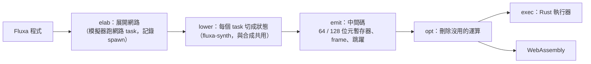

# fluxa-emu：把 Fluxa 編譯成快速模擬器，讓 Linux 跑在 Fluxa 的 RV64 上

## 目標

Veryl 有 veryl-emu（RTL → WebAssembly），Linux 能在瀏覽器裡跑在 Veryl 寫的 Rv64Soc 上；跑馬燈、
俄羅斯方塊、貪食蛇都是那塊開發板上的 Linux 程式。Fluxa 要有一樣的東西：

1. **fluxa-emu**：把 Fluxa 程式編譯成能快速執行的形式（`fluxa/emu`，crate rueda-fluxa-emu）。
2. **Fluxa RV64 開得了 Linux**：和 Rv64Soc 相同的記憶體映射，開同一個 OpenSBI + Linux 映像。
3. **IDE**：Fluxa 版的開發板範例（跑馬燈、俄羅斯方塊……），模擬機可以選 fluxa-emu。

Fluxa 模擬器（`fluxa/sim`）是直譯器：每個運算走一次語法樹（async、boxed future），變數查雜湊表，
值是 `i128` 的 enum，每個 task 是一條執行緒、通道操作要加鎖。RV64 上每秒約一萬個指令，開 Linux 要兩小時。

## 做法

- **和合成共用前半段**：`lower` 把 task 在通道操作處切成狀態。運算式的值域、轉換、常數摺疊照
  `gen`（合成）的規則，但 `gen` 做多工器的地方這裡真的分支：`if` 就是 `if`，用執行期索引的陣列就是一次 load。
- **寬度**：值的範圍決定暫存器是 64 位元（N）還是 128 位元（W）。Fluxa 的整數精確到 120 位元，
  大部分放得進 64 位元；N 暫存器存值除以 2^64 的餘數，正負號看範圍。
- **變數**：task 的變數在 frame 裡（狀態之間保留），一個狀態開始時載入它用到的，結束時存回改過的。
  函式呼叫展開，區域變數是暫存器。
- **通道**：記憶體裡的環形緩衝區（筆數、開頭、關閉、深度，然後是 token）。
- **排程**：每個實例跑到要等通道為止，一輪一輪，直到沒有實例能動。
- **和模擬器一樣嚴格**：落點（有型別的變數、參數、通道）的值超出型別就停（E0301），索引越界、除以零也是。

模擬器是標準答案：`reda emu x.fx` 把程式的 test 照跑，但 task 換成編譯後的版本
（`fluxa::runtime::HwProvider`，和閘級共模擬同一個介面）；`fluxa/emu/tests/agree.rs` 逐個 test 比對。

## 版本

| 版本 | 內容 | 驗證 |
|---|---|---|
| E1 ✓ | crate `fluxa/emu`：elab、emit、opt、Rust 執行器、`reda emu x.fx` | 所有範例、RV32I、RV64（basic、mmu、amo、fp、irq、system）每個 test 與模擬器相同；37 萬條指令的 RV64 迴圈：模擬器 1,247 秒，執行器 30 秒 |
| E2 ✓ | WebAssembly 後端（`wgen.rs`：每個程式碼一個 `step` 函式，`br_table` 跳到狀態；128 位元的乘、移位、除是輔助函式）、Node 測試平台（`fluxa/emu/js/emu.mjs`）、`reda emu -o x.wasm` | `fluxa/emu/tests/wasm.sh`：範例、RV32I、RV64 共 222 台機器，錄下執行器的輸入、輸出 token，wasm 重播後輸出相同；RV64 在 Node 上每秒約 234 萬條指令（Rust 執行器的 17 倍） |
| L1 ✓ | `fluxa/rv64/linux/soc.fx`：Fluxa 寫的 Rv64Soc。`Hart` 一個 task（RV64IMAC + Zicsr + Zicntr + Zifencei + Sstc + Svadu、M / S / U、Sv39、512 項 TLB、RAM、CLINT），照 riscv-emu 的 `cpu.rs`；`Devices`（UART、PLIC、GPIO、關機裝置）照 `bus.rs`；外界（UART 收字、GPIO 輸入）用詢問通道。`boot.mjs` 在 Node 上開機 | `fluxa/rv64/linux/test.sh`：同一個映像（`web/dist/img_linux.js`）開到 busybox shell、執行指令；前 100 萬條指令的 commit log 和 riscv-emu 逐行相同。8,450 萬條指令 9.8 秒（每秒 860 萬條） |
| E3 | 加速：變數留在暫存器、排程 | |
| L2 | IDE：Fluxa 開發板範例、模擬機引擎 fluxa-emu | npm test、瀏覽器實測 |

## 為什麼 Linux 用另一顆 RV64

`fluxa/rv64/rv64.fx` 是 task 串成的管線（Fetch、Decode、Execute、Mem、Fpu、MulDiv），指令 ROM 與資料
記憶體分開（都從位址 0 起），112 個 test 依賴這個映射；每條指令要經過好幾次通道交接，加上三個等待迴圈。
開 Linux 需要和 Rv64Soc 一樣的記憶體映射與 ISA（同一個映像，裝置樹在 OpenSBI 裡），所以 `linux/soc.fx` 是另一顆：
一個 hart task 自己擁有 RAM（像 Veryl 的多週期 Rv64Core），周邊在另一個 task。照 riscv-emu 寫，才能逐條比對 commit log。

## 量測

RV64 的 `Decode` 每條指令要轉三個 `for _ in 0..MAX_INFLIGHT` 的等待迴圈（Fluxa 沒有 `while` / `break`），
每圈至少一個狀態：E1 平均每條指令約 1,700 個運算，其中約三分之一在這些迴圈裡。
這在合成出來的硬體上也是同樣多拍，所以改 RV64（先檢查要不要等）同時讓硬體的 CPI 變小。
