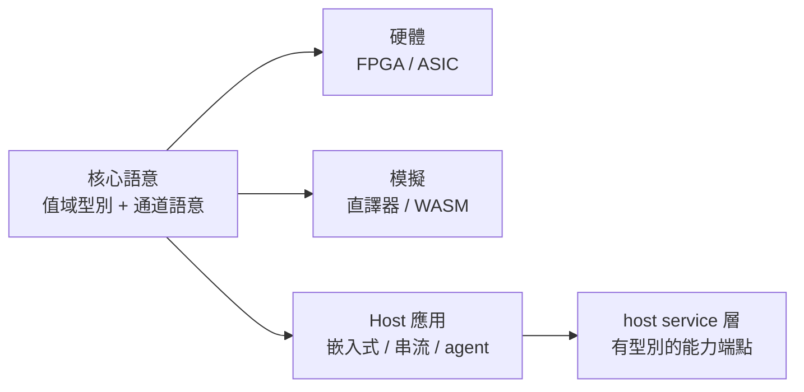

# 02 相鄰領域擴張：把「可驗證的確定性 task 程式」推出去

> 狀態：提案。既有事實以「**既有**」標示，尚未實作的想法以「**提案**」標示。

## 0. 推廣的不是語言，是五個屬性

六個相鄰領域看起來雜，但它們共用的不是語法，而是同一組工程屬性。**這五個屬性才是可攜的資產**：

| 屬性 | Fluxa 現有支撐 | 跨領域意義 |
| --- | --- | --- |
| 確定性 | 兩種排程器必須給出相同結果；task 層禁用 `try_recv`／`empty`／`len`（規格 §7.2、§7.7） | 可重現、可除錯、可回放 |
| 靜態上界 | 有界 FIFO、靜態可展開的 spawn 樹、通道守恆檢查（§6.5、§7.7） | 記憶體與佇列不會無限成長 |
| 精確寬度 | 封閉值域、`carry` 累加分析（規格 §3、§5.4） | 沒有「猜」的整數寬度 |
| 能力隔離 | 線性端點所有權、通道即契約（§7.3） | 誰能讀寫什麼由型別決定 |
| 可重放 | 同一測試在三層結果相同（`../spec/synthesis-plan.md` §2） | 行為可當作證據保存 |

**最大的共通缺口只有一個：host service（外部服務）模型。** 今天 Fluxa 的 task 沒有 I/O（`print` 在合成時被丟棄，規格 §12.3），沒有時間模型（沒有 `tick`、沒有 timeout、`select` 不存在），`spawn` 次數必須靜態可展開。因此：

> 要離開晶片，第一件事是把「檔案、網路、螢幕、感測器、計時器、甚至 LLM」定義成**有型別的外部服務**，用通道端點交給 task；能力因此是型別決定的，而不是約定。

這正是 capability security 的形狀：task 拿到的是一個 `chan<u8>` 端點，不是 root 權限。再加上 record／replay，就能做到「同一份輸入 → 位元級相同的輸出」。細節見 [03](03-共通基礎建設.md)。

---

## 1. 嵌入式／IoT firmware（含車規、功能安全）

**為什麼成立**：現代 MCU firmware 其實**已經是** task + queue 的形狀（FreeRTOS／Zephyr），但缺三樣東西——佇列無界（吃掉記憶體並造成 jitter）、型別只到 `uint32_t`（不是值域）、錯誤在執行期才爆。Fluxa 恰好補這三樣。車規（ISO 26262）在乎的正是「無動態配置 + 可分析時序 + 可追溯」。

一個感測節點天然就是網路：`sample(tick)` → `filter` → `aggregate` → `encode` → `radio`，再加 `flash` 與 `supervisor`（看門狗）。排程靜態、緩衝定長、寬度精確，這三件事在嵌入式領域是直接可宣傳的賣點。

**最小實驗**：挑一個開源感測器 firmware（ESP32／Arduino 級節點），用 Fluxa 重寫 3 個 task（取樣、濾波、封包），保留原 MCU 驅動不動。量測程式大小、切換延遲，以及**靜態檢查有沒有抓到原版的真實 bug**——這是關鍵賣點：不是「我寫得比較漂亮」，而是「我寫的時候被工具抓到你原本會漏的問題」。

**缺什麼**

- I/O 模型：需要 `device`／`service` 宣告（UART、SPI、I2C、ADC 變成有型別的通道端點），合成時映射到真實 peripheral。
- 決定性時間：`tick` channel，以及「本 tick 內無 token 則走 else」的決定性 timeout。
- 記憶體：`mem<T, N>` 現在映射 block RAM（FPGA）；MCU 需要靜態 SRAM 配置模型與 stack／heap 大小估算。
- 沒有浮點：模擬器有 `Float(f64)`，但硬體不支援浮點（規格 §12.3），感測與控制常需要 f64 → 要嘛定點化（嵌入式可行），要嘛明確切「simulation-only 擴充」。

**誰會買**：車電、工業、醫療韌體團隊；以及最在意 WCET 與靜態記憶體的 safety team。

**坑**：功能安全的流程比一般軟體重得多，一次要對方全面改寫不現實；務必先做「單一 task 可熱替換」的最小切口。

---

## 2. 串流／視訊／網路管線（edge AI、影像、封包處理）

**為什麼成立**：FFmpeg／GStreamer／DPDK 本質就是 dataflow，但現有做法普遍有兩個老問題——(a) shutdown／flush 時的 deadlock 與競態；(b) unbounded queue 造成延遲不可預測。Fluxa 的**有界 FIFO + 明確 close 語意 + token 守恆檢查**，恰好把「靠默契」變成「被檢查」。

而且 Fluxa 已經有影像與 ML 的具體零件：`std::Window3x3`（line-buffer 視窗）與 `std::SystolicMatmul`（PE 陣列），見 `../spec/std.md`。

**最小實驗（最有說服力的一個）**：同一條 pipeline 寫一次，編譯成兩個目標——CPU 版走既有的 emu／WASM 路徑，硬體版走 FPGA——然後**用同一組測試比對兩者的 token 序列**。這正是既有的三層等價方法，只是把「層」從模擬器／編譯器／閘級換成「CPU／硬體」。故事變成：「一條影像管線，一份程式，CPU 與 FPGA 兩個目標，行為保證一致。」這對邊緣 AI 團隊是能立刻聽懂的價值主張。

**缺什麼**

- Frame 邊界：現在只有 `close`（end-of-stream），影像需要「一幀結束」的第二種邊界（flush）。
- 速率：token 計數有了，但沒有 bytes/s、FIFO 佔用率、drop policy 的可視化。
- Host I/O：相機／檔案／RTP。
- 背壓語意要寫清楚：來源慢、sink 快時 token 滯留；這在視訊是「丟幀」還是「阻塞」的策略選擇，Fluxa 目前只有阻塞。

**誰會買**：邊緣 AI／影像公司、廣播設備、網路卡（可搭配 DPDK 風格）。

**坑**：不要去和 FFmpeg 搶 codec；賣「你的 pipeline glue 與其部署」，而不是「你的 codec」。

---

## 3. 機器人控制

**為什麼成立**：ROS 2 的痛點是節點動態發現、topic 佇列無界、延遲抖動；而機器人控制迴路最怕「不知道這一拍會不會算完」。Fluxa 提供靜態拓樸與已知速率，可做類似固定優先序的時序分析；通道契約即介面契約，適合跨團隊分工（感知／規劃／控制）。

**最小實驗**：把四層 pipeline（camera → detect → plan → control）用 Fluxa 重寫，控制迴路用定點數，並展示「拓樸與速率在編譯期已知 → 給出每拍的時間上界」。

**缺什麼（這一段最難）**

- **浮點**：機器人研究預設 f64，而 Fluxa 硬體不支援。要做就必須走定點化設計流程（可行，但需要領域專家）。
- **即時優先權／搶占**：目前沒有優先序、搶占、deadline 模型；WCET 論證會缺一塊。
- **ROS 2 整合**：IDL、launch、Python 工具鏈（rviz／plot），工程量不小。
- 感測器與驅動的 host service。

**誰會買**：研究實驗室、機器人新創；但導入成本最高。

**建議**：排在最後。先用「嵌入式／串流」把 host service 與時間模型建好，機器人會自然變簡單。

---

## 4. 編譯器教學（最便宜、最快、產出貢獻者）

**為什麼成立**：這是 Mirage（OCaml）、Futhark、Nix、F18 那一類的經典模式——**用一個小到可以一學期讀完的語言，讓學生從頭做完一整條編譯管線**。Fluxa 的規模正合適，而且教材已經備齊：

| 需要 | Fluxa 已有 |
| --- | --- |
| 語言規格 | `../spec/Fluxa語言規格v1.0.md`（v1.0，章節清楚） |
| 教材 | `../book/`（127 節，含練習） |
| 論文 | `../paper/fluxa-paper.md` |
| 範例 | `fluxa/examples/`（FIR、MAC、conv3x3、gemm…） |
| 一致性測試集 | `fluxa/bench/`（規格 + 向量 + oracle） |

**lab 設計（10 個就夠）**

1. 讀 spec，實作一個 range 型別檢查器（區間算術）。
2. 實作 `carry` 累加範圍分析。
3. 實作 token 守恆檢查。
4. 實作兩種排程器，並驗證兩者結果一致。
5. 實作 FSM 降階（task → 狀態）。
6. 實作 `pipeline(ii = 1)` 模數排程。
7. 實作 FIFO 網路展開。
8. 實作一個 Verilog 後端。
9. 擴充標準庫：寫一個自己的 generator。
10. 用 `bench/` 的 oracle 做自己的語言一致性測試。

**產出**：學生的實作會變成 reference implementation（用來對拍官方實作），學生會變成貢獻者，教授會變成推廣者。這條線的 ROI 最高，而且幾乎不需要新增核心功能。

**風險**：課程品質與維護成本（每年要更新）。緩解：讓 lab 直接使用 repo 內的 spec 與 bench，教材與實作同一份來源。

---

## 5. 形式驗證工具

**為什麼成立（這裡有個被低估的技術亮點）**：Fluxa 的值域語意**本來就是 SMT 可表達的**——封閉區間 + 整數線性算術，正好是 SMT-LIB 的整數與線性算術片段。所以「這個累加器在 16 次迭代後仍安全」這種性質，不只可以被保守區間分析涵蓋，還可以被 Z3 證明；「 $n$ 條通道的 token 守恆 」也可以變成線性算術命題。

另一條路是 **property-as-program**：用 Fluxa 寫 reference model 與 assertion network，再以 gatesim 做「實作 vs 模型」的差異檢驗。現有的差異測試矩陣，本質上就是一個弱化的模型檢查。

**最小實驗**

- 把 `carry` 的累加分析從「保守區間」升級成「區間 + SMT 反例」：找出區間分析無法證明但實際安全的案例，給出證明而非警告。
- 為一個小協定（例如 valid／ready 握手 + close）寫一個 Fluxa reference model，與手寫 Verilog DUT 做差異測試，做成一則 case study。

**缺什麼**

- 時間邏輯：現在只有斷言，沒有 liveness／安全性的時序性質。
- 反例最小化與 GUI（交給 SMT solver）。
- 與現有工具鏈（SymbiYosys、Verilog Formal 等）對接。

**誰會買**：學術（CAV／FMC／LICS）、以及需要「可簽核證據」的團隊。

**風險**：這是研究合作，不是產品路線；建議以與學校合作的方式做，不要自己開戰線。

---

## 6. AI agent 的結構化執行環境（自家人先吃）

**為什麼成立**：今天的 agent 執行環境是「任意 shell + 任意 Python + 非確定性工具」，所以**無法重現一次執行**，也無法證明一個政策不會越權或死鎖。Fluxa 的 task／chan 形狀正好是 capability model：

- 每個能力是一條**有型別的通道**（`chan<u8>` 的檔案讀取端點），而不是一個 root shell；
- 緩衝有界 → 記憶體與流量有靜態上界；
- 排程確定 → 同一輸入序列必然同一行為；
- record／replay → 把模型輸出記錄下來後，執行可位元級重現。

一個關鍵相容性：**agent 的動態性在 task 內的迴圈裡**（何時呼叫哪個工具），**不在 task 的數量上**。所以「模型決定要跑幾次」不違反 Fluxa 的靜態 spawn 限制；只有「模型動態決定要開幾個 worker」才需要設計成受限形式（例如固定 N 個 worker + 通道仲裁）。

**最小實驗**：把自家的 `agge` graph runtime（現在是 Python + threads）用 Fluxa 重寫成**確定性的 agent runtime**：節點 = task、依賴 = 通道、並行度由靜態拓樸決定、失敗節點的處理是明確的迴圈邊界。收益不是「更快」，而是：同一個 graph 的執行可重現、失敗可重播、每次執行都留下可審核的 token 紀錄。

這同時是最有力的 demo：**「我們用自己發明的語言，重寫了我們自己最依賴的工具。」**

**缺什麼**

- host service：檔案、shell、網路、HTTP、LLM 呼叫。
- record／replay host service（記錄模型回應）。
- 預算／燃料（fuel）機制：目前沒有「最多跑幾步」的語言級控制。
- 沙箱：task 的能力隔離已有，但**外部程序**的隔離還要靠 OS／容器層。

**誰會買**：企業 AI 平台（「可審計、可重現、有資源上界的 agent 執行環境」是明確的採購理由）、以及做 agent 基礎設施的新創。

**坑**：agent 領域的迭代速度遠快於硬體；**千萬別讓 agent 需求反過來污染語言核心**——用 service 層隔開。

---

## 7. 建議順序（依 ROI 與風險）

| 順序 | 領域 | 投入 | 為什麼先做 | 成功判準 |
| --- | --- | --- | --- | --- |
| 1 | 編譯教學 | 1–2 個月 | 教材已備齊；產出貢獻者與 reference implementation | 一門課開完；≥3 個外部 PR |
| 2 | AI agent runtime | 2–3 個月 | 自家 dogfooding；敘事最強；同時解決自己「執行不可重現」的痛點 | graph runtime 重寫並可重播 |
| 3 | 串流／邊緣 AI | 2–3 個月 | PMF 最好；既有 std 生成器直接可用；CPU／FPGA 雙目標故事 | 一條 pipeline 雙目標、同一組測試通過 |
| 4 | 嵌入式／功能安全 | 6 個月 | 市場最大；但需 I/O、時間、SRAM 配置、WCET | 一個真實 firmware 節點重寫並上板 |
| 5 | 形式驗證（SMT） | 研究合作 | 技術亮點強；風險是變成研究案 | 一個區間分析無法證明的案例被證明 |
| 6 | 機器人 | 最後 | 缺浮點／即時／ROS2，坑最多 | — |

## 8. 三個 90 天實驗

- **E1 一門課**：用 `../book/` + spec 開一門課，10 個 lab，conformance suite 用 `bench/`；產出 `docs/course/`（講義 + lab + 解答指引）。
- **E2 Host service v0.1**：`service` 宣告 + `tick` + record／replay，讓 Fluxa 程式能和真實世界對談且可重播；demo 用「感測器 pipeline」或「agent 執行器」其一。見 [03](03-共通基礎建設.md)。
- **E3 雙目標 pipeline**：同一條影像／conv3x3 pipeline，CPU（WASM）+ FPGA 雙目標，用同一組測試比對；寫成 demo 短片 + 論文附錄。

## 9. 跨領域的共通原則

1. **不要為了通用而稀釋硬體子集。** 見 [03](03-共通基礎建設.md) §4。
2. **每個領域的第一個里程碑都必須是「用既有工具抓到我原本會漏的問題」**，而不是「我寫得更漂亮」。
3. **可重現性優先於功能。** 領域越通用，越需要 record／replay 與固定種子。
4. **保留核心語意。** 新領域的需求應該被吸收進 host service 層與標準庫，而不是塞進語言核心。

## 10. 相關文件

- [01-推廣策略.md](01-推廣策略.md)：在 IC 設計領域的推廣。
- [03-共通基礎建設.md](03-共通基礎建設.md)：host service、決定性時間、語言不變量。
- `../spec/`：所有既有事實的來源。
