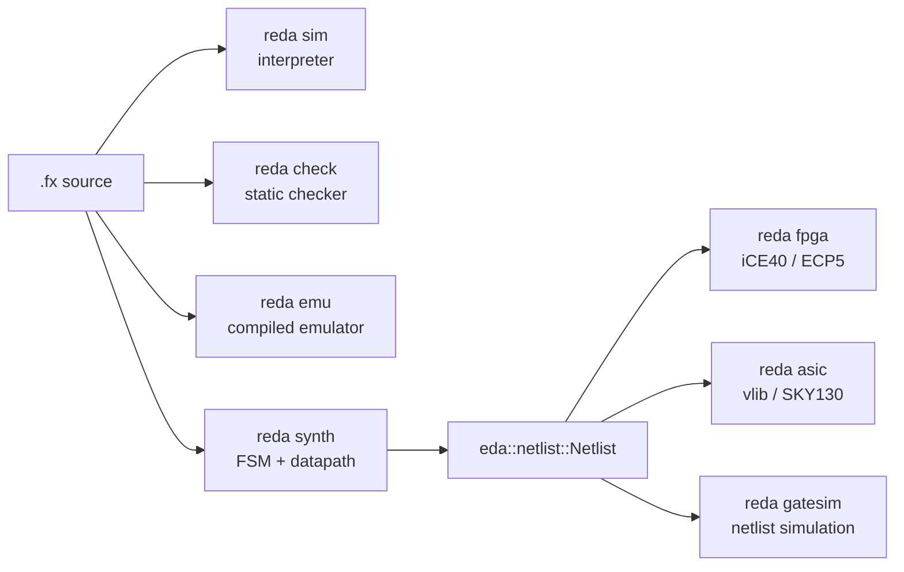
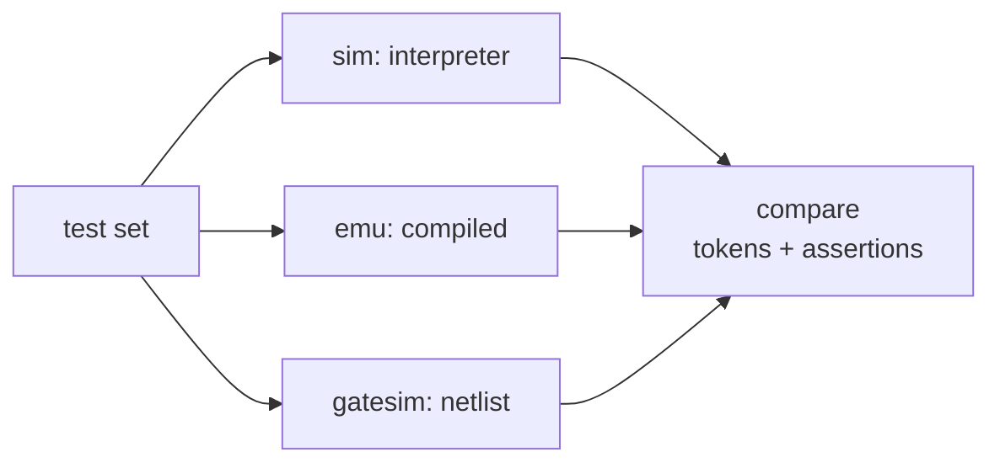

# Fluxa: A Range-Typed, Task-Based High-Level Hardware Language with Cross-Layer Equivalence Verification

**Author:** ccckmit (`ccckmit@gmail.com`) — *rueda: An EDA for IC design, written in Rust*
**Artifact:** <https://github.com/ccc-eda/rueda> (`fluxa/` subtree)
**Version:** Fluxa language specification v1.0 (2026-11-21), `rueda` 0.7.0

---

## Abstract

Hardware design languages force designers to choose between the convenience of software and the precision of hardware. High-level synthesis (HLS) tools narrow this gap, but the resulting designs still rely on implicit conventions — fixed word widths, ad-hoc handshake protocols, and verification performed only on the final netlist. When an AI agent writes hardware, these conventions become the dominant failure mode: models produce plausible code that fails at simulation time or violates a protocol only discoverable after elaboration.

This paper presents **Fluxa**, a hardware description language designed around three commitments. First, *widths are types*: every integer is a closed range, and bit-width inference, narrowing, and accumulator growth are checked by interval arithmetic rather than convention. Second, *concurrency is a process network*: tasks communicate over bounded FIFO channels with linear endpoint ownership, and the language deliberately removes the non-deterministic channel primitives that would break determinism. Third, *verification is layered and mechanical*: the same test set must produce identical results in an interpreter, a compiled emulator, and gate-level simulation of the synthesized netlist, with the toolchain reporting any divergence.

We describe the type system, the task/channel semantics and their determinism properties, the implementation of the interpreter, static checker, synthesizer, compiled emulator, and FPGA/ASIC back ends, and the cross-layer equivalence methodology. We report an empirical study in which a small language model writes five hardware kernels in Fluxa and in Veryl, a sibling RTL language in the same toolchain: the model completed 5/5 kernels in Fluxa versus 2/5 in Veryl, wrote 2.2–6.8× less code, and produced hardware of comparable area and frequency. A follow-up study with larger cores indicates that the remaining bottleneck is network wiring and resource sizing rather than expressiveness. We further report that a standard-library generator for systolic matrix multiplication reduced a hand-written 319-line, 37,233-logic-cell design to 33 lines and 18,008 logic cells.

---

## CCS Concepts

- **Hardware description languages** → Hardware design languages
- **High-level synthesis** → High-level synthesis
- **Type systems** → Language features; Semantics
- **Concurrency** → Synchronization; Formal languages
- **Verification** → Model checking; Testing

**Keywords:** high-level synthesis, bit-precise static analysis, Kahn process networks, interval arithmetic, determinism, cross-layer equivalence, AI-assisted hardware design

---

## 1. Introduction

### 1.1 The verification bottleneck

The economics of hardware design changed when code generation became cheap. Writing a kernel in a hardware language is now a matter of minutes; *proving the kernel is correct* is not. This asymmetry is painful in hardware for a specific reason: a software bug is usually recoverable by patching and redeploying, whereas a hardware bug is baked into a mask or a bitstream. The cost of verification therefore dominates, and any language or tool that moves errors earlier — before synthesis, before layout, and ideally before the code is even written — has outsized value.

### 1.2 The gap in current high-level design

Existing high-level approaches fall into two camps. RTL-adjacent DSLs (Chisel, SpinalHDL, Kissel, Veryl) keep bit-level precision but expose the underlying synchronous protocol: a designer writes a state machine that moves data across a `valid`/`ready` interface, and a test bench must drive that same protocol cycle by cycle. HLS tools (Vitis HLS, Dahlia) let a designer write sequential-looking code and let a compiler decide the micro-architecture, but they keep widths implicit: a C `int` is 32 bits, a narrowing is silent, and overflow is a runtime curiosity rather than a type error.

Both camps share one property that we believe is the main obstacle to AI-assisted hardware design: **the correctness of a design depends on conventions that are not in the type system**. The handshake protocol is not checked by the type system. The word width of an accumulator is not checked by the type system. The number of tokens produced and consumed by two tasks is not checked by the type system. Consequently, an AI agent must infer these conventions from documentation and examples, and when it mis-infers one, the failure surfaces late — at simulation, or worse, after tape-out.

### 1.3 Fluxa's commitments

Fluxa is a hardware description language and toolchain that makes three of these conventions into checked properties.

**Commitment 1 — widths are types.** Every integer in Fluxa carries an exact closed range, not a bit count with a signedness flag. Arithmetic is interval arithmetic; the result range is computed, and if the result does not fit a declared landing site the program is rejected with a diagnostic that names the minimum sufficient type. Narrowing is never implicit: `as`, `wrap`, `sat`, and `to` are distinct operations with distinct contracts, and accumulators use a dedicated `carry` form whose type is checked against the *number of iterations*.

**Commitment 2 — concurrency is a process network.** A `task` is an independent process; tasks exchange tokens over bounded FIFO channels; channel endpoints are linear resources that are moved, not copied, at `spawn`. The non-deterministic primitives (`try_recv`, `empty`, `len`) are removed from task-level code, because they would make a program's observable behavior depend on scheduling. The result is a language whose semantics is that of a Kahn process network: token order within a channel is fixed, FIFO depth changes blocking but not logical order, and two different schedulers must agree.

**Commitment 3 — verification is layered and mechanical.** The toolchain contains three execution engines over one semantics — an interpreter, a compiled emulator, and gate-level simulation of a synthesized netlist — and a single rule: *the same test set must give the same answer in all of them*. The synthesizer is not allowed to silently change behavior; a divergence is a bug in the synthesizer, reported with the token-level difference.

### 1.4 Contributions

1. A closed-range integer type system with interval-arithmetic-based bit-width inference, checked narrowing, and iteration-aware accumulator analysis (§4).
2. A task/channel concurrency model with Kahn process-network determinism, linear endpoint ownership, and token-conservation checking (§5).
3. A hardware interface derivation where channel parameters become `valid`/`ready`/`close` stream ports and internal channels become FIFOs, so that the same abstraction serves simulation, synthesis, and back-end implementation (§6.4).
4. A cross-layer equivalence methodology in which one test set is executed by an interpreter, a compiled emulator, and the synthesized netlist, with divergence treated as a defect (§7).
5. An empirical comparison of AI-authored hardware in Fluxa and Veryl, including hardware quality metrics, plus a study of where the model fails on larger cores (§8).

---

## 2. Background and Related Work

### 2.1 High-level synthesis

HLS tools map sequential-looking source onto pipelined datapaths. Commercial tools such as Xilinx Vitis HLS accept C/C++ and require the designer to specify widths with explicit types such as `ap_int<N>`; academic systems such as Dahlia use a cyclic intermediate representation to expose loop-level scheduling decisions. HLS is powerful when the design is a regular numeric kernel, but its type system inherits C's implicit widths, so numeric edge cases surface as simulation failures or, with insufficient annotation, as silent hardware behavior.

### 2.2 RTL-embedded DSLs

Chisel, SpinalHDL, and Kissel embed hardware construction in a host language, retaining bit-level precision and providing elaboration-time checking. Veryl, implemented in the same toolchain as Fluxa and described in §8.2, is a SystemVerilog generator with a unified semantics model. These systems are excellent for cycle-accurate designs, and they are the natural comparison point for Fluxa because they share a toolchain, a back end, and a verification methodology. Their cost is that the designer writes the protocol: a `ready`/`valid` handshake in the design, and again in the test bench.

### 2.3 Process networks and determinism

Kahn's process networks (1962) model computation as a set of processes communicating over FIFO channels, and are the standard formalism for deterministic dataflow. Fluxa adopts the semantics wholesale (§5), with two departures enforced by the type system: channels are *bounded*, so backpressure exists and deadlock is possible and must be diagnosed; and endpoints are *linear*, so a channel has exactly one consumer unless explicitly broadcast.

### 2.4 Static analysis of bit widths

Bit-width inference by interval arithmetic is well established in HLS, and the specific problem of accumulator growth over loops has been addressed in several systems. Fluxa's contribution is not the technique but its *integration*: width inference, narrowing policy, and accumulator analysis live in one type system that also serves the simulator and the synthesizer, so the number the checker reports is the number the hardware uses.

### 2.5 Ownership for hardware interfaces

Rust's ownership discipline prevents aliasing by making resources non-copyable and moved on transfer. Fluxa applies a restricted form to channel endpoints (§5.3), where the correctness issue is not memory safety but *interface ambiguity*: a channel with two consumers is either a broadcast (which must be explicit) or a defect.

### 2.6 AI-assisted hardware design

Recent work has demonstrated that language models can produce hardware of competitive quality for small cores, and that the bottleneck shifts from code generation to verification and integration. Fluxa's design is aligned with this observation: the language is designed so that an agent's output can be *checked* by mechanical means, and §8 reports an experiment in which this design difference produced a measurable difference in completion rate.

---

## 3. Language Overview

A Fluxa program is a set of top-level items. The core items are:

| Item | Role |
| --- | --- |
| `const` | Compile-time constants, including arrays and range-typed constants |
| `fn` | Value-level functions, executed combinatorially |
| `comb fn` | A function explicitly required to be zero-cycle |
| `comptime fn` | Compile-time computation, usable for parameterization |
| `task` | An independent process communicating over channels |
| `test` | A test harness: a specification of observable behavior |

The canonical example is a four-tap FIR filter expressed as a task over two channels:

```rust
const COEF: [i8; 4] = [1, 2, 3, 4];

task Fir(input: chan<i8> in, out: chan<i16> out) {
    let mut h0: i8 @reg = 0;
    let mut h1: i8 @reg = 0;
    let mut h2: i8 @reg = 0;
    let mut h3: i8 @reg = 0;

    pipeline(ii = 1) for s in input {
        h3 = h2; h2 = h1; h1 = h0; h0 = s;
        let y = (0..4).unrolled()
                        .map(|k| COEF[k] * window(k))
                        .tree_sum();
        out.send(y.sat::<i16>());
    }
    out.close();
}
```

Three properties of this snippet are worth naming, because they are the language's design in miniature:

- The channel types are exact (`chan<i8>`, `chan<i16>`), and the narrowing from the 18-bit exact sum to `i16` is explicit (`sat`).
- The history registers are declared `@reg`, which fixes their iteration-commit semantics (§4.5) rather than leaving it to the elaborator.
- The scheduling intent (`pipeline(ii = 1)`, `unrolled`, `tree_sum`) is written in the source as a *requirement*, not as an optimization request, and the toolchain reports whether the requirement was met.

---

## 4. The Type System

### 4.1 Closed ranges as the only integer model

An integer type in Fluxa is a closed range $[l, h]$ subject to the constraint that $l \le h$ holds. The types `i8` and `u8` denote the ranges $[-128, 127]$ and $[0, 255]$ respectively. The representation of a value is not a storage width but a mathematical set, and the hardware width is derived from the range:

$$
w = \left\lceil \log_2 (h - l + 1) \right\rceil + \begin{cases} 1 & \text{if } l < 0 \\ 0 & \text{otherwise}\end{cases}
$$

Because the range is exact, a program cannot be ambiguous about whether a value is signed, how wide it is, or whether it fits.

### 4.2 Interval arithmetic

Arithmetic is defined on ranges. For addition:

$$
[l_1, h_1] + [l_2, h_2] = [l_1 + l_2,\ h_1 + h_2]
$$

For multiplication, all four endpoint combinations are evaluated:

$$
[l_1, h_1] \times [l_2, h_2] = [\min P,\ \max P], \quad P = \{l_1l_2,\ l_1h_2,\ h_1l_2,\ h_1h_2\}
$$

For division and remainder, the divisor range is required to exclude zero; otherwise the program is rejected with `E0102` (division by zero) at the point of definition, not at run time. Left shift by $k$ scales the range by a factor of $2^k$ and right shift truncates it according to the arithmetic-shift rule.

The result of an expression is a range, and a range may be *widened* only by an explicit conversion (§4.3). This is the mechanism that makes bit-width inference total: every expression has a range without any annotation from the designer.

### 4.3 Landing sites and explicit narrowing

A range may not flow into a landing site that cannot contain it. A landing site is a typed variable, a typed parameter, or a channel element type. Violations produce `E0301`, which reports the source range, the destination type, and the minimum sufficient type:

```text
error[E0301]: value range [-128, 127] does not fit i8? no: fits i16
  help: the smallest type that can hold [-120, 120] is i16
```

Narrowing is always explicit, and the four available forms encode different hardware contracts:

| Form | Contract | Hardware meaning |
| --- | --- | --- |
| `as::<T>()` | Reinterpret; may be lossy | Bit selection / truncation |
| `.wrap::<T>()` | Keep the low bits | Modular arithmetic (free in hardware) |
| `.sat::<T>()` | Clamp to the target bounds | Comparators and a saturator |
| `.to::<T>(round, ovf)` | Explicit rounding and overflow policy | Shift-and-round plus a chosen overflow path |

The distinction is not cosmetic. `wrap` and `sat` produce different hardware, and the specification requires the simulator, the compiler, and the synthesizer to implement the same choice; the toolchain has a regression test that asserts this (§7.2).

### 4.4 Accumulators

Single-operation safety does not imply loop safety: a value added $N$ times may exceed its type even if each addition is individually well-defined. Fluxa therefore provides an explicit accumulator form:

```rust
carry total: i32 = 0;
for s in input {
    total += s;
}
```

If the initial range equals $[a,b]$ and the increment at accumulation point $s$ has range $[\ell_s, h_s]$ with that point executing at most $N_s$ times, then the final range is:

$$
R = \left[\ a + \sum_s N_s \min(\ell_s, 0),\ \ b + \sum_s N_s \max(h_s, 0)\ \right]
$$

and $R$ must be contained in the declared type of the accumulator, otherwise `E0301` is reported with the minimum sufficient type. The same analysis applies to a typed `let mut` accumulator and composes with nested loops, whose iteration bounds multiply. Non-additive self-updates (e.g. `x = x << 1`) are *not* linearized: the checker requires each step to fit the declared type, and the programmer must opt into `wrap` or `sat` if repetition is intended.

This design makes a common HLS failure — an accumulator that is 32 bits wide because "32 bits felt safe" — into a checked, minimal, and reviewable choice.

### 4.5 Iteration semantics of `@reg`

A variable declared `@reg` has *iteration-commit* semantics: within one iteration, reads observe the value at the beginning of the iteration; writes are committed at the end of the iteration and become visible in the next one. This makes a shift register expressible directly:

```text
h3 ← h2 ; h2 ← h1 ; h1 ← h0 ; h0 ← s      (all reads use the values at iteration start)
```

In hardware this corresponds to flip-flops sharing a clock edge, and it removes an entire class of ambiguity about whether an assignment inside a loop reads the old or the new value.

### 4.6 Fixed-point numbers

A fixed-point type is an integer type plus a scale: `fixed<I, F>` stores a value scaled by the factor $2^{-F}$ in binary. Addition aligns fractional widths and extends the result range; multiplication adds both integer and fractional widths. Rounding is an explicit parameter, and overflow after rounding is again an explicit parameter, mirroring the integer case (§4.3). The specification marks the current fixed-point surface as bounded, and the paper does not claim more than the v1.0 subset.

---

## 5. Tasks, Channels, and Determinism

### 5.1 The process-network model

Every `task` is an independent process. A channel is a bounded FIFO with three operations:

| Operation | Behavior |
| --- | --- |
| `tx.send(v)` | Enqueue a token; block if the FIFO is full |
| `rx.recv()` | Dequeue the oldest token; block if the FIFO is empty |
| `tx.close()` | Close the sending side; no further token may be sent |

`for v in rx` consumes all tokens already sent and terminates after observing closure. A task that receives from a channel it does not own, or that sends on a closed channel, is rejected (§5.3).

### 5.2 The determinism property

Fluxa's semantics is Kahn process network semantics. In the absence of deadlock, the following hold:

1. **Order.** Tokens on a single channel are observed in FIFO order.
2. **Depth independence.** FIFO depth changes blocking and throughput, but not the logical token sequence of any channel.
3. **Schedule independence.** The actual interleaving of tasks does not change the logical output sequence.
4. **Layer independence.** The interpreter, the compiled emulator, and gate-level simulation of the synthesized netlist produce identical token sequences for the same test.

Property 2 is what makes FIFO depth a *resource* decision rather than a *semantic* one. In practice, however, the depth is not free: it determines whether the network deadlocks at a given schedule, so the checker also verifies token conservation (§5.5) and the synthesizer reports the gate cost of each FIFO (§6.5).

Property 3 is enforced structurally: `rx.try_recv()`, `rx.empty()`, and `rx.len()` observe the FIFO at an arbitrary instant and therefore depend on scheduling. They are rejected in task-level code and reserved for a `stage` layer that is not implemented in v1.0.

### 5.3 Linear endpoint ownership

A channel endpoint is a linear resource: it is created by `chan::<T>(depth = d)` and moved into a task by `spawn`. After the move, the spawning scope may not use it. Violations produce `E0702` at run time and are detectable statically in many cases.

The purpose is to eliminate a class of interface ambiguity. Without linear endpoints, a channel with two consumers is a plausible-looking program whose meaning depends on which consumer wins the race; with them, a channel has exactly one consumer unless `broadcast` is used, which consumes the source endpoint and creates $n$ receivers that all observe the same token sequence.

```rust
let (tx, rx) = chan::<i8>(depth = 4);
spawn Worker(rx, out_tx);
send(tx, v);   // tx moved; sending on it here is an error
```

### 5.4 Deadlock

If every live task is blocked on a channel operation, the run is in deadlock and the simulator reports `E0701`, listing the live tasks and the channel each is waiting on. Deadlock is a first-class, diagnosable outcome rather than a hang.

### 5.5 Token conservation

The static checker models each channel as two linear equations — one for the producer side and one for the consumer side — and compares the token counts implied by the program. When the counts disagree and the difference could block, the checker reports `E0501`; when tokens remain but the difference fits in the FIFO, it emits the provisional warning `W0503`. This check is conservative: it cannot prove that *every* execution deadlocks, but it catches the common case of a producer and consumer that were written against different assumptions.

### 5.6 Why this matters for AI-generated code

The channel model removes the handshake state machine from the source. A designer — or a model — writes `out.send(y)` rather than a `valid`/`ready` protocol with a four-state FSM and a matching test bench. §8 measures the effect of this difference directly: in the failing Veryl runs, the model consistently stalled on simulation timing of the handshake, not on the algorithms.

---

## 6. Implementation

The toolchain is `rueda`, whose command `reda` provides one subcommand per tool. The language front end produces a gate-level netlist; nothing downstream of the netlist knows the source language.



### 6.1 Interpreter

The interpreter evaluates the AST directly. Values are range-carrying integers (up to 120 bits), variables live in a hash environment, and each task is a native thread with locking channel operations. Two schedulers are provided: a native thread scheduler and a cooperative single-threaded scheduler. The cooperative scheduler exists precisely to test property 3: if the two disagree on any test, the semantics are not deterministic and the bug is a language-level defect.

The interpreter is the *oracle*: it is the most direct expression of the specification, and it is the reference against which the compiler and the synthesizer are validated.

### 6.2 Static checker

The checker performs interval-based type checking, landing-site checks, accumulator analysis, channel contract and token-conservation checks, ownership checks, and a single-bank resource model for pipelined loops. Its diagnostics always contain three parts — location, evidence, and a feasible correction — following the principle that a diagnostic must let the reader act without consulting the manual.

### 6.3 Compiled emulator

`reda emu` reuses the synthesizer's front half: it elaborates the network, lowers each task into states at channel operations, and emits an intermediate code over 64- and 128-bit registers with the channel as a ring buffer. The result runs either on a Rust executor or is emitted as WebAssembly. The emulator is deliberately *not* cycle-accurate: it does not insert registers at hardware timing boundaries, because its purpose is to validate that compilation preserves semantics, not to predict timing.

The compiled emulator shares the elaboration and lowering code with the synthesizer, so a divergence between the interpreter and the emulator localizes to the compiler, and a divergence between the emulator and gate-level simulation localizes to the datapath generation.

### 6.4 Synthesis

Synthesis proceeds in six stages: elaboration (constant evaluation, generic monomorphization, static expansion of the spawn tree, one FIFO per channel), bit-width derivation (the same interval rules as the checker), lowering (each task to a control-flow graph in which channel operations are state boundaries), scheduling (an FSM, plus modular scheduling for `pipeline(ii = n)`), datapath generation, and netlist emission.

A `pipeline(ii = 1)` loop is lowered to a single state that fires in a cycle when all required inputs are valid and all outputs are ready. The structural restriction that follows from this is that one iteration may use each channel at most once, and that a channel operation may not be hidden in a conditional; violating these yields `E0412`, which names the bottleneck. `ii >= 2` currently falls back to an ordinary FSM, which preserves semantics but does not promise a fixed initiation interval of $n$ cycles; the specification states this limitation explicitly rather than leaving it to be discovered.

The hardware interface is derived from the language abstraction:

| Language construct | Hardware realization |
| --- | --- |
| Top-level channel parameter `c` | `c_data`, `c_valid`, `c_ready`, `c_close` ports |
| Non-channel parameter | Input port, unless fixed with `--param NAME=VALUE` |
| Internal `chan<T>(depth = d)` | FIFO of depth $d$ |
| `spawn` tree | One netlist containing all task instances |
| `mem<T, N>` accessed only as `m[i]` | Block RAM (read and write occupy one cycle each) |

A token moves only when `c_valid && c_ready` are both asserted; `c_close` marks end-of-stream and carries no data. This is the standard `valid`/`ready` protocol, but it is *derived* rather than written, and the test bench written against the channel is reused unchanged against the netlist.

### 6.5 Back ends and reporting

The netlist passes to an FPGA flow (iCE40 and ECP5 mapping, placement, routing, bitstream) and an ASIC flow (standard-cell mapping, placement, clock-tree synthesis, routing, timing and power analysis, DRC/LVS, GDSII). The synthesizer reports per-part gate counts, and warns when FIFOs account for at least 30% of total gates — a signal, observed in practice, that a network's buffer depths have been inflated to satisfy simulation rather than the design.

### 6.6 Standard library as generators

The standard library provides parameterizable circuit generators written in Fluxa itself — `std::SystolicMatmul::<N, AW, CW>` and `std::Window3x3::<W, H, PW>` — not as opaque IP but as ordinary task networks that participate in simulation, checking, and synthesis like user code.

---

## 7. Cross-Layer Equivalence Verification

### 7.1 The methodology

The verification rule of the toolchain is:

> For a given program and test set, the token sequences and assertion outcomes produced by the interpreter, the compiled emulator, and gate-level simulation of the synthesized netlist must be identical.



The comparison is at the level of observable behavior — the token sequence on each output channel, the position of closure, and the outcome of every assertion — not at the level of internal timing. This is deliberate: the language does not promise a cycle count, so a cycle-level comparison would compare things the language does not define. It does, however, promise token-level identity, and the toolchain treats any divergence as a defect in the lowering or datapath generation, to be fixed before the design is considered synthesizable.

### 7.2 Practical enforcement

The rule is enforced by the regression suite rather than by inspection. Every synthesizable example is run at all three layers; the emulator has a dedicated agreement test that compares, test by test, against the interpreter, including the RV32I and RV64 processor programs; and a WebAssembly replay test records the executor's inputs and outputs and asserts that the WASM build reproduces them. This is how two classes of implementation divergence were found and fixed during development, both of which had been invisible in behavioral simulation alone: the behavior of the `+%` operator when its left operand was untyped, and the derivation of channel element width from the declared type rather than from the declared width of the channel instance.

### 7.3 What the methodology does not claim

Passing a test set establishes consistency across layers for the tested inputs; it is not a proof of equivalence for all inputs, and the toolchain does not provide formal properties or a cycle-accurate `stage` layer in v1.0. Section 9 discusses the resulting limits on the strength of the claims in this paper.

---

## 8. Evaluation

### 8.1 Method

We evaluate Fluxa along three axes: (i) whether the language is usable by an AI agent without human repair, (ii) the quality of the hardware that results, and (iii) the cost of the verification methodology.

The AI study uses a fixed protocol. Five kernels are specified in `fluxa/bench/*/spec.md` with test vectors computed by an independent Python model: a four-tap FIR (`fir4`), an eight-element dot product (`dot8`), a byte-stream CRC-32 (`crc32`), a four-element sorting network (`sort4`), and a 16-bin histogram using memory (`hist`). A single model (MiniMax-M3.1-Flash, driven through the `agge` agent harness with a 40-step budget) is given the specification, the language documentation, and two examples, and writes both the design and its test bench. The same procedure is applied to Veryl, the sibling RTL language in the same toolchain, with its own documentation and examples. The harness runs one combination at a time (concurrent requests exceed the provider's rate limit) and logs every `reda` invocation. Independently of what the model reports, the authors re-run simulation and synthesis and read every test to confirm that the specification's vectors were actually checked. Hardware metrics are obtained with `nextpnr-ice40` on an iCE40 HX8K.

### 8.2 Completion

| Kernel | Fluxa | Veryl |
| --- | --- | --- |
| `fir4` | pass, 22 s, 3 `reda` calls | fail, 930 s, 10 calls, syntax errors at exit |
| `dot8` | pass, 137 s, 8 calls | fail, 328 s, 7 calls, simulation never converged |
| `crc32` | pass, 52 s, 3 calls | pass, 502 s, 6 calls |
| `sort4` | pass, 83 s, 6 calls | pass, 204 s, 4 calls |
| `hist` | pass, 30 s, 8 calls | fail, 214 s, 7 calls, simulation never converged |
| **Total** | **5 / 5** | **2 / 5** |

The three failing Veryl runs ended with an empty answer or an unfinished tool tag — the shape of an agent that exhausted its step budget. The failures concentrate on simulation timing rather than on the algorithms themselves, which is consistent with the hypothesis that the handshake protocol, not the computational structure, is the dominant obstacle for a model in an RTL-adjacent language.

### 8.3 Source size

| Kernel | Fluxa (lines) | Veryl (lines) | Ratio |
| --- | ---: | ---: | ---: |
| `fir4` | 30 | 176 | 5.9× |
| `dot8` | 48 | 231 | 4.8× |
| `crc32` | 85 | 188 | 2.2× |
| `sort4` | 81 | 316 | 3.9× |
| `hist` | 38 | 259 | 6.8× |

The Veryl surplus is dominated by two artifacts that Fluxa eliminates: the `valid`/`ready` handshake state machine, and the test bench driving that handshake cycle by cycle.

### 8.4 Hardware quality

| Implementation | LC | LUT4 | CARRY | DFF | BRAM | Fmax (MHz) |
| --- | ---: | ---: | ---: | ---: | ---: | ---: |
| `fir4`, model-written Fluxa | 260 | 165 | 47 | 29 | 0 | 224 |
| `fir4`, reference Fluxa example | 191 | 125 | 37 | 29 | 0 | 213 |
| `dot8`, Fluxa | 1658 | 1521 | 94 | 625 | 0 | 86 |
| `crc32`, Fluxa | 141 | 139 | 0 | 37 | 0 | 200 |
| `crc32`, Veryl | 148 | 146 | 0 | 34 | 0 | 179 |
| `sort4`, Fluxa | 363 | 316 | 35 | 79 | 0 | 67 |
| `sort4`, Veryl | 298 | 251 | 35 | 48 | 0 | 55 |
| `hist`, Fluxa | 128 | 120 | 4 | 24 | 1 | 111 |

For the two kernels that both languages completed, hardware quality is comparable: `crc32` is nearly identical, and `sort4` uses 22% more area in Fluxa while running 22% faster. The abstraction does not degrade the hardware.

The gap between the model-written and reference `fir4` is instructive: both cheaper models widened samples to `i32` before multiplying, costing 36% more area than the reference. Width inference already produces the exactly sufficient width; over-widening is waste that the current checker does not flag, since it checks that a value *fits* rather than that it is not *wider than necessary*. Adding a "too wide" diagnostic is a straightforward extension.

### 8.5 Scaling to larger cores

A second study scales to larger designs under the same protocol: `mm4` (a 4×4 systolic matrix multiply specified as 16 processing elements), `conv3x3` (a 3×3 convolution over an 8×6 image stream with a two-line buffer), `sha256`, `tpu4` (a 4×4 int8 matrix unit with a control task), and `simt4` (a four-lane SIMT core with a mask stack and divergent branches).

| Kernel | Language | Result | Lines | `reda` calls | Time |
| --- | --- | --- | ---: | ---: | ---: |
| `mm4` | Fluxa | simulation and synthesis pass; netlist correct but too large for the device | 319 | 11 | ~17 min |
| `mm4` | Veryl | simulation and synthesis fail | 993 | 3 | 579 s |
| `conv3x3` | Fluxa | pass | 97 | 6 | 466 s |
| `conv3x3` | Veryl | pass | 285 | 2 | 173 s |
| `sha256` | Fluxa | `"abc"` passes; genesis-block mining fails | 213 | 7 | 609 s |
| `tpu4` | Fluxa | simulation passes; network structure correct | 261 | ≥2 | 507 s |
| `simt4` | Fluxa | passes on first attempt | 327 | 1 | 918 s |

Three observations follow. First, the model *can* hand-write large task networks: `tpu4` correctly instantiated 16 processing elements with a controller decoding `LOADW`/`LOADX`/`MATMUL`/`STORE`/`HALT`, and `simt4` passed on the first attempt despite mask stacks and divergent control. The evidence therefore does not support "models cannot write large cores"; it points instead at a different bottleneck.

Second, the bottleneck is network wiring and resource sizing. The `mm4` Fluxa design grew to 37,233 logic cells — far beyond the HX8K's 7,680 — and the log shows why: while chasing simulation deadlocks, the model repeatedly increased channel depths, 60 of 79 channels reaching depth 16. Simulation neither slows nor penalizes this, but the hardware cost is immediate. The synthesizer's FIFO-area warning (§6.5) reports 56% of the gates in FIFOs for that design, which is exactly the signal needed to catch this class of mistake.

Third, the `sha256` failure is an algorithmic error, not a language limitation: the model packed an 80-byte block header into a single 64-byte block, so words 16–19 containing the nonce were never hashed. The single-block `"abc"` case passed, which is consistent with that diagnosis. Such failures require better specification or a reference implementation, not new language features.

### 8.6 Standard-library generators

The first step suggested by the previous study was to fix the wiring problem rather than the language. The standard library now provides `std::SystolicMatmul::<N, AW, CW>` and `std::Window3x3::<W, H, PW>`, written in Fluxa and shipped as ordinary task networks.

| `mm4` implementation | Lines | `reda` calls | Time | LC |
| --- | ---: | ---: | ---: | ---: |
| hand-written by the model | 319 | 11 | ~17 min | 37,233 |
| using the generator | 33 | 3 | 66 s | 18,008 |

The generator eliminates the wiring problem outright: all channel depths return to 2, and the design halves in area. It does not make the design fit the HX8K; the remaining cost is the per-processing-element control (about 1,162 generic gates each, implemented as sequential state machines with LUT multipliers), which is a task-synthesis quality issue rather than a network issue. The `conv3x3` model did not adopt the generator — the task was a single streaming core, and the wiring difficulty that motivates the generator was absent — and wrote its own 80-line implementation instead, at 888 LC and 88.2 MHz.

### 8.7 Cost of the verification methodology

| Engine | Simulates | Node | Browser | Time to shell |
| --- | --- | ---: | ---: | ---: |
| `veryl-emu` | RTL, every clock cycle | ~4.2 M cycles/s | ~1.2 M instr/s | ~55 s |
| `fluxa-emu` | behavior, tasks compiled to states | ~14 M instr/s | ~5 M instr/s | ~6–8 s |
| `riscv-emu` | instruction set only | ~54–67 M instr/s | similar | ~1–2 s |

The three engines simulate at different layers, so the comparison is about cost of verification, not about speed of one simulator. `fluxa-emu` is a behavior-level engine: it executes the same Linux image as the other two, but because Fluxa describes tasks rather than per-clock registers, there is less to recompute per instruction. The verifier's cost therefore scales with the *behavioral* complexity of the design rather than with its gate count, which is why the same test set can be run at all three layers within a CI budget.

### 8.8 Synthesis results on large designs

| Design | Technology | Result |
| --- | --- | --- |
| 16-tap FIR | SKY130 | GDSII produced; 38 MHz; DRC clean; LVS matches |
| 4-tap FIR | iCE40 UP5K | 191 cells; 77 MHz; bitstream produced |
| RV32I core (network of tasks) | ECP5-85 | 24,743 LUT4, 5,516 FF (29% of the 85k device); 24 tests pass under `opt` and iCE40 gate-level simulation |
| RV64G system-on-chip | ECP5-85 | 72,834 LUT positions (87%), 12,179 FF, 32 DP16KD; 8.35 MHz; longest path in decode (126 LUT levels) |

The RV32I case is the strongest end-to-end evidence for the paper's central claim: a design whose components are separate tasks, communicating only through channels, synthesizes to a *single* netlist whose behavior is checked by the *same* tests that checked the source. The RV64G case also exposes the current limit of the approach: the synthesizer does not yet insert registers on long task paths automatically, so a 126-LUT-level decode path dominates the timing budget — a scheduling problem in the back end, not a semantic one.

---

## 9. Threats to Validity

We state these explicitly because several of them bound the strength of the AI results.

**Single-run, single-model.** Each AI combination was run once with one model, so §8.2–§8.4 report a sample of one. The difference between 5/5 and 2/5 is suggestive, not a confidence interval.

**Step budget asymmetry.** The 40-step budget favors the language with fewer protocol-level steps. A larger budget might change the Veryl results; this was not measured.

**Reference-material asymmetry.** The model was given two chapters and two examples for Veryl and, for Fluxa, documentation plus two examples closely related to the assigned kernels. The difference in outcome therefore confounds language difficulty with documentation quality. The most direct evidence that the protocol is the operative factor is the failure mode itself: the failing Veryl runs stalled in simulation timing, not in algorithm design.

**No human-written control.** The only reference implementation of `fir4` was itself written by an AI (a stronger model) during language development, so the "model vs. reference" comparison in §8.4 contrasts a cheap model with a strong model, not a model with a human.

**Unmeasured throughput.** The studies did not measure samples per cycle with a common test bench, so the `pipeline(ii = 1)` claim is supported by structure and by the synthesis schedule, but not by a throughput measurement.

**Equivalence is test-based.** §7 establishes consistency across layers on the tested inputs; it does not constitute a proof for all inputs, and the toolchain provides no formal properties in v1.0.

---

## 10. Discussion

**What the language makes checkable.** The three commitments are mutually reinforcing rather than independent. Closed ranges make the hardware's word width a *derived* quantity, so the synthesizer cannot disagree with the checker about it. Linear endpoints make a channel's consumer unique, so token conservation is a well-posed question. Determinism makes "the same test" a meaningful notion across three engines, so cross-layer equivalence is a checkable claim. Removing any one of the three weakens the others: without determinism, gate-level simulation results depend on how the netlist is driven; without exact widths, the equivalence check cannot distinguish a width bug from a protocol bug.

**Where the remaining difficulty lies.** §8.5 is instructive in a way we did not anticipate. The model was not blocked by expressiveness: it built 16-element systolic arrays and SIMT cores with divergent control. It was blocked by *sizing* — by not knowing that increasing a FIFO depth is free in simulation and expensive in silicon, and by the sheer labor of wiring a network by hand. This motivated a design response (generators, per-part area reporting, FIFO-area warnings) rather than a language response, which we think is the right order of operations: the language should make semantics checkable, and generators should handle the parts of design that are labor rather than semantics.

**The verification cost scales with behavior.** Because Fluxa programs describe tasks and channels rather than per-clock registers, the compiled emulator and the gate-level simulator operate on much smaller artifacts than an equivalent RTL design would. The consequence is that a three-layer verification loop is affordable, which is what makes the "verification is expensive" premise of §1.1 addressable in practice.

**Toward AI-driven hardware engineering.** The evidence in §8 suggests a division of labor: models are well suited to producing candidate networks and test vectors, and the language's static checks and cross-layer equivalence provide the objective signal needed to accept or reject them. The remaining human-judgment decisions — bit-width policy, topology, scheduling, and interface — are exactly the decisions that the checker reports evidence for but cannot make.

---

## 11. Future Work

- **Width diagnostics.** Report over-wide values, not only values that do not fit; over-widening was the largest avoidable area cost observed in §8.4.
- **Depth diagnostics.** Warn when a FIFO depth exceeds what the program's own token accounting requires, which would have caught the `mm4` failure mode at the moment it was introduced.
- **Better task synthesis.** Per-task control overhead dominates the area of network designs (§8.6); automatic path-based register insertion in the back end would address the RV64G timing result in §8.8.
- **Higher-level generators.** The study supports fixed-operation generators first and only then higher-order parameterization (`map(f)`, `reduce`), which requires additional treatment of function values and generic inference.
- **Statistical repetition.** Repeating the AI studies across models and multiple runs to replace single samples with distributions.
- **Formal properties.** A `stage` layer with explicit validity intervals would permit cycle-accurate reasoning and would let the equivalence rule of §7 be strengthened toward a property rather than a test.

---

## 12. Conclusion

Fluxa treats hardware design as a problem of *checked abstraction* rather than of annotation. Widths are derived from exact ranges; concurrency is a process network with linear resources and no schedule-dependent primitives; and the same specification is executed at three levels of abstraction with disagreement treated as a defect. The toolchain realizes all three in a single Rust code base — interpreter, static checker, compiler, synthesizer, and FPGA/ASIC back ends — with a gate-level netlist as the only boundary between language and technology.

The empirical results support the design thesis in the setting where it matters most. A small language model, given the same budget, completed all five assigned kernels in Fluxa and two in Veryl, wrote 2.2–6.8× less code, and produced hardware of comparable area and frequency. Larger cores exposed the true remaining bottleneck as network wiring and resource sizing, which standard-library generators addressed by halving area and reducing the model's effort by an order of magnitude. The broader lesson is that for AI-assisted hardware engineering, the productive investment is not in making the language easier to write, but in making the language's *promises* mechanically checkable.

---

## Appendix A. Diagnostics

| Code | Status | Meaning |
| --- | --- | --- |
| `E0102` | implemented | Divisor range includes zero |
| `E0301` | implemented | Value does not fit the landing site; or accumulator/carry overflow |
| `E0401` | implemented | One iteration of a pipelined loop exceeds available resource ports |
| `E0412` | implemented | `pipeline(ii = n)` cannot be met; the bottleneck is named |
| `E0501` | implemented | Token counts on a channel are not conserved and the difference can block |
| `W0503` | provisional | Tokens remain on a channel; not necessarily a deadlock |
| `E0701` | provisional | Runtime deadlock; live tasks and awaited channels are listed |
| `E0702` | provisional | Endpoint ownership violation |
| `E0703` | provisional | Index out of range |

Each diagnostic carries a location, the evidence (values, ranges, channel deltas, resource usage), and a feasible correction.

## Appendix B. Reproducing the Results

```sh
# Build the toolchain
cargo build --release -p rueda

# Static analysis, behavior, and hardware
reda check   fluxa/examples/fir4.fx
reda sim     fluxa/examples/fir4.fx
reda emu     --top Fir fluxa/examples/fir4.fx
reda synth   --top Fir fluxa/examples/fir4.fx
reda gatesim ice40 --top Fir fluxa/examples/fir4.fx
reda fpga    --top Fir --pcf pins.pcf --bin fir4.bin fluxa/examples/fir4.fx
reda asic    --top Fir --pdk sky130 --gds fir4.gds --def fir4.def fluxa/examples/fir4.fx

# AI study
cd fluxa/bench
./run.sh fluxa fir4 minimax
./measure.sh fir4/fluxa/fir4.fx Fir4
```

The AI experiments require a model provider key and `agge`; the toolchain experiments require only `cargo` and, for the FPGA numbers, `nextpnr-ice40`.

## Appendix C. Artifact Map

| Path | Contents |
| --- | --- |
| `fluxa/docs/spec/Fluxa語言規格v1.0.md` | Language specification v1.0 |
| `fluxa/docs/spec/synthesis-plan.md` | Synthesis architecture and milestone log |
| `fluxa/docs/spec/emu-plan.md` | Compiled-emulator design and measurements |
| `fluxa/docs/spec/ai-bench.md` | Full AI experiment report, including the larger-core study |
| `fluxa/docs/spec/std.md` | Standard-library generator contracts and area measurements |
| `fluxa/bench/` | Experiment harness, specifications, and per-run logs |
| `fluxa/examples/` | Language examples used as synthesis and verification targets |
| `fluxa/docs/book/` | Tutorial book deriving from the same specification |
| `fluxa/docs/idea/` | Project strategy: adoption in the IC design community, and expansion of the language's semantics into adjacent domains |

---

*All measurements in this paper are produced by the commands in Appendix B on the `rueda` 0.7.0 workspace. Numbers attributed to the AI study are those recorded in `fluxa/docs/spec/ai-bench.md`; `nextpnr` frequency figures vary by roughly ±5% between runs on an unloaded machine.*
