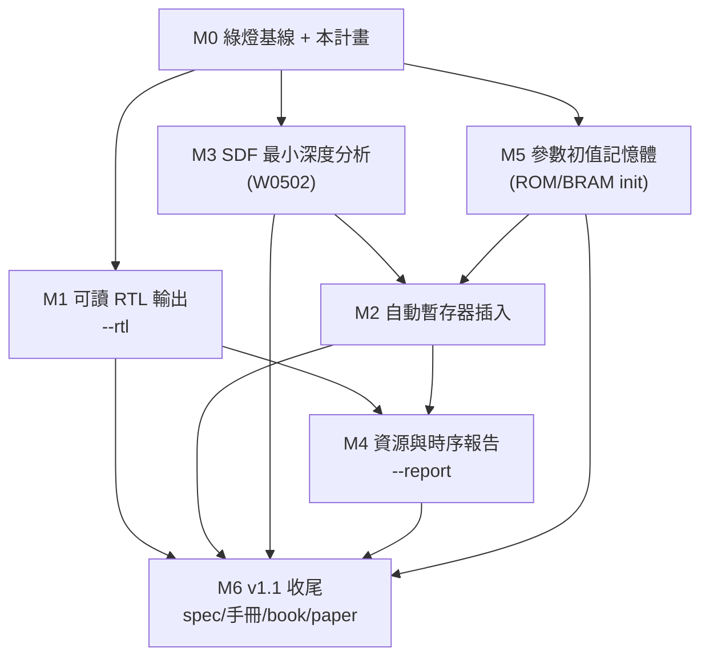

# Fluxa v1.1 計畫（分支 `fluxa_next`）

版本 1.1｜規劃於 2026-11-21｜分支 `fluxa_next`｜對應工具版本 `rueda` 0.8.0

本文件是 `fluxa_next` 分支的延伸版本計畫。它承接 `synthesis-plan.md`（F1–F9 已完成）、`emu-plan.md`（E1–E3b 已完成）與 `Fluxa語言規格v1.0.md`，並把 `../idea/` 的三份策略文件（推廣策略、相鄰領域擴張、共通基礎建設）轉成可執行的工作項。

## 0. 這一版要做什麼

**主題：讓 Fluxa 接得進既有流程。**

v1.0 已經能證明「Fluxa 寫的硬體是對的」（sim／emu／gatesim 三層等價），也證明「AI 真的能用 Fluxa 寫硬體」（`ai-bench.md`）。但它還不能回答兩個現實問題：

1. **設計師的硬體怎麼進我的流程？** 現在只有閘級網表，沒有可讀的 RTL，也沒有插入暫存器後的效能數字。
2. **我怎麼知道這份設計長什麼樣？** 沒有資源報告，CI 與 agent 無法比較兩個版本的代價。

因此 v1.1 的主線是四件事：**可讀 RTL 輸出、自動暫存器插入、資源報告、SDF 最小深度分析**。

### 0.1 語言相容性保證

**v1.1 不新增任何語言特性。** 語言核心（封閉值域、確定性排程、線性端點、靜態 spawn、硬體無浮點）完全維持 v1.0 的樣子。變化全部在工具鏈：

| 類型 | v1.1 的變化 |
| --- | --- |
| 新增工具選項 | `reda synth --rtl FILE`、`reda synth --report`（或擴充 `--format json`）、`--pipeline-insert` |
| 新增工具輸出 | 可讀 SystemVerilog RTL、資源與時序報告 |
| 新增診斷 | W0502（通道最小深度不足導致吞吐下降）、W0504（路徑過長，建議插入暫存器） |
| 語言語意 | **不變** |

理由見 `../idea/03-共通基礎建設.md` §4：一旦為了通用而稀釋硬體子集，Fluxa 就會變成「C/C++ + 合成子集」。語言擴張留給 v1.2，且必須先走 RFC。

### 0.2 v1.2 的預告（不在本分支進行）

依 `../idea/03-共通基礎建設.md` S1–S5，以及 spec §14 的保留清單：

- host service（有型別的能力端點）與 record／replay；
- 決定性時間（`tick` 與決定性 timeout）；
- `stage` 層（cycle-accurate 語意）；
- Graph API、`iface`、`schedule`；
- comptime 步數上限（E0601）、`assume`；
- 標準庫模組化（`std::num`、`std::stream`、`std::mem`、`std::test`）。

---

## 1. 里程碑

### M0 綠燈基線與分支治理（半天）

**內容**

1. 在 `fluxa_next` 跑一次完整基線：`cargo test --release -p rueda-fluxa`、`cargo test --release -p rueda-fluxa-synth`、`cargo test --release -p rueda-fluxa-emu`、`./test.sh`；記錄結果到本文件的「基線」小節。
2. 確認 `fluxa_next` 相對 `main` 的差異只有文件（`docs/idea/`、本計畫），程式碼零改動。

**驗收**：基線全綠；本文件進版本控制。

**依賴**：無。

#### M0 的結果：三個既有的引擎落差（已修）

基線不是一開始就綠的。跑基線時發現三個問題，都屬於「模擬器是基準、其他引擎必須同意」的落差：

| 問題 | 現象 | 修正 |
| --- | --- | --- |
| `err_chan_type.fx` 的診斷不決定 | 程式裡有**兩處**型別不符，哪一處先被回報取決於排程 → 兩種排程器的訊息第一行可能不同 → `examples` 測試偶發失敗（約 1/4 機率） | 範例改成只有一處不符（多一條型別相符的支路），錯誤訊息不再隨排程改變 |
| emu 接受模擬器拒絕的 `+%` | `err_wrap_untyped.fx`（`+%` 的左邊是推論型別的變數）在模擬器與合成器都報錯，emu 卻照跑 | emu 的 `part_ty` 改用**宣告型別**（與 `synth/src/gen.rs` 同一條規則），不再用推論型別當回繞型別 |
| emu 接受型別不符的通道 | `err_chan_type.fx` 在 emu 下通過（模擬器與合成器都拒絕） | 檢查搬到 **spawn 點**（`sim/src/interp.rs` 的 `do_spawn`）：硬體任務不再繞過型別檢查；emu 的網路編譯也加上同一條檢查 |

第三項是最重要的修正：規格 §7.4 本來就寫「模擬器在 `spawn` 時檢查此條件」，但硬體任務（emu、閘級共模擬）因為不綁定參數而跳過了檢查。現在檢查在呼叫端，**三個引擎共用同一條規則**。

副作用：合成器的訊息也統一成規格與教科書引用的措辭（`the channel ... carries i8, the parameter is chan<i16>`），`reda/tests/format_json.rs` 的期待值隨之更新。

**語言相容性**：沒有變。規格 §7.4 的敘述（spawn 時檢查）反而更貼近實作；三個引擎的行為從此一致。

---

### M1 可讀的 RTL 輸出 `reda synth --rtl FILE`（1.5–2 週）★最高優先

**為什麼第一個做**

- 直接回答 `synthesis-plan.md` §4 的未決項 3（要不要輸出可讀的 RTL）。
- 是 `../idea/01-推廣策略.md` §2.1 的 P0：設計師要能「換前端」而不是「換流程」。
- 是共模擬（§2.2）與第三方審查的前提。
- 使用者可以用它讀懂 Fluxa 生成的硬體——這是教科書之外最直接的教學材料。

**內容**

1. **單一來源**：RTL 由 `synth/lower.rs` 的狀態描述產生，不另寫第二套前端。閘級網表與 RTL 必須來自同一份狀態／資料路徑資訊，否則兩條路徑會分歧。
2. **輸出形狀**：每個 task 一個 `always_ff` 狀態機；通道為具名 FIFO（深度與型別取自宣告）；`mem` 保留推論 block RAM 的線索（`(* ram_style = "block" *)` 之類的可攜註解）；頂層埠沿用現有設計（通道變 valid／ready 埠，見 §4 未決項 1）。
3. **可讀性優先**：命名沿用程式中的 task／通道／變數名（`lower.rs` 已有唯一命名規則）；迴圈展開成具名 block；不追求與閘級相同。
4. **不追求**：不做邏輯優化、不做時序分析、不保證可在任何 Verilog 工具重現原效能——這是「設計審查與整合用」的輸出，不是簽核用輸出。

**驗收**

- `examples/` 每個 `.fx` 都能產生 RTL；RTL 經 yosys 綜合後與現有閘級網表**邏輯等價**（可用 `equiv` 或比較輸出序列）。
- RTL 產物在 iverilog／verilator 下執行的 token 序列，與 `reda sim` 相同。
- 與 `gatesim` 的差異測試維持全過（`synth/tests/gatesim.rs`）。
- 至少一個實際例子（RV32I 或 FIR）以 RTL 走完 yosys → nextpnr → 閘級比對。

**風險**

- 兩條輸出路徑分歧 → 緩解：共用 lowering，並加入「RTL 與網表等價」的測試。
- RTL 太大（RV64 那種） → 緩解：只要求 examples 級別可用；大型設計允許輸出 `--rtl` 但標示實驗性。

**依賴**：M0。

#### M1 的設計（實作前定案）

**目標**：`reda synth --rtl FILE.sv` 產生**可讀的 SystemVerilog**：設計師看得懂 FSM、暫存器與算式，而不是 6627 行的閘級 `assign`。

**不做**：不做 RTL 級的時序分析或優化；不取代閘級網表（簽核路徑不變）；不追求與 `gen.rs` 的閘級結構相同。

##### 形狀

- **每個葉節點一個 module**（`task` → module），沿用 `gen.rs` 既有的埠約定：
  - 輸入通道 `x`：`x_data[W-1:0]`、`x_close`、`x_valid`（入）、`x_ready`（出）；
  - 輸出通道 `y`：`y_data`、`y_valid`、`y_close`（出）、`y_ready`（入）；
  - 其他參數：輸入埠或常數。
- **通道 → FIFO module**（深度取自宣告），以 valid/ready/close 與兩端連接；`close` 走同一組握手（`valid` 同時帶 close）。
- **頂層 module**：`clk`、`rst` 加上任務的通道埠；`--top` 指定。
- **FSM**：一個 block 一個狀態（與 `lower.rs` 的 `Cfg` 相同），狀態名用 block 的行號或語意名。
- **資料路徑**：字級（word-level）算式，不是逐位元閘。

##### 實作策略：文字後端

`gen.rs` 的資料路徑是**逐位元**的（`ty::add` 造出進位加法器的閘）。要可讀，就要在字級重做算術。做法：

- **共用**：`lower.rs` 的 `Cfg`（狀態與終結子）、`ty.rs` 的 `Ty`（型別與位寬）、`graph.rs` 的網路展開（實例與通道）。
- **另做**：`rtl.rs` 的一個文字後端——值不再是位元向量，而是**運算式字串 + 值域 + 小數位數**（`TV`）。算子的值域規則**逐條照抄 `ty.rs`**（`add`/`sub`/`mul` 的上下界、`divrem` 的商餘範圍、`convert` 的 sat/wrap/trunc/nearest）。
- **風險**：兩套算術實作可能分歧。控制手段：
  1. 值域規則寫成**同一份**程式碼（把 `ty.rs` 的範圍計算抽成純函式，兩邊共用），值域分歧就不可能發生；
  2. 行為以**模擬器**為準：產生的 RTL 用 iverilog 跑，token 序列必須與 `reda sim` 相同（見下）。

##### 必須照抄的 FSM 語意（從 `gen.rs` 讀出）

| 規則 | 內容 |
| --- | --- |
| 狀態推進 | `go = is_s & fire`；`fire` 依終結子而定 |
| `Goto` / `Branch` | `fire = 1`；分支由條件決定下一狀態 |
| `Recv` | `ready = is_s & !closed`；`fire = valid \| closed`（通道關閉即離開迴圈）；資料在 `valid` 時取用 |
| `Send` | 在狀態 `s` 提供資料（`valid = is_s`）；`fire = ready`（消費者接受才前進） |
| `Close` | 提供 close（`valid = is_s`）；`fire = ready` |
| `CloseOwned` | 離開時關閉仍持有的通道（除非已關閉） |
| `MemRead` / `MemWrite` | 各佔一個週期（`fire = 1`） |
| `Pipe` | 迭代一次一拍：輸入皆 valid 且輸出皆 ready 才 fire；head 取掉最後一個 token 後離開 |
| 暫存器提交 | block 的寄存器更新**只在 `go` 時**寫回（`var_d[canon(n)].push((go, value))`） |
| 通道的 closed | 每個通道一個「已關閉」旗標，跨狀態保留 |

##### 驗證

1. **可編譯**：`iverilog`（或 verilator）編譯產物無錯。
2. **行為等價**：產生的 RTL 以 iverilog 模擬，**token 序列與 `reda sim` 相同**。做法：把測試 harness 也發成 RTL（測試的 Fluxa 程式碼 → 測試 module），斷言翻成 SV 的立即斷言，pass/fail 與模擬器一致。
3. **迴歸**：閘級路徑不受影響（`synth/tests/gatesim.rs` 全過）。

##### 分段

| 段 | 內容 | 驗收 | 狀態 |
| --- | --- | --- | --- |
| M1.1 | `TV`（文字值）與算子，值域規則與 `ty.rs` 共用 | 單元測試：兩邊的值域一致；iverilog 跑過算式 | **完成**（2026-11-21） |
| M1.2 | 葉節點的 FSM 與埠（`rtl.rs`） | `Mac` 產生可編譯的 SV；手寫 testbench 驗證 token 序列 | **完成**（2026-11-21） |
| M1.3 | 網路：實例 module、FIFO module、頂層 | `gemm` 產生多 module 的 SV | **完成**（2026-11-21） |
| M1.4 | 測試 harness 的 RTL 化，與模擬器自動對照 | 每個範例自動比對 pass/fail 與 token | 未開始 |
| M1.5 | 文件（spec 的工具章節、手冊第 7/9 章） | 規格與實作一致 | 未開始 |

**M1.1 已完成的內容**

- `ty.rs`：值域規則抽成 `Rng` 與一組純函式（`rng_add`、`rng_sub`、`rng_mul`、`rng_divrem`、`rng_shl`、`rng_shr`、`rng_shift`、`rng_bitop`、`rng_not`、`rng_select`、`rng_convert`），閘級後端與文字後端**共用同一份**，兩邊不可能對寬度有分歧。
- `rtl.rs`：`TV`（運算式 + 值域）與算子（加減乘除餘、移位、位元、比較、選擇、轉換含 sat/wrap/trunc/nearest/even）。飽和轉換用比較式而非 `min`/`max`（iverilog 沒有 `min`；任何工具都能用）。
- `synth/tests/rtl.rs`：用 iverilog 實際跑算式，值必須與模擬器相同（沒有 iverilog 時略過；編譯失敗算失敗，不會被當成略過）。

**M1.1 學到的三件事**

1. SV 的定寬字面值不能寫成 `9'sd-5`，要寫 `-9'sd5`（減號在字面值外面）。
2. iverilog 沒有 `min`/`max`（SystemVerilog 才有），所以飽和轉換用比較式。
3. SV 的算術結果寬度是**運算元的寬度**（不是型別推導的寬度），所以乘法的兩個運算元必須先擴到結果的寬度，否則 `255 * 255` 在 8 位元裡先溢位成 1。

**M1.2 已完成的內容**

- `reda synth --rtl FILE.sv --top TASK`：葉節點的任務印成 SystemVerilog module——每個 block 一個狀態，通道是 valid/ready 串流埠，其他參數是輸入埠或常數。資料路徑是字級的，所以 module 讀起來像程式（`acc + a * b`），不是閘門雜燴。
- 語意照抄 `gen.rs`：同樣的狀態、同樣的握手、同樣的「狀態在 token 被取走時才前進」。`gen.rs` 的型別推導與參數種類改成共用函式（`hw_params`、`types`），兩個後端看到同樣的寬度。
- `synth/tests/rtl.rs`：模組真的跑起來（iverilog），送出的 token 必須是程式算出來的那些——加倍、累加、計數，以及 `mac.fx` 的管線（每個 clock 一個 token）。
- 沒有 iverilog 時略過；編譯失敗算失敗，不會被當成略過。

**M1.2 學到的四件事**

1. **符號要寫在文字裡**：`$signed(...)`／`$unsigned(...)` 明說一個值怎麼讀，之後的 cast 才會照樣延伸。閘門後端是延伸「值的符號位」，SV 的 cast 也是——所以用 cast（`w'(x)`）而不是自己接填充位（iverilog 不支援混合的 `{n{1'b0}}, x`）。
2. **SV 的寬度由上下文決定**：`a + b` 的結果寬度是上下文的寬度，所以兩個運算元不必手動擴到結果寬度——但要小心：上下文的寬度必須比運算元寬，否則先截斷再運算。
3. **管線的條件要在主體之前看**：閘門後端先看 loop 條件再跑主體，文字後端若在主體之後才看，條件裡的計數器已經被更新了（差一個迭代）。
4. **測試平台要懂握手**：管線每個 clock 取一個 token，測試平台若停住不動，同一個 token 會被重複取用——測試平台要用標準的 valid/ready 生產者。

**M1.3 已完成的內容**

- `graph.rs` 的「網路展開」抽成 `elaborate()`：在模擬器裡跑任務的主體（用錄製式的硬體提供者），記下每個 `spawn` 與每條通道。閘門後端與文字後端**共用同一份展開**，所以兩邊看到的網路一定相同。
- RTL 網路 = 頂層 module + 每個實例的 module + 實例之間的 `FluxaFifo`（參數化的佇列 module，語意照抄閘門後端的 FIFO）。任務自己的通道埠直接接到實例（沒有 FIFO）。
- `broadcast` 由網路自己產生的任務實作（`Broadcast` module）✓。
- 驗證：`pipeline.fx`（三個階段 + 一個 broadcast）產出的多 module SV 真的跑起來，送出的 token 與程式算的一樣。

**M1.3 學到的兩件事**

1. **展開要共用**：網路是「模擬器跑出來的」，閘門與 RTL 兩邊若各跑一次，兩邊的網路可能不同——所以抽成一個函式。
2. **FIFO 的兩側不能接反**：發送端接 FIFO 的 push 側、接收端接 pop 側；接反了編譯器會說「多個驅動」。

##### 風險

| 風險 | 緩解 |
| --- | --- |
| 兩套算術語意分歧 | 值域規則共用同一份程式；行為以模擬器為準（M1.4 自動比對） |
| `pipeline(ii = n)` 與 `@reg` 的語意最難 | 先做沒有 pipeline 的任務，M1.2 用 `Mac` 之外的簡單任務；pipe 另立一段 |
| 浮點／定點的捨入 | 定點先只支援 `trunc` 與 `nearest`（`to::<T>(round = …)`），其餘明確報錯 |
| 產物太大 | 只輸出被要求的 `--top`；大型設計允許標示實驗性 |

---

### M3 SDF 最小 FIFO 深度分析與 W0502（3–5 天）

**為什麼**

- spec §14 列為未實作；它同時是「資源」與「吞吐」的中間量。
- **M2 的前置**：插入暫存器會改變各通道的深度需求，沒有分析工具就會插錯或插爆。
- 直接改善 E0501（通道守恆／深度）的誤報問題：知道最小深度後，守恆檢查可以用更精確的容量。

**內容**

1. 靜態估算每條通道的最小深度：SDF 速率平衡（steady-state rate balance）＋ 迴圈內的 burst 需求。
2. 診斷 W0502：估算深度不足、會降低吞吐（對照 v0.1 §7 的設計意圖）。
3. 把估算結果也帶進 M4 的報告。

**驗收**

- 對 `examples/` 每個 `.fx`，報告的估算深度與 `reda sim --stats` 實測最大佔用對照（實測值不得超過估算值；否則是分析漏估，須修）。
- 已知會降吞吐的案例能觸發 W0502。

**依賴**：M0。

---

### M2 自動暫存器插入（2–3 週）

**為什麼**

目前 Fluxa 合成出來的硬體效能故事偏弱：RV64G 在 ECP5-85 只有 8.35 MHz，最長路徑在 Decode（TLB 讀出 → 例外與 trap 判定 → 下一狀態）有 **126 層 LUT**；規格 §323 說排程器會自動插入暫存器，但還沒做。這讓「Fluxa 寫的硬體跑不快的批評」無法反駁。

**內容**

1. 依資料路徑長度與 `--clock` 目標，決定插入 pipeline register 的位置。
2. 插入必須**保持 token 順序與握手語意**；延遲增加是可接受的，順序不可變。
3. 與 `@reg`（迭代結束才提交）、`pipeline(ii = n)`、`serial for` 的語意協調：插入點不得跨越 `@reg` 的讀寫邊界。
4. 提供 `--pipeline-insert auto|off|<n>`（`<n>` 為目標頻率或延遲預算），預設 `auto`（以 `--clock` 為準）。
5. 診斷 W0504：插入後仍過長時提示。

**驗收**

- RV64G 在 ECP5-85 ≥ 25 MHz（3 倍），LUT 增幅 ≤ 15%。
- 所有 gatesim 測試（每個 test 逐一比對）token 序列不變。
- 對 `examples/` 全部通過等價測試。

**風險**（本里程碑風險最高）

- 跨狀態插入暫存器改變握手時序，可能引入死鎖或 token 遺失 → 緩解：先以 RV32I／FIR 驗證，再碰 RV64。
- 暫存器插入位置若跨越 `@reg`，會破壞「讀到舊值」的語意 → 緩解：把 `@reg` 邊界設為不可跨越的屏障，寫成測試。
- FIFO 深度需求變化 → 依賴 M3。

**依賴**：M0、M3（M5 若已完成則一併）。

---

### M5 參數初值記憶體：ROM／BRAM init 收尾（1 週）

**為什麼**

`synthesis-plan.md` F8 留下「用參數當初值的 `mem` 仍是暫存器」；F9 只處理了 `$mem:NAME:init` 網與 block RAM 的 init。程式與資料（如 RV64 的 Linux image）因此吃大量 FF。

**內容**

1. 參數初值的 `mem`：折成 ROM 邏輯，或在目標支援時映射成 BRAM INIT（iCE40 `INIT_*`、ECP5 `INITVAL_*`，排列依 yosys）。
2. netsim 起始值與 `load_mem` 保持一致（等價測試涵蓋）。

**驗收**

- RV64G 的程式／資料區不再佔用 FF；資源表前後比較見 M4。
- gatesim 等價測試不變。

**依賴**：M0。

---

### M4 資源與時序報告 `reda synth --report`（3–5 天）

**為什麼**

接續 `reda --format json` 的方向（`docs/note/` 對 AI agent 的結構化回饋設計）。資源報告讓 CI 與 agent 能比較兩個版本；`../idea/01-推廣策略.md` 的對照表與 bench 榜單都需要它。

**內容**

1. 報告欄位：各目標的 LUT／FF／BRAM／DSP 數量、估計 Fmax、最長路徑深度（以 LUT 層數或延遲級數表示）、每條通道的估算深度、插入的暫存器數。
2. 以 JSON 輸出（與 `--format json` 合併或擴充，維持既有 schema 相容）。
3. 報告中的每個數字都可由 `--rtl` 或網表重現，不做無法驗證的估算。

**驗收**

- `reda synth x.fx --format json` 產出穩定的報告 schema；有測試鎖定欄位。
- 報告中的 LUT／FF 數與實際 nextpnr 結果一致（容許 < 1%）。

**依賴**：M1、M2、M3。

---

### M6 v1.1 收尾：規格、手冊、教材、論文（1 週）

**內容**

1. `Fluxa語言規格v1.1.md`：語言核心不變；更新 §14 保留清單（W0502、E0601 等的狀態）、新增「工具輸出」章節（RTL 輸出與資源報告的語意）、補上暫存器插入對 token 順序的保證。
2. `docs/v1.1.md`：版本變更紀錄（沿用 v0.1／v0.2／v0.3 的寫法）。
3. `docs/book/`：新增或修訂對應章節——第 7 章（task 到硬體）補可讀 RTL，第 8 章（時序與資源）補自動暫存器插入，第 9 章（網表到晶片）補資源報告；第 12 章（AI 工作流）補「agent 用 `--report` 比較版本」的做法。
4. `docs/paper/fluxa-paper.md`：更新 artifact 表與實驗數據（若 M2 改變了 Fmax／資源數據）。
5. `../idea/01-推廣策略.md`：把已完成的項目標為已完成，補上新的 P0。

**驗收**

- 規格 v1.1 與實作一致（每一條「可做」的敘述都有可執行的例子或測試對應）。
- book 的新增內容遵守既有格式規則（檔名 `NN.S-標題.md`、目錄縮排、行內數學前後空格）。

**依賴**：M1–M5。

---

## 2. 優先序與預估

| 優先 | 里程碑 | 預估 | 依賴 | 關鍵成果 |
| --- | --- | --- | --- | --- |
| 1 | M1 可讀 RTL | 1.5–2 週 | M0 | 接入既有流程的鑰匙 |
| 2 | M3 SDF 深度分析 | 3–5 天 | M0 | W0502 + M2 的前置 |
| 3 | M5 參數初值記憶體 | 1 週 | M0 | 省下大量 FF |
| 4 | M2 自動暫存器插入 | 2–3 週 | M0、M3 | 效能敘事 |
| 5 | M4 資源報告 | 3–5 天 | M1–M3 | CI／agent 可比較 |
| 6 | M6 收尾 | 1 週 | M1–M5 | spec v1.1、教材、論文 |

M1、M3、M5 彼此獨立，可並行；M2 是風險最高的一項，排在 M3 之後；M4、M6 收尾。

## 3. 驗證策略（沿用專案既有規則）

每個里程碑遵守 `AGENTS.md` 與 `fluxa/AGENTS.md`：

1. **先寫測試、再實作**。
2. `cargo test --release -p rueda-fluxa`、`-p rueda-fluxa-synth`、`-p rueda-fluxa-emu` 全過。
3. `cargo clippy --release -p <crate> --all-targets` 無警告。
4. `./test.sh`（CI 內容）通過；涉及網頁的改動另跑 `cd web && npm test` 與 `npm run e2e`。
5. 硬體相關改動另跑 `./test.sh --full`（yosys／nextpnr／KLayout，OSS CAD Suite）。
6. **等價性是硬門檻**：任何改動合成或降階的里程碑，`synth/tests/gatesim.rs` 必須逐 test 與行為模擬一致。
7. 提交前檢查 `git status`、`git diff`、`git log --oneline -10`，只 stage 預期檔案；不自行 push。

## 4. 風險表

| 風險 | 影響 | 緩解 |
| --- | --- | --- |
| 自動暫存器插入破壞語意 | 高 | 保守插入（只在 task 內、@reg 邊界外）；先 RV32I 後 RV64；逐 test 等價 |
| RTL 輸出與網表分歧 | 中 | 單一 lowering 來源；等價測試作為門檻 |
| Fmax 提升代價是面積暴增 | 中 | 以 LUT 增幅 ≤ 15% 為驗收線；提供 `--pipeline-insert off` 逃生門 |
| 規格與實作漂移 | 中 | M6 收尾把 spec v1.1 與實作逐條對照；book/paper 同步更新 |
| 分支發散難以合併 | 低 | 里程碑各自獨立可合併；不做跨里程碑的大重構 |

## 5. 這一版不做的事

1. **不新增語言特性**（host service、tick、stage、Graph API 都留給 v1.2）。
2. **不做第二套前端**：RTL 輸出必須來自既有 lowering。
3. **不為吞吐改變 token 順序語意**。
4. **不做通用語言化的旗標**（例如 `--fast` 關掉值域檢查）：那會讓可合成性不可機械判定。
5. **不做浮點硬體支援**。
6. **不追求 RTL 產物可直接簽核**：簽核路徑仍是既有的閘級網表流程。

## 6. 基線（`fluxa_next`，2026-11-21）

| 檢查 | 指令 | 結果 |
| --- | --- | --- |
| 模擬器 | `cargo test --release -p rueda-fluxa` | 25 passed（`examples` 另含兩種排程器對照） |
| 合成器 | `cargo test --release -p rueda-fluxa-synth` | 20 passed（gatesim 逐 test 對照）+ 3 passed |
| 執行器 | `cargo test --release -p rueda-fluxa-emu` | 10 passed（與模擬器逐 test 對照） |
| CI | `./test.sh` | 全過：cargo-test、reda-sim、tutorial、veryl-emu、fluxa、rvemu-jit、web、web-e2e |
| clippy | `cargo clippy --release -p <crate> --all-targets` | 變更的三個檔案（`sim/src/interp.rs`、`emu/src/emit.rs`、`emu/src/lib.rs`）無警告；其餘為既有警告 |

**分支狀態**：`fluxa_next` 自 `main` 分出；工作樹包含尚未提交的搬移（`fluxa/book/` → `fluxa/docs/book/`、`fluxa/docs/*.md` → `fluxa/docs/spec/`）與本計畫、`docs/idea/`、`docs/paper/`。

## 7. 相關文件

- `synthesis-plan.md`：硬體子集實作計畫與進度（F1–F9）。
- `emu-plan.md`：編譯後執行器的計畫與進度（E1–E3b）。
- `Fluxa語言規格v1.0.md`：語言語意基準（v1.1 只改工具鏈與保留清單）。
- `std.md`：標準庫現況。
- `ai-bench.md`：AI 寫硬體的實驗基準。
- `../idea/01-推廣策略.md`、`../idea/02-相鄰領域擴張.md`、`../idea/03-共通基礎建設.md`：策略與長期版圖。
- `../book/`：教科書（12 章 127 節），v1.1 完成後同步。
